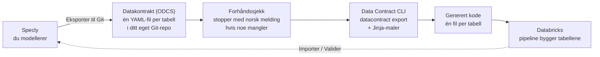
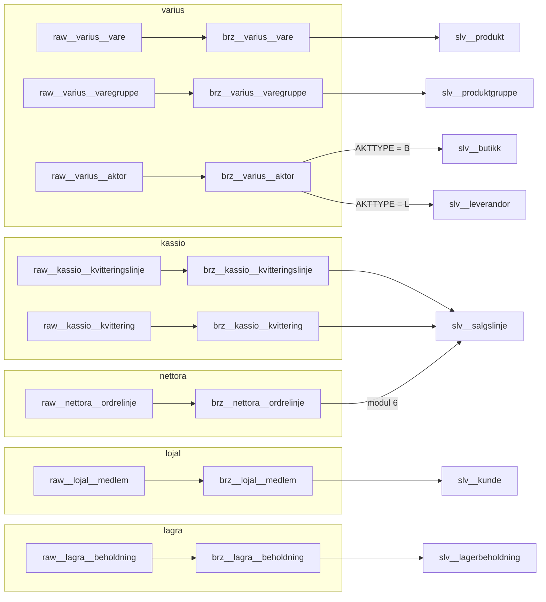

# Specly-kurset: design

*Godkjent 22.11.2026. Sist rettet 24.11.2026: alle modulene (0-11) er bygget, og gjennomført i Specly, Git og
Databricks i natttesten 23.-24.11 (terminalsporet hele veien, de fem notebookene i nettlesersporet i eget skjema). Det
som ikke er klikket eller prøvd, står i `docs/kursholder.md`. Dette dokumentet bestemmer hva vi bygger.*

Innhold:
1. Formål, deltakerne og sporene
2. Bedriften og spørsmålene
3. Kildene
4. Modellen per lag
5. Prinsippene
6. Hendelsene i dataene
7. Modulene
8. Arbeidsflyt og verktøy
9. Forutsetninger og første oppsett
10. Erfaringer fra den forrige oppgaven
11. Åpne spørsmål

---

## 1. Formål, deltakerne og sporene

### 1.1 Formål

Kurset skal vise to ting:
1. **Hvordan du bruker Specly i praksis**: tabeller, kolonner, oppstrøm, nedstrømsnavn, nøkler, relasjoner,
   diagrammer, begreper og dataprodukter.
2. **Hvordan modellen gir kode av seg selv.** Du modellerer i Specly. Koden som bygger tabellene i Databricks,
   genereres fra modellen. Du skriver ingen pipelinekode selv.

### 1.2 Kjeden fra modell til tabell

Dette er bildet hele kurset bygger på. Deltakeren ser hvert ledd minst én gang.



Hvert ledd i én setning:
- **Specly** er der modellen lages og diskuteres.
- **Datakontrakten** er en åpen standard (Open Data Contract Standard, ODCS). Specly skriver én fil per tabell
  til ditt eget Git-repo. Modellen er dermed din, i et åpent format. Specly låser deg ikke inne.
- **Forhåndssjekken** leser kontraktene og stopper før noe genereres hvis modellen er ufullstendig.
- **Data Contract CLI** (`datacontract`) er et åpent verktøy som leser ODCS-kontrakter. Med kommandoen
  `datacontract export` og en Jinja-mal per tabelltype blir hver kontrakt til kode.
- **Koden** kaller en liten felles plattformpakke. Den gjør det som alltid er likt: nøkler, historikk, typer.
  Malen fyller bare inn det som er spesielt for tabellen.
- **Databricks** kjører koden. Specly kan lese tabellene tilbake (Importer fra Databricks, Valider mot
  Databricks).

### 1.3 Hvem deltakerne er

| Område | Hva vi regner med | Hva det betyr for kurset |
|---|---|---|
| Databricks | Kjenner grensesnittet, men ikke nødvendigvis godt. Mange har jobbet mer i Microsoft Fabric | Det som er spesielt for Databricks forklares kort: katalog, skjema, volum, pipeline, SQL-editor. Sammenligning med Fabric der det hjelper (volum er omtrent som Files i et lakehouse) |
| Terminal | Noen er vant til den, andre ikke | Ingen må bruke terminal. Hver kommando står ferdig til å kopieres, med én setning om hva den gjør og hva du skal se |
| Datamodellering | Kan prinsippene (fakta, dimensjoner, nøkler, historikk), men er ikke eksperter | «Les mer» gir kort repetisjon og lenker til artiklene på specly.no/laer. Hovedløpet forutsetter dem ikke |
| Specly | Har ikke brukt det før | Hvert konsept forklares grundig der det innføres. Senere moduler viser til den modulen («Lært i modul 3»), siden du kanskje har startet senere |
| ODCS | Kjenner det kanskje litt | Kurset viser hvordan det du gjør i Specly blir et felt i kontrakten, og hvilken linje i koden feltet gir |

### 1.4 Sporene

Kurset er moduler. Du velger de modulene som passer rollen din. Hver modul har et startpunkt, så du kan
begynne midt i (se kapittel 8).

| Spor | For hvem | Moduler | Ca. tid |
|---|---|---|---|
| **Kjerne** | alle som skal modellere | 0, 2, 3, 4, 5 | 2 timer (+ oppsett før kursdagen) |
| **Modellerer, videre** | de som skal bygge modellen | 6, 7, 11 | 1 t 45 min |
| **Admin** | prosjektadministrator | 0, 1, 2, 8 | 2 timer |
| **Forvalter** | de som dokumenterer og eier data | 0, så rett på 8, 9, 10 | 1 t 30 min |

Senere kan vi legge til egne moduler for de som bare har lesetilgang (Viewer) og for bidragsytere
(Contributor, som foreslår endringer via pull request).

---

## 2. Bedriften og spørsmålene

**Toppfart Sport AS** (oppdiktet) er en sportskjede med seks butikker og en nettbutikk. Den selger utstyr og
klær til ski, løping, friluftsliv og sykkel.

| Butikk | Kommune | Merknad |
|---|---|---|
| Toppfart Majorstuen | Oslo | |
| Toppfart Bergen sentrum | Bergen | |
| Toppfart Solsiden | Trondheim | |
| Toppfart Stavanger | Stavanger | |
| Toppfart Tromsø | Tromsø | |
| Toppfart Lillehammer | Lillehammer | Åpner 5. september (ny butikk i perioden) |
| Toppfart nettbutikk | | Egen «butikk» i varesystemet |

Toppfart har en kundeklubb. Medlemmer har nivå Bronse, Sølv eller Gull, og får rabatt etter nivå.
Medlemmet viser kortet i kassen, men ikke alltid.

**Spørsmålene forretningen stiller** (hver av dem brukes i en modul):

| Hvem | Spørsmål | Modul |
|---|---|---|
| Salgssjef | Hva er omsetningen per butikk og varegruppe per uke? Hvor mye blir returnert? | 5 |
| Salgssjef | Hvor stor del av salget skjer på nett, og hvordan utvikler det seg? | 6 |
| Kundeklubbansvarlig | Hvor mye handler Gull-medlemmene, og var de Gull da de handlet? Hvor stor del av kjøpene i butikk er uten medlemskort? | 7 |
| Innkjøpssjef | Hvor mye har vi på lager av hver vare, per butikk og dag? Hvilke varer går tomme? | 11 |

---

## 3. Kildene

Periode: **1. august til 31. oktober 2026** (tre hele måneder). Kildene har hver sin navnestil, akkurat som i
virkeligheten. Derfor må navnene oversettes, og det skjer på ett sted (kapittel 5.4).

### 3.1 Oversikt

Kildesystemene er oppdiktede produkter med egne navn, slik kildene er i virkeligheten. Navnet står i
tabellnavnene (`raw__varius__vare`), i landing-mappen og i `sys__kildesystem`. I tekst skriver vi gjerne
rollen også: «varesystemet Varius». Kalenderen er ikke et innkjøpt system, men bedriftens egen tabell.

| Kildesystem | Hva det er | Navnestil | Format | Leveranse | Tas inn i modul |
|---|---|---|---|---|---|
| `varius` | varesystemet (varer, varegrupper, butikker og leverandører) | `STORE_BOKSTAVER`, norske forkortelser | CSV, `;`, desimalkomma, dato `dd.MM.yyyy` | fullt uttrekk den 1. hver måned kl. 05 | 2 |
| `kassio` | kassesystemet i butikkene | `camelCase`, engelsk | CSV, `,`, desimalpunktum, tidspunkt i UTC | daglig fil kl. 06 for gårsdagen | 2 |
| `nettora` | nettbutikkplattformen | `snake_case`, engelsk | JSON (én linje per rad) | daglig fil kl. 06 for gårsdagen | 6 |
| `lojal` | kundeklubben | `camelCase`, engelsk | JSON | daglig fil kl. 04 | 7 |
| `lagra` | lagersystemet | `snake_case`, korte navn | Parquet | daglig telling mandag til lørdag kl. 23 | 11 |
| `kalender` | bedriftens egen kalender | `STORE_BOKSTAVER` | CSV | én fil som dekker 2026 og 2027 | 5 |

Filnavn i landing: `landing/<kilde>/<tabell>/<tabell>_ÅÅÅÅMMDDThhmm.<csv|json|parquet>`, for eksempel
`landing/varius/vare/vare_20260801T0500.csv`. Tidspunktet i filnavnet er når filen kom. Det er ikke datoen
dataene gjelder.

### 3.2 Tabeller og kolonner

**varius**

| Tabell | Kolonne | Eksempel | Betyr |
|---|---|---|---|
| `vare` | `VARENR` | `004711` | Varenummer, alltid seks tegn med ledende nuller |
| | `VARETEKST` | `Fjellstav karbon 120 cm` | Navnet på varen |
| | `VGRP` | `FRI02` | Varegruppekode |
| | `LEVNR` | `502` | Aktørnummeret til leverandøren |
| | `MERKE` | `Nordtind` | Merke |
| | `UTPRIS` | `1299,00` | Veiledende utsalgspris med mva, desimalkomma |
| | `STATUS` | `A` | `A` aktiv, `U` utgått |
| `varegruppe` | `VGRP` | `FRI02` | Varegruppekode |
| | `VGRP_TEKST` | `Staver og stavtilbehør` | Navnet på varegruppen |
| | `HOVEDGRP` | `Friluftsliv` | Hovedgruppe |
| `aktor` | `AKTNR` | `101` | Aktørnummer. Butikker 101-107, leverandører 501-510 |
| | `AKTTYPE` | `B` | `B` butikk, `L` leverandør |
| | `NAVN` | `Toppfart Majorstuen` | Navn |
| | `KOMMUNE` | `Oslo` | Kommune (tom for nettbutikken og noen leverandører) |
| | `AAPNET_DT` | `05.09.2026` | Når butikken åpnet (tom for leverandører) |
| | `ORGNR` | `912345678` | Organisasjonsnummer (bare leverandører) |

**kassio**

| Tabell | Kolonne | Eksempel | Betyr |
|---|---|---|---|
| `kvittering` | `storeId` | `101` | Butikken (samme nummer som `AKTNR`) |
| | `receiptNo` | `20260801-101-0042` | Kvitteringsnummer, unikt per butikk |
| | `soldAt` | `2026-08-01T09:14:22Z` | Tidspunkt for kjøpet, UTC |
| | `memberNo` | `300042` eller tomt | Medlemsnummer. Tomt når kortet ikke ble vist (ca. 40 %) |
| | `paymentType` | `CARD` | `CARD`, `CASH` eller `VIPPS` |
| `kvitteringslinje` | `storeId` | `101` | Butikken |
| | `receiptNo` | `20260801-101-0042` | Kvitteringen linjen hører til |
| | `lineNo` | `1` | Linjenummer på kvitteringen |
| | `sku` | `4711` | Varenummer, **uten** ledende nuller |
| | `qty` | `2` | Antall. Negativt ved retur |
| | `unitPrice` | `1299.00` | Pris per enhet med mva, desimalpunktum |
| | `discount` | `129.90` | Rabatt på linjen i kroner |
| | `campaignCode` | `HOST26` | **Ny kolonne fra 1. oktober** (hendelse H10) |

**nettora**

| Tabell | Kolonne | Eksempel | Betyr |
|---|---|---|---|
| `ordrelinje` | `order_id` | `N-2026-008812` | Ordrenummer |
| | `line_no` | `1` | Linjenummer |
| | `customer_id` | `300042` | Medlemsnummer. Alltid fylt: du må være medlem for å handle på nett |
| | `ordered_at` | `2026-08-01T20:03:11Z` | Tidspunkt for bestillingen, UTC |
| | `product_code` | `004711` | Varenummer, med ledende nuller |
| | `quantity` | `1` | Antall |
| | `price` | `1169.10` | Pris per enhet etter rabatt, med mva |

**lojal**

| Tabell | Kolonne | Eksempel | Betyr |
|---|---|---|---|
| `medlem` | `memberId` | `300042` | Medlemsnummer |
| | `firstName` | `Ingrid` | Fornavn (oppdiktet) |
| | `lastName` | `Haugen` | Etternavn (oppdiktet) |
| | `postalCode` | `0367` | Postnummer |
| | `tier` | `SILVER` | `BRONZE`, `SILVER` eller `GOLD` |
| | `joinedDate` | `2024-03-15` | Innmeldingsdato |

**lagra**

| Tabell | Kolonne | Eksempel | Betyr |
|---|---|---|---|
| `beholdning` | `whs_store` | `101` | Butikken |
| | `item_no` | `4711` | Varenummer, heltall |
| | `count_date` | `2026-08-03` | Tellingsdato |
| | `on_hand` | `14` | Antall på lager ved dagens slutt |
| | `on_order` | `20` | Antall bestilt, ikke mottatt |

**kalender**

| Tabell | Kolonner |
|---|---|
| `dag` | `DATO` (`2026-08-01`), `UKEDAG` (`lørdag`), `UKE` (ISO), `MND`, `KVARTAL`, `AAR`, `HELLIGDAG` (`J`/`N`) |

### 3.3 Volum

Små tall, slik at Databricks Free holder:

| Hva | Antall |
|---|---|
| Varer / varegrupper / leverandører | ca. 150 / 12 / 10 |
| Medlemmer | ca. 800 |
| Kvitteringer per dag (alle butikker) | ca. 250, med 1-4 linjer hver |
| Nettordrer per dag | ca. 40 |
| Lagerrader per tellingsdag | ca. 900 (150 varer × 6 butikker) |

### 3.4 Kildeark

Hver kilde får et kort kildeark (`kilder/<kilde>.md`), slik en dataingeniør ofte får det når en ny kilde skal
inn. Det inneholder:
- hvem som eier systemet, og hvem du kontakter
- leveransemåte: fullt uttrekk eller endringer (deltalast)
- når dataene er klare til å hentes
- format: skilletegn, desimaltegn, dato- og tidsformat, tidssone
- kjente svakheter

Bare format-delen er nødvendig for koden. Resten er god dokumentasjon. Kurset forklarer hvorfor slik
informasjon bør ligge sammen med kilden, men ber deg bare legge inn det koden trenger (modul 2).

---

## 4. Modellen per lag

### 4.1 Lagene

| Lag | Prefiks | Jobb | Kolonnenavn | Historikk |
|---|---|---|---|---|
| raw | `raw__<kilde>__<objekt>` | Filene slik de kom. Alle leveranser stablet | Kildens | Ingen (alle leveranser ligger der) |
| bronze | `brz__<kilde>__<objekt>` | 1:1 med kildetabellen. Rensing, typer, nøkkel, historikk. Ingen sammenslåing | Kildens | Alltid SCD2 |
| sølv | `slv__<objekt>` | Her starter den felles modellen for bedriften: én tabell per forretningsobjekt, uansett kilde | Forretningens, på norsk | Følger bronze |
| gull | `gld__d__<objekt>`, `gld__f__<prosess>` | Stjerner for rapporter og analyse | Forretningens | Dimensjoner SCD1, SCD2 der det velges |

I tekst heter lagene raw, bronze, sølv og gull.

### 4.2 Fra kilde til sølv



Sølv er **ikke** 1:1 med kildene:
- **Én kildetabell blir to.** `aktor` har både butikker og leverandører. I sølv blir det `slv__butikk` og
  `slv__leverandor`, hver med et radfilter på `AKTTYPE`.
- **To kildetabeller blir én.** Kassen leverer kvitteringshode og kvitteringslinjer hver for seg.
  `slv__salgslinje` setter dem sammen: én rad per linje, med tidspunkt, butikk og medlem fra hodet.
- **To kilder i samme tabell.** I modul 6 kommer nettbutikkens ordrelinjer inn i den samme
  `slv__salgslinje`. Kolonnen `salgskanal` sier om raden kom fra butikk eller nett.

### 4.3 Bronze

**Bronze er fortsatt 1:1 med kilden.** Én bronze-tabell per raw-tabell, med navn etter kildetabellen
(`brz__varius__vare`, `brz__kassio__kvitteringslinje`). Kolonnene beholder kildens navn (`VARENR`, `sku`). Bronze
renser, gir typer, regner nøkkel og tar vare på historikken, men slår ikke sammen og døper ikke om. Den felles
datamodellen for bedriften lages først i sølv.

Hver kolonne som brukes videre, får et **nedstrømsnavn**: navnet den skal ha i sølv. Kolonnen heter fortsatt
det samme i bronze. Nedstrømsnavnet er bare beskjeden til neste lag.

Eksempel, `brz__varius__vare`:

| Kolonne | Datatype | Flagg | Rensing | Nedstrømsnavn |
|---|---|---|---|---|
| `pk__brz__varius__vare` | bigint | PK | | |
| `bk__brz__varius__vare` | string | | | |
| `VARENR` | string | **BK** | trim, fjern ledende nuller | `varenummer` |
| `VARETEKST` | string | | trim | `produktnavn` |
| `VGRP` | string | | trim, store bokstaver | `produktgruppekode` |
| `LEVNR` | int | | | `leverandornummer` |
| `MERKE` | string | | trim, tom til null | `merke` |
| `UTPRIS` | decimal(10,2) | | | `utpris_belop` |
| `STATUS` | string | | trim | `statuskode` |
| `sys__gyldig_fra`, `sys__gyldig_til` | timestamp | | | |
| `sys__kildesystem` | string | | | |

Typene castes av én felles funksjon i plattformkoden. Den leser datatypen fra kontrakten og formatet
(desimalkomma, `dd.MM.yyyy`) fra kildesystemet i Specly. Kallet genereres. Du skriver aldri cast selv.

BK i bronze:

| Tabell | BK |
|---|---|
| `brz__varius__vare` | `VARENR` |
| `brz__varius__varegruppe` | `VGRP` |
| `brz__varius__aktor` | `AKTNR` |
| `brz__kassio__kvittering` | `storeId`, `receiptNo` |
| `brz__kassio__kvitteringslinje` | `storeId`, `receiptNo`, `lineNo` |
| `brz__nettora__ordrelinje` | `order_id`, `line_no` |
| `brz__lojal__medlem` | `memberId` |
| `brz__lagra__beholdning` | `whs_store`, `item_no` |
| `brz__kalender__dag` | `DATO` |

Nøkler som skal treffe hverandre, må ha samme type og format, fordi hashen bruker verdiene som tekst.
`VARENR` (renset), `sku`, `product_code` og `item_no` er derfor alle `string` uten ledende nuller i bronze.
`AKTNR`, `LEVNR`, `storeId` og `whs_store` er alle `int`.

`brz__lagra__beholdning` har BK uten dato med vilje. Hver telling blir da en ny versjon av beholdningen for
varen i butikken. Det er det modul 11 bygger på.

### 4.4 Sølv

| Tabell | Granularitet | Bygger på | BK | Lenker (`fb__`) |
|---|---|---|---|---|
| `slv__produktgruppe` | én rad per varegruppe | `brz__varius__varegruppe` | `produktgruppekode` | |
| `slv__leverandor` | én rad per leverandør | `brz__varius__aktor`, radfilter `AKTTYPE = 'L'` | `leverandornummer` | |
| `slv__butikk` | én rad per butikk (inkl. nettbutikken) | `brz__varius__aktor`, radfilter `AKTTYPE = 'B'` | `butikknummer` | |
| `slv__produkt` | én rad per vare (`er_aktiv` er Beregning `statuskode = 'A'`) | `brz__varius__vare` | `varenummer` | `fb__slv__produktgruppe`, `fb__slv__leverandor` |
| `slv__salgslinje` | én rad per varelinje på en kvittering eller nettordre | linje + hode i kassen; nettbutikken (modul 6) | `butikknummer`, `salgsnummer`, `linjenummer` | `fb__slv__produkt`, `fb__slv__butikk`, `fb__slv__kunde` (modul 7) |
| `slv__kunde` | én rad per medlem | `brz__lojal__medlem` | `medlemsnummer` | |
| `slv__lagerbeholdning` | én rad per vare og butikk | `brz__lagra__beholdning` | `butikknummer`, `varenummer` | `fb__slv__produkt`, `fb__slv__butikk` |
| `slv__dato` | én rad per dag | `brz__kalender__dag` | `dato` | |

Kolonnene i `slv__salgslinje`:

| Kolonne | Fra kasse | Fra nettbutikk (modul 6) | Merknad |
|---|---|---|---|
| `butikknummer` | `kvittering.storeId` | (ingen) | Beregning etter unionen: `107` når `sys__kildesystem = 'nettora'`. Nettbutikken er butikk 107 |
| `salgsnummer` | `receiptNo` | `order_id` | |
| `linjenummer` | `lineNo` | `line_no` | |
| `salgskanal` | `sys__kildesystem` | `sys__kildesystem` | Beregning: `'Nett'` for nettbutikken, ellers `'Butikk'` |
| `salg_tidspunkt` | `kvittering.soldAt` | `ordered_at` | UTC |
| `salg_dato` | Beregning: dato i norsk tid | samme | ikke filens dato (hendelse H12) |
| `varenummer` | `sku` | `product_code` | renset likt i bronze |
| `medlemsnummer` | `kvittering.memberNo` | `customer_id` | tom i kassen uten kort |
| `antall` | `qty` | `quantity` | negativt ved retur |
| `enhetspris_belop` | `unitPrice` | `price` | |
| `rabatt_belop` | `discount` | (ingen) | Beregning etter unionen: `coalesce(rabatt_belop, 0)`. Nettprisen er allerede etter rabatt |
| `belop` | Beregning `antall * enhetspris_belop - rabatt_belop` | samme | kroner med mva |
| `fb__slv__produkt`, `fb__slv__butikk`, `fb__slv__kunde` | | | se kapittel 5.2. `fb__slv__butikk` er Beregning `nokkel(butikknummer)` etter unionen, fordi nettbutikken ikke har butikk i kilden |

### 4.5 Gull

**Første stjerne (modul 5): salg**

```
              gld__d__dato
                   ▲ fk__gld__d__dato
gld__d__produkt ◄── gld__f__salg ──► gld__d__butikk
      fk__gld__d__produkt       │        fk__gld__d__butikk
                        ▼ fk__gld__d__kunde (modul 7, Datoeffektiv på = salg_dato)
                   gld__d__kunde (SCD2)
```

| Tabell | Granularitet | Historikk | Kolonner (utenom nøkler) |
|---|---|---|---|
| `gld__f__salg` | én rad per salgslinje | | `butikknummer`, `salgsnummer`, `linjenummer` (BK, degenererte dimensjoner), `antall`, `enhetspris_belop`, `rabatt_belop`, `belop`; `salg_dato` fra modul 7 (for «Datoeffektiv på»). `salgskanal` står i sølv, ikke i faktaen: modul 6 viser at gull ikke endres (et «Tenk over» der) |
| `gld__d__produkt` | én rad per vare | SCD1 | `varenummer`, `produktnavn`, `merke`, `utpris_belop`, `er_aktiv`, `produktgruppekode`, `produktgruppenavn`, `hovedgruppe`, `leverandornavn` |
| `gld__d__butikk` | én rad per butikk | SCD1 | `butikknummer`, `butikknavn`, `kommune`, `apnet_dato` |
| `gld__d__dato` | én rad per dag | SCD1 | `dato`, `ukedag`, `uke`, `maned`, `kvartal`, `ar`, `er_helligdag` |
| `gld__d__kunde` (modul 7) | én rad per versjon av et medlem | **SCD2** | `medlemsnummer`, `medlemsniva`, `postnummer`, `innmeldt_dato` |

`gld__d__produkt` henter varegruppe og leverandør inn i samme tabell via `fb__`. Ingen snøfnugging: en
dimensjon er enklere å bruke med alt på én rad (artikkelen «Dimensjonsmodellering i praksis»).

Målene `antall`, `rabatt_belop` og `belop` i `gld__f__salg` er additive: de kan summeres over alle dimensjoner.
`enhetspris_belop` står også i faktaen, men er ikke additiv: summen av priser betyr ingenting.

**Lagerbeholdning (modul 11)**

| Tabell | Granularitet | Kolonner |
|---|---|---|
| `gld__f__lagerbeholdning` | én rad per vare, butikk og **dag** (også søndager) | `fk__gld__d__produkt`, `fk__gld__d__butikk`, `fk__gld__d__dato`, `butikknummer`, `dato`, `varenummer` (BK), `antall_pa_lager`, `antall_i_bestilling`, `telling_dato` (tellingen raden bygger på; søndag er det lørdagens) |

Dette er et periodisk øyeblikksbilde. Lagersystemet teller ikke på søndager, men faktaen har en rad for hver
dag i kalenderen: beholdningen ved slutten av dagen, altså den siste tellingen. Målene er **semi-additive**:
de kan summeres over varer og butikker, men ikke over dager. Faktaen gjenbruker produkt, butikk og dato som
felles dimensjoner.

I Specly er det feltet **Faktatype** = «Periodisk øyeblikksbilde» på faktaen (avgjort 23.11). Dagen kommer fra en
BK-kolonne med oppstrøm i kalenderen (`dato` fra `slv__dato.dato`), og koden tar versjonen i sølv som gjaldt ved slutten
av hver dag, fra dagen for første til dagen for siste leveranse (`oyeblikksbilde` i `plattform/gull.py`). Tomt felt
betyr transaksjon, som `gld__f__salg`. Hvorfor et eget felt og ikke Historikk: Historikk sier hvilke versjoner en
dimensjon har. Faktatype sier hva en rad i faktaen er. Det er to forskjellige spørsmål, og å blande dem i ett felt gjør
begge vanskeligere å lese.

---

## 5. Prinsippene

### 5.1 Navn

Fra artiklene «Standarder for dataplattformen» og «Fra forretningsbegrep til kolonne» på specly.no:

| Regel | Eksempel |
|---|---|
| Små bokstaver og understrek, ingen æ, ø, å i navn | `apnet_dato`, ikke `ÅpnetDato` |
| Ingen forkortelser i sølv og gull | `varenummer`, ikke `varenr` |
| Forretningens navn fra sølv og oppover, kildens navn i raw og bronze | `VARENR` i bronze, `varenummer` i sølv |
| Samme ting heter det samme overalt | `butikknummer` i alle tabeller som har det |
| Sann/usann starter med `er_` eller `har_` | `er_aktiv`, `er_helligdag` |
| Dato slutter på `_dato`, tidspunkt på `_tidspunkt` (alltid UTC) | `salg_dato`, `salg_tidspunkt` |
| Beløp slutter på `_belop` eller heter `belop` | `rabatt_belop` |
| Antall starter med `antall` | `antall_pa_lager` |
| Kode og navn skilles | `produktgruppekode`, `produktgruppenavn` |
| Systemkolonner starter med `sys__` | `sys__kildesystem`, `sys__gyldig_fra` |

Forhåndssjekken håndhever reglene som kan sjekkes maskinelt.

### 5.2 Nøkler

Fire prefikser. De innføres én om gangen i kurset:

| Prefiks | Betyr | Finnes fra | Innføres i |
|---|---|---|---|
| `bk__<tabell>` | Tabellens forretningsnøkkel som hash av BK-kolonnene | bronze | modul 3 |
| `pk__<tabell>` | Primærnøkkel, ett tall per rad (per versjon når tabellen har historikk) | bronze | modul 3 (vises), 5 (brukes) |
| `fb__<sølvtabell>` | Peker på en annen sølvtabells `bk__` | sølv | modul 4 |
| `fk__<gulltabell>` | Peker på en dimensjons `pk__` | gull | modul 5 |

Regler:
- **BK-flagget står på de naturlige nøkkelkolonnene**, aldri på `bk__`. Koden regner ut `bk__` og `pk__`.
- **Hashen bruker bare verdiene.** Samme verdier i samme rekkefølge gir samme hash i alle tabeller. Derfor
  kan `fb__slv__produkt` i salgslinjen regnes ut fra `varenummer` på raden og treffe `bk__slv__produkt`.
- **Lesbare naturlige nøkler står ved siden av.** `varenummer` står i salgslinjen sammen med `fb__slv__produkt`.
  Da ser du hvilken verdi raden hadde, også når oppslaget ikke traff.
- **En `fk__` er aldri tom.** Den er en `pk__`, `-1` eller `-2`.

| Verdi | Navn | Betyr |
|---|---|---|
| `-1` | Ukjent | Nøkkelen var fylt, men fantes ikke i dimensjonen (ukjent varenummer) |
| `-2` | Mangler | Nøkkelen var tom i kilden (kvittering uten medlemskort) |

Alle gull-dimensjoner får de to radene automatisk. En faktarad forsvinner aldri i en join.

**Datodimensjonen er et unntak:** `pk__gld__d__dato` er datoen som tallet `ÅÅÅÅMMDD` (`20260801`), ikke en
hash. En dag endrer seg aldri, og et lesbart tall er lettere å feilsøke. (Må støttes i malene, se kapittel 11.)

### 5.3 Historikk

- **Bronze tar vare på alle versjoner** (SCD2). Det kommer av tabelltypen. Når en verdi endrer seg mellom to
  leveranser, lukkes den gamle versjonen (`sys__gyldig_til`) og en ny starter (`sys__gyldig_fra`). Forsvinner
  en rad fra et fullt uttrekk, lukkes versjonen.
- **Sølv følger bronze.** Sølvtabellene har de samme versjonene, slått sammen over tid når en tabell bygger
  på flere bronze-tabeller.
- **Gull velger.** Dimensjoner er SCD1 (bare gjeldende versjon) som standard. Du velger SCD2 der historikken
  betyr noe for analysen. I kurset er det `gld__d__kunde`: om et medlem var Gull da det handlet.
- **SCD2-dimensjon krever «Datoeffektiv på».** En `fk__` til en SCD2-dimensjon må vite hvilken dag den skal
  slå opp på. Faktaen velger da versjonen som gjaldt den dagen. En dato betyr slutten av dagen: versjonen som gjaldt
  ved midnatt etter datoen. Da finner et salg 1. august medlemmet, selv om første uttrekk kom kl. 04 samme dag.

### 5.4 Nedstrømsnavn

Et navn bestemmes ett sted: som nedstrømsnavn på kolonnen i laget før. Kolonnen i neste lag får det navnet av
seg selv når du henter den fra oppstrøm.

**Unntak: flagget «Eget navn».** Noen ganger skal én kildekolonne hete forskjellig i to sølvtabeller. `AKTNR`
i varesystemet er nummeret på en aktør, og en aktør er enten en butikk eller en leverandør. Da gjør du slik:
- Nedstrømsnavnet er det generelle navnet, helst kildesystemets egen fellesbetegnelse: `AKTNR` får
  `aktornummer`, `NAVN` får `aktornavn`.
- I sølv døper du om der filteret gjør betydningen smalere: `butikknummer` i `slv__butikk`,
  `leverandornummer` i `slv__leverandor`. Sølvkolonnen får flagget **«Eget navn»**.
- Forhåndssjekken godtar et navn som avviker fra nedstrømsnavnet når flagget er på. Uten flagget stopper den,
  fordi en glemt omdøping ellers ikke synes.

Flagget står på sølvkolonnen, fordi det er den som avviker.

I kontrakten skrives nedstrømsnavnet til `businessName`. Det er ett felt du ser i YAML-filen, og kurset viser
det.

### 5.5 Hvor logikken bor

Det meste utledes. Du skriver uttrykk bare i to felt.

| Hva | Hvor det kommer fra |
|---|---|
| Datatype og cast | datatypen på kolonnen + formatet på kildesystemet |
| Nytt navn | nedstrømsnavnet i laget før |
| Hovedtabellen | tabellen til den første BK-kolonnens oppstrøm |
| Join mellom tabeller | relasjonene i Specly |
| `bk__`, `pk__`, `fb__`, `fk__` | BK-flagg og relasjoner |
| -1 og -2 | tabelltypen gull dimensjon |
| Historikk | tabelltypen (bronze), feltet Historikk (gull) |
| Union av to kilder i sølv | feltet «Union av» på tabellen (kapittel 11, punkt 2) |
| Periodisk øyeblikksbilde | feltet Faktatype på faktaen (kapittel 4.5) |
| **Beregning** | hvordan en kolonne regnes ut (`antall * enhetspris_belop - rabatt_belop`). Specly har fra 18.11 en felttype «Beregning» med faste byggeklosser som Specly sjekker (navn og datatyper), og fri SQL som nødutgang. Kurset bruker fri SQL i Beregning, fordi byggeklossene ikke holder for kjerneløpet (kapittel 11, punkt 12) |
| **Radfilter** | SQL-uttrykk for hvilke rader som er med (`AKTTYPE = 'B'`) |

En kolonne som er laget (Beregning eller flere oppstrømskolonner), skal ha et **utviklernotat** som forklarer
den for mennesker. Ingen mal leser notatet.

### 5.6 Fra Specly til Unity Catalog

| I Specly | I kontrakten (ODCS) | I Databricks |
|---|---|---|
| Beskrivelse på tabellen | `schema[0].description` | `COMMENT` på tabellen (`comment=` i dekoratoren) |
| Beskrivelse på kolonnen | `properties[].description` | `COMMENT` på kolonnen (`ddl()` i `plattform/felles.py`) |
| Eier på tabellen (feltet `eier`, `odcsTarget: team.name`) | `team.name` på roten av dokumentet | tabelltaggen `eier` |
| Klassifisering på kolonnen (feltet `klassifisering`, `odcsTarget: classification`) | `properties[].classification` | kolonnetaggen `klassifisering` |
| (regnes ut) | den strengeste klassifiseringen blant kolonnene: rekkefølgen i valgene for feltet (`offentlig`, `intern`, `fortrolig`) | tabelltaggen `klassifisering` |
| Granularitet på faktaen (feltet `granularitet`) | `schema[0].dataGranularityDescription` | ingen tag |

En tom beskrivelse gir ingen `COMMENT`. Beskrivelsene har vært med fra modul 2. Eier, klassifisering og granularitet
innføres i modul 8 (feltene finnes i prosjektoppsettet fra start, kravene kommer i modul 8). Flaggene i ODCS-feltet
`tags` (BK, PK, FK, Eget navn) er merker for modellen, ikke styring, og blir ikke tags i Unity Catalog.

Pipelinen kan ikke sette tags (dekoratoren har ingen tags). Derfor:
1. `./generer` lager `databricks/pyspark/plattform/tags_data.py` fra kontraktene (`maler/pyspark/tags.py.j2`), som
   `konstanter.py`. Feltene leses der `odcsTarget` sier (`tools/modell.py`), også `team.name` på roten.
2. Etter pipelinen setter `sett_tags` i `databricks/pyspark/plattform/tags.py` taggene: `./kjor` steg 5
   (`tools/sett_tags.py`, gjennom SQL warehouse) og `notebooks/kurs_generer_kjor` og `kurs_til` (med `spark`). Den leser
   først hva som står (`information_schema`), og kjører bare `ALTER … SET TAGS` / `UNSET TAGS` for det som avviker.
   Bare nøklene `eier` og `klassifisering` røres. En eid nøkkel uten verdi fjernes.
3. `./kurs sjekk M8` sammenligner taggene i Databricks med dem fasit gir. Lokalt (uten Databricks) sjekkes bare SQL-teksten
   (enhetstestene) og kontraktene.

Prøvd i Databricks 24.11.2026: `ALTER MATERIALIZED VIEW … SET TAGS` virker på tabeller en pipeline eier, og taggene står
etter en vanlig kjøring. Ikke prøvd: at de står etter en full refresh (`docs/kursholder.md`, «Modul 8: slik er taggene
bygget»).

---

## 6. Hendelsene i dataene

Generatoren planter hendelser som modulene bruker. Alt annet holder seg stabilt mellom leveranser: ingen
tilfeldige endringer i felt som ikke skal endres (Sirkla-feilen med nye tidsstempler i hvert uttrekk).

| # | Hendelse | Kilde | Når | Brukes i modul |
|---|---|---|---|---|
| H1 | Varenummer har ledende nuller i varesystemet og nettbutikken (`004711`), ikke i kassen og lageret (`4711`) | varius, kassio | alltid | 3 (rensing), 4 (koblingen virker) |
| H2 | Desimalkomma og datoformat `dd.MM.yyyy` i varesystemet | varius | alltid | 2 (kildeark), 3 (cast) |
| H3 | Prisendring: `004711` får ny utpris | varius | uttrekket 1. oktober | 3 (to versjoner i bronze), 5 (SCD1 i gull) |
| H4 | En vare bytter varegruppe | varius | uttrekket 1. september | 5 («Tenk over»: SCD1 flytter gammelt salg) |
| H5 | Ny butikk, Lillehammer, åpner 5. september | varius, kassio | fra uttrekket 1. september | 4, 5 |
| H6 | En vare blir utgått (`STATUS = U`) | varius | uttrekket 1. oktober | 5 |
| H7 | Kvittering uten medlemskort, ca. 40 % | kassio | alltid | 7 (`fk__gld__d__kunde = -2`) |
| H8 | Ukjent varenummer (`9999`) på noen linjer | kassio | 14. august | 5 (`fk__gld__d__produkt = -1`) |
| H9 | Retur: negativt antall, ca. 2 % av linjene | kassio | alltid | 5 |
| H10 | Ny kolonne `campaignCode` i kvitteringslinjen | kassio | fra 1. oktober | 3 eller 6 (skjemaendring) |
| H11 | Den samme linjen står to ganger i én fil | kassio | 21. august | 3 (én rad i bronze) |
| H12 | Filene for 12. september kommer 14. september | kassio | 14. september | 4 (salg_dato fra `soldAt`, ikke fra filen) |
| H13 | Kjøp like etter midnatt (midnattsåpning): UTC-datoen er dagen før den norske datoen | kassio, nettora | noen dager | 4 (`salg_dato` i norsk tid) |
| H14 | Medlem `300042` går fra Sølv til Gull, og flytter senere | lojal | 20. september og 10. oktober | 7 (SCD2) |
| H15 | Nettordre fra et medlemsnummer som ikke finnes i kundeklubben | nettora | 3. oktober | 7 (`fk__gld__d__kunde = -1`) |
| H16 | Lagersystemet teller ikke på søndager | lagra | alle søndager | 11 (raden for søndag er lørdagens telling) |
| H17 | En vare går tom på lager i en butikk | lagra | uke 40 | 11 |

Fasit regnes fra generatorens sannhet, ikke fra pipelinen. Hver modul har sine forventede tall.

---

## 7. Modulene

12 moduler på 20-75 minutter. Hver modul har et startpunkt (`start/M<n>` i Git) og et sluttpunkt
(`fasit/M<n>`). Hvert steg sier hva du lærer, og hvorfor, før du klikker.

### 7.1 Prinsipper for læringen

- **Få, store moduler.** Kjerneløpet (modul 2-5) tar ca. 3,5 timer. Da har du gått hele kjeden fra fil til
  stjerne, generert og kjørt.
- **Én gang for hånd, så smart, men ikke for smart.** Den første tabellen i et lag lager du selv, steg for
  steg, i Specly. De neste lager du med det Specly selv har som skalerer: flere kolonner fra oppstrøm på én
  gang, tabelltype etter navnemønster, relasjons- og begrepsregler. Det du ikke trenger å lage selv, legger
  `./kurs fyll` inn (kapittel 8). Vi lager få kursskript, og ingen som skjuler hvordan Specly virker. Ingen
  modul ber deg klikke det samme fem ganger.
- **Lært i modul N.** Et konsept forklares grundig der det innføres. Senere moduler forklarer det ikke på
  nytt, men viser til modulen («Lært i modul 3»), siden du kanskje har startet senere.
- **Se virkningen hver gang.** Etter en endring i Specly ser du feltet i kontrakten, linjen i den genererte
  koden og resultatet i Databricks.
- **Gjett før du kjører.** «Hva tror du skjer?» før en kjøring, svaret rett etter.
- **Feil med vilje.** Noen steg lar deg gjøre en vanlig feil og se hva forhåndssjekken eller tallene sier.
- **Ekte spørsmål fra gull og oppover.** Fra modul 5 starter hver modul med et spørsmål fra forretningen og
  ender med en spørring som svarer på det. Raw, bronze og sølv ender med en kort kontroll av at dataene ble
  som du ventet.
- **Valgfri dybde.** «Les mer» kan brettes ut. Hovedløpet er kort.

### 7.2 Oversikt

| # | Modul | For hvem | Ca. tid | Du lærer | Genereres og kjøres |
|---|---|---|---|---|---|
| 0 | Oppsett | alle | 30 min, før kursdagen | repo, Specly-prosjekt, Databricks klart | landing fylles, kildetabeller lages |
| 1 | Prosjektoppsett (lesemodul, valgfri) | admin | 40 min | tabelltyper, standardkolonner, navneregler, datatyper, kildesystemer, ODCS-innstillinger, roller | ingenting |
| 2 | Raw fra kilden | alle | 35 min | Importer fra Databricks, kildesystem, tabelltype, rundturen | raw |
| 3 | Bronze | modellerer | 45 min | oppstrøm, nedstrømsnavn, BK, rensing, datatype | bronze |
| 4 | Sølv | modellerer | 75 min | felles modell, radfilter, flere tabeller til én, `fb__`, relasjoner, diagrammer | sølv |
| 5 | Første stjerne | modellerer | 60 min | granularitet, fakta og dimensjon, `pk__`/`fk__`, -1/-2, datodimensjon, stjernediagram | gull, første svar |
| 6 | Ny kilde: nettbutikk | modellerer | 60 min | ny kilde rett inn i sølvmodellen, union, Beregning, endring via Git og `specly.py` | endringen flyter gjennom |
| 7 | Kunden og historikk | modellerer | 45 min | SCD2-dimensjon, Datoeffektiv på | `gld__d__kunde` |
| 8 | Dokumentasjon og styring | admin, forvalter | 45 min | påkrevde felt, beskrivelse, eier, klassifisering, Unity Catalog | COMMENT og tags i Databricks |
| 9 | Forretningsbegreper | forvalter | 45 min | begreper, begrepsregler, arvede beskrivelser | |
| 10 | Dataprodukt | forvalter, eier | 20 min | dataprodukt, eier, forbruker, begrensninger | |
| 11 | Lagerbeholdning | erfaren | 60 min | ny kilde (Parquet), periodisk øyeblikksbilde, semi-additive mål | `gld__f__lagerbeholdning` |

*Rettet 24.11:* tidene er de som står øverst i hver `moduler/M<n>.md` og på introsiden (`docs/kurs-intro.html`).
Kjerneløpet (modul 2-5) er 35 + 45 + 75 + 60 = 215 minutter, ca. 3,5 timer. Alle tolv modulene er 560 minutter,
ca. 9 t 20 min. Tidene for modul 3-9 og 11 er testagentens anslag fra natttesten 23.-24.11, ikke målt med en deltaker
(`docs/kursholder.md`). Det opprinnelige målet var 120 minutter for kjerneløpet (kapittel 11, spørsmål 13).

### 7.3 Modulene i korte trekk

**Modul 0: Oppsett.** Sjekklisten i kapittel 9. Du lager ditt eget repo fra malrepoet og ditt eget, tomme
Specly-prosjekt. Så kobler du dem sammen (prosjektet leser oppsettet fra `specly/Config` i repoet, kurset bruker ingen
prosjektmal), setter ODCS-innstillingene og kjører oppsettet. Det fyller landing i din
Databricks og lager kildetabellene. Du er ferdig når du ser filene i volumet og tabellene under `toppfart_kilde_kassio`.

**Modul 1: Prosjektoppsett (admin).** En valgfri lesemodul («se og forstå») i ditt eget prosjekt fra modul 0. Den har
ikke noe startpunkt og ikke noe eget øvingsprosjekt.
- Du ser oppsettet i Admin, og det samme oppsettet i Git (`specly/Config`).
- Du ser hva tabelltypen bronze består av: navnemønster, standardkolonner og felt. Den eneste øvelsen er en
  testtabell (`brz__test__vare`), som du lager og sletter igjen.
- Du ser datatyper, kildesystemer og reglene, og hvor nedstrømsnavnet skrives i kontrakten (ODCS-innstillingene).
- Du går gjennom roller, og hva Azure DevOps krever: service principal, hvem hos kunden som gjør hva.
- Du ser hva en prosjektmal inneholder, og hvorfor kurset ikke bruker en.

Den opprinnelige øvelsen (lag bronze selv i et tomt øvingsprosjekt) lot seg ikke gjennomføre, fordi startpunktet
`start/M1` ikke finnes. Hva som må lages for å få den tilbake, står i `docs/kursholder.md`.

**Modul 2: Raw fra kilden.**
- Du importerer kildetabellene fra Databricks («Importer fra Databricks»), kobler dem til kildesystemet og
  setter tabelltype raw. Tabelltypen settes for alle på én gang, etter navnemønster.
- Fra kildearket legger du inn bare det koden trenger: format, skilletegn, desimaltegn og datoformat (H2).
  Du ser hvor resten kunne stått.
- Første rundtur: Eksporter til Git, se kontrakten (YAML), generer, kjør, og se raw-tabellen i Databricks.
- Kontroll: antall rader per fil, og `sys__kildefil`.

**Modul 3: Bronze.**
- Alt gjøres i Specly. Du lager `brz__varius__vare`: ny tabell med tabelltype bronze, så alle kolonnene fra
  `raw__varius__vare` på én gang med «Legg til ny kolonne fra oppstrømstabell». Så BK på `VARENR`, rensing
  (fjern ledende nuller, trim), datatype (`decimal` for `UTPRIS`) og nedstrømsnavn.
- Du ser kallet til cast-funksjonen og rensingen i den genererte koden.
- De to kassetabellene lager du på samme måte. Det går fort, fordi kolonnene hentes samlet. De to andre
  varius-tabellene er samme håndverk en gang til, og legges inn med `./kurs fyll M3` (7.1: ingen modul ber deg klikke
  det samme fem ganger). Ønsket er et eget valg i Specly, «Lag bronze fra raw» (`docs/specly-feil.md`, Ø1).
- Kontroll: `VARENR` uten nuller, `UTPRIS` som tall, linjen fra H11 bare én gang. Etter alle leveransene har
  `004711` to versjoner (H3).

**Modul 4: Sølv.**
- `slv__butikk` og `slv__leverandor` fra samme bronze-tabell med radfilter. `AKTNR` har det generelle
  nedstrømsnavnet `aktornummer`. I sølv blir det `butikknummer` og `leverandornummer`, med flagget «Eget
  navn» (kapittel 5.4). Først prøver du uten flagget, og ser at forhåndssjekken stopper.
- `slv__salgslinje`: linje og hode satt sammen via en relasjon, `fb__slv__produkt` og `fb__slv__butikk`, `salg_dato`
  med Beregning i norsk tid (H12, H13).
- `slv__produkt` og `slv__produktgruppe` legges inn med `./kurs fyll`.
- Første diagrammer: ett per kilde og ett for sølv.
- Kontroll: alle `fb__slv__produkt` treffer, unntatt `9999` (H8). Lillehammer har salg fra 5. september (H5).

**Modul 5: Første stjerne.** Salgssjefen spør om omsetning per butikk og varegruppe per uke, og om returer.
- Først Kimballs fire steg på papir: prosess, granularitet, dimensjoner, mål.
- Så `gld__f__salg` og `gld__d__produkt` for hånd. `gld__d__butikk` og `gld__d__dato` legges inn med fyll.
- Relasjonene og stjernediagrammet.
- Kjør, og svar på spørsmålet med en spørring.
- Kontroll: `9999` gir `-1` (H8). Returene trekker fra omsetningen (H9). Den utgåtte varen har
  `er_aktiv = false`, men salget før står (H6). «Tenk over»: H3 (prisen i faktaen er salgsprisen) og H4
  (SCD1 flytter gammelt salg til ny gruppe).

**Modul 6: Ny kilde, nettbutikken.** Salgssjefen vil vite andelen nettsalg.
- Raw for nettbutikken lager du via Git, og bronze legges inn med `fyll` (samme håndverk som i modul 3). Git-veien forklares her: kopier en
  kontrakt, endre den for hånd eller med Claude, kjør `specly.py check`, push og «Hent inn» i Specly.
  **Pass på id-ene.** En kopiert kontrakt har id-ene til originalen, og to tabeller eller kolonner med samme id
  blander Specly sammen. Slett alle `id`-linjene i kopien og kjør `specly.py fix --add-ids --changed-from main`,
  som skriver nye id-er. `specly.py check` sier fra om noe fortsatt er feil. (Kontraktens `id` øverst blir det nye
  navnet: `fix` lager de nye id-ene av den.)
- Hovedpoenget: rader fra nettbutikken inn i den samme `slv__salgslinje`. Du sier på tabellen at den er en
  union av kassen og nettbutikken, og gir kolonnene oppstrøm fra begge. `sys__kildesystem` sier hvor hver rad
  kom fra. Beregning etter unionen gir `salgskanal`, `butikknummer = 107` og `rabatt_belop = 0` for nettbutikken.
  Oppstrømmen fra nettbutikken legges til i Git (ni like endringer, og blyanten i Specly tar én kilde). «Union av» og
  Beregning gjøres i Specly. Først genererer du uten «Union av», og ser forhåndssjekken foreslå feltet.
- Gull endres ikke. Faktaen har nettsalget etter neste kjøring.

**Modul 7: Kunden og historikk.** Kundeklubben spør hvor mye Gull-medlemmene handler, og om de var Gull da de
handlet.
- Kundeklubben inn som kilde (raw og bronze med `fyll`), så `slv__kunde`, `fb__slv__kunde` i salgslinjen og `gld__d__kunde` med SCD2.
- `fk__gld__d__kunde` med «Datoeffektiv på» = `salg_dato`. Faktaen får `salg_dato` som kolonne, fordi «Datoeffektiv på» peker på en kolonne i samme tabell.
- Kontroll: medlem `300042` har tre versjoner (H14). Kjøp uten kort gir `-2` (H7), det ukjente medlemmet
  gir `-1` (H15).

**Modul 8: Dokumentasjon og styring.**
- Admin slår på styringsnivået: beskrivelse, eier (et team) og klassifisering blir påkrevd for tabelltypene.
  Forhåndssjekken på styringsnivå viser hva som mangler.
- Du fyller ut feltene i Specly, også mange på én gang.
- Etter neste kjøring ser du beskrivelsene som COMMENT og klassifiseringen som tags i Catalog Explorer.
- Kort om roller: Viewer og Contributor (forslag via pull request).

**Modul 9: Forretningsbegreper.** Du lager begrepene Butikk, Produkt, Medlemsnivå og Salgsbeløp, kobler dem
med begrepsregler, og ser at kolonnene arver beskrivelsen. Én definisjon, mange kolonner.

**Modul 10: Dataprodukt.** Dataproduktet Salg: tabeller, diagram, eier, forbruker og begrensninger. Du ser
filen (ODPS) i Git.

**Modul 11: Lagerbeholdning.** Innkjøpssjefen spør om lager per vare, butikk og dag.
- Ny kilde i Parquet, og BK uten dato i bronze (kapittel 4.3). `slv__lagerbeholdning` legges inn med `fyll`.
- `gld__f__lagerbeholdning` som periodisk øyeblikksbilde over kalenderen. Søndagen får lørdagens telling (H16).
- Semi-additive mål: hvorfor summen over dager ikke betyr noe.
- Svar på spørsmålet: hvilke varer gikk tomme, og hvor (H17).

### 7.4 Rundturen

Fra modul 2 går hver endring den samme veien. Den forklares grundig én gang, og står deretter som en kort
sjekkliste:

1. Endre i Specly (eller i Git).
2. Eksporter til Git (eller hent inn fra Git).
3. Generer koden (forhåndssjekken kjører først).
4. Kjør pipelinen.
5. Kontroller.

---

## 8. Arbeidsflyt og verktøy


### 8.1 Startpunkter

Repoet har en pakket fil (zip-format) per startpunkt, laget av `tools/startpunkter.py`:
- `.startpunkter/start-M<n>.startpunkt`: hele `specly/`-mappen slik den er før modulen
- `.startpunkter/fasit-M<n>.startpunkt`: slik den er etter modulen

**Hvorfor zip og ikke mapper:** Specly leser alle `.odcs.yaml` i repoet, også utenfor `specly/`. Kopier av
kontraktene med de samme id-ene ble lest som mulige omdøpinger, og holdt tilbake alle slettinger i «Hent inn»
(`docs/klikkgjennomgang-1123.md`, S1). I en pakket fil ser Specly dem ikke. Filene heter ikke `.zip`, fordi Databricks pakker ut `.zip`-filer når en
mappe lastes opp til arbeidsflaten (prøvd 23.11: alle åtte havnet i samme mappe). Filene er deterministiske (faste
tidsstempler), så de endrer seg i Git bare når innholdet endres. Verktøyene og notebookene pakker dem ut til en
midlertidig mappe (`tools/kursmoduler.py`, `startpunkt_mappe`).

Startpunktet før en modul har bare det modulen forutsetter:
- relasjoner som modulteksten ber deg lage, er tatt ut av startpunktene før den modulen (`RELASJONER_I_MODUL`, for
  eksempel kvitteringslinje → kvittering i modul 4)
- `start/M2` har kildesystemene uten format og regex-mønster, fordi modul 2 steg 4 ber deg fylle dem ut

Senere kan malrepoet få Git-tagger med de samme navnene (`start/M<n>`, `fasit/M<n>`).

`specly/` er den fulle modellen, fasit for den siste modulen. Startpunktene før en modul tar bort det modulen legger til.
Det som tas bort, står som data i `tools/kursmoduler.py`. `tools/startpunkter.py --sjekk` lager alle i en midlertidig
mappe, sjekker dem og sier fra hvis `.startpunkter/` ikke er lik.

Vil du begynne på modul 5, starter du fra `start/M5`. Der er raw, bronze og sølv ferdige.

**Modul 6-11.** Startpunktene er én kjede over modulnumrene: `start/M<n>` er alt fra modulene med lavere nummer.
Modul 8-10 legger ikke til tabeller, men endrer prosjektoppsettet og kontraktene: `start/M8` = `fasit/M7` (med
nettbutikken og kunden), og `start/M11` = `fasit/M10`. Modul 8 gir kravene i `Config/table_types.json` og eier,
granularitet og klassifisering i gull-kontraktene (`STYRING_I_MODUL`). Modul 9 gir begrepene i `Concepts/` og begrepets
tekst på kolonnene med «Overskriv» (`BEGREPER_I_MODUL`, `KOLONNEBESKRIVELSE_FOR_MODUL`). Modul 10 gir
`DataProducts/Salg.odps.yaml` og `dataProduct: Salg` i kontraktene (`DATAPRODUKT_I_MODUL`). Startpunktene har ingen
diagrammer, så dataproduktet i fasit har ikke diagrammet `Salg`. Modul 11 trenger bare
modul 5, men kjeden er enklest å forstå og vedlikeholde: den som tar sporet 6, 7, 11, fortsetter rett på, og den som
kommer fra modul 5, får 6 og 7 med `./kurs til M11`. Endringer i en tabell fra en tidligere modul (modul 6 gjør
`slv__salgslinje` til en union, modul 7 gir den `fb__slv__kunde` og faktaen `salg_dato` og `fk__gld__d__kunde`) står i
`tools/kursmoduler.py` (`KOLONNER_I_MODUL`, `BEREGNING_I_MODUL`, `BESKRIVELSE_FOR_MODUL`), og startpunktene før modulen
har tabellen uten dem. Oppstrøm og «Union av» som peker på tabeller fra senere moduler, tas alltid bort. Kontraktene i
`start/M2` til `fasit/M5` er byte-like dem fra før modul 6 kom inn (sjekket 23.11), unntatt beskrivelsen av
`gld__f__salg`, som er rettet fra modul 5. `specly/Config` er lik i alle startpunktene, også kildesystemene `nettora`,
`lojal` og `lagra`, feltene «Union av» og Faktatype, og feltene fra modul 8 og 10 (Eier, Klassifisering, Granularitet,
Begrensninger, Bruk, Forbruker). Unntakene er kildesystemene i `start/M2` og kravene i `table_types.json` før modul 8.
`./kurs til` henter derfor tabellene, begrepene, dataproduktet, kildesystemene og tabelltypene fra startpunktet
(`FRA_STARTPUNKTET`), og ikke resten av `specly/Config`.

### 8.2 Kommandoene

To spor gir det samme resultatet (kapittel 9.3). Vi skiller mellom verktøy et ekte prosjekt også ville hatt,
og de få kommandoene som bare finnes fordi dette er et kurs.

| Kommando | Hva den gjør | Finnes i et ekte prosjekt? |
|---|---|---|
| `./generer` | Forhåndssjekk og kodegenerering fra kontraktene | ja |
| `./kjor` | Deploy og kjøring i Databricks, og tags i Unity Catalog etter pipelinen (5.6) | ja |
| `./kurs oppsett` | Lager katalog, skjema og landing-volum i din Databricks, kopierer filene og lager kildetabellene | nei, kildene finnes fra før |
| `./kurs til M5` | Setter alt til starten av modul 5: modellen i `specly/` i arbeidskopien din skrives over med startpunktet `start/M5` (tabeller, begreper, dataprodukter, kildesystemer og tabelltyper; resten av `specly/Config` røres ikke), koden genereres, pipelinen kjøres med full refresh, og tabeller i skjemaet ditt uten kontrakt slettes. Kommandoen viser hva som går tapt og spør før den skriver over eller sletter. Den bytter ikke branch og committer ikke: etterpå committer og pusher du selv `specly/`, og henter inn i Specly med «Importer fra Git» → «Hent inn til …». Virker for hvilken som helst modul, også bakover | nei |
| `./kurs fyll M4` | Legger inn tabellene modulen ikke ber deg lage selv: kopierer kontraktfilene fra `fasit/M4` inn i `specly/` i arbeidskopien din, og lar tabeller du alt har, være. Den committer ikke og rører ikke Databricks: du committer og pusher selv, og henter inn i Specly med «Hent inn til …». Finnes for modul 3, 4, 5, 6, 7 og 11 | nei, se under |
| `./kurs sjekk M5` | Sammenligner kontraktene og tallene i Databricks med fasit for modulen, og sier hva som avviker. Fra modul 8 også kravene, eier, granularitet, klassifisering og taggene i Databricks | nei |

**Om `fyll`:** Det går bare fordi kurset har bestemt forretningsbehovet og har en fasit. I virkeligheten finnes
det ingen fasit å fylle fra. Modellen må lages ut fra hva forretningen trenger, og det er det kurset øver på.
Forklaringen står én gang for deltakeren, i `moduler/start.md` («Om `fyll`»), og modulene lenker dit der `fyll` brukes.
`./kurs fyll` skriver den samme påminnelsen hver gang.

I nettlesersporet gjør én notebook per kommando det samme: `notebooks/kurs_oppsett`, `kurs_til`, `kurs_fyll` og
`kurs_sjekk`, og `notebooks/kurs_generer_kjor` for `./generer` og `./kjor`. Genereringen er den samme koden
(`tools/generer.py`, som `./generer` også kjører). I stedet for `databricks bundle deploy` lager notebookene en egen
pipeline, «Specly-kurs <skjema> (notebook)», med de samme innstillingene som `databricks.yml`
(`tools/kurspipeline.py`). Et skjema drives av ett spor: en tabell kan bare eies av én pipeline, så `kurs_til` og
`kurs_generer_kjor` stopper hvis skjemaet allerede har pipelinen fra terminalsporet. Sperren slår til i cellen som
leser feltene, før noe er generert, byttet eller slettet (`kurspipeline.terminalsporet_eier`). Motsatt vei stopper
`./kjor` med `SCHEMA_ALREADY_EXISTS` når notebooken har laget skjemaet, og skriver en norsk forklaring under feilen.

Slik er notebookene bygget (rettet og prøvd i Databricks 24.11, `docs/kursholder.md`):
- **Feltene (widgetene) lages i en egen første kodecelle i alle fem** («Feltene», i `kurs_fyll` «Feltet «Modul»»). En ny notebook, og en notebook
  etter «Pull» i Git-mappen, har ingen felt. Deltakeren kjører den cellen alene for å sette felt før første kjøring,
  eller trykker «Run all» og får standardverdiene.
- **`kurs_fyll` har «Velg modul» som standard i feltet «Modul».** Første «Run all» stopper uten å endre noe og ber
  deltakeren velge modul. Feltet må lages i en tidligere celle enn den notebooken stopper i, ellers tegner Databricks
  det aldri.
- **`kurs_til` har feltet «Bekreft (skriv over og slett)», som står på `nei`.** Går noe tapt, viser notebooken listen
  og stopper før noe er endret. Går ingenting tapt, kjører den rett gjennom. Etter en vellykket kjøring setter den
  «Bekreft» tilbake til `nei` (feltet fjernes i én celle og lages på nytt i den neste).
- `kurs_sjekk` har `M2` som standard i «Modul», og `kurs_til` har `start/M4` i «Til».
- `kurs_sjekk`, `kurs_til` og `kurs_generer_kjor` skriver resultatet i en egen siste celle.

### 8.3 Forhåndssjekken på to nivåer

| Nivå | Når | Sjekker |
|---|---|---|
| kode | alltid | det som trengs for å lage riktig kode: datatyper, BK, oppstrøm, relasjoner, navnestandard, Beregning og Radfilter |
| styring | fra modul 8 | beskrivelser, eier, klassifisering, granularitet |

Styring er ikke påkrevd fra start. Det slås på i modul 8 som en endring i prosjektoppsettet. Da ser deltakeren
at kravene er noe organisasjonen bestemmer.

### 8.4 Egen Databricks per deltaker

- Katalog, skjema, volum og CLI-profil er variabler. Ingenting er hardkodet.
- Standard i Databricks Free: katalog `workspace`, skjema `toppfart`.
- Hvert skjema har sin egen utrullingstilstand (`workspace.root_path: ~/.bundle/${bundle.name}/${var.skjema}` i
  `databricks.yml`). Uten dette delte alle skjemaer én tilstand, og `./kjor` med et annet skjema tok over pipelinen
  og tabellene til det første.
- Kjøringen må holde seg innenfor grensene i Databricks Free (små volumer, serverless).

### 8.5 Gjenbruk fra `specly-demo-plattform`

| Gjenbrukes (kopieres og tilpasses) | Må endres |
|---|---|
| Mønsteret i `tools/lag_data.py`: deterministisk generator, fasit fra sannheten | Ny bedrift, nye kilder, hendelsene i kapittel 6 |
| `tools/forhandssjekk.py` med norske meldinger og testene | To nivåer (kode og styring), nye tabellnavn |
| `maler/pyspark/*.py.j2` og `databricks/pyspark/plattform/` | Union av kilder i sølv, `pk__` som `ÅÅÅÅMMDD` for dato, tags til Unity Catalog, format per kildesystem i cast |
| `kjor.sh` og `tools/tilbake_til_start.sh` | Blir `./kurs`, med variabler for arbeidsflate og skjema |
| `tools/modell.py` | Nye felt og nye plasseringer i ODCS |
| | Nytt: kildetabeller for import, startpunkter, `fyll`, `sjekk` per modul, HTML-bygging av oppgavene |

### 8.6 Regler i prosjektoppsettet

Prosjektet har regler i `specly/Config`, slik at modellen blir lik uten at deltakeren må huske alt:

| Fil | Regel |
|---|---|
| `column_sorting_rules.json` | `pk__` først, så `bk__`, så `fb__`/`fk__`, så kolonnene med BK-flagg, så resten alfabetisk, `sys__` til slutt |
| `relation_rules.json` | `fb__<tabell>` → `bk__<tabell>` i sølv (`0..N` til `0..1`), `fk__<tabell>` → `pk__<tabell>` fra `gld__f__` til `gld__d__` (`0..N` til `1`) |
| `flag_rules.json` | PK på `pk__`, FK på `fb__` og `fk__` |

Raw-tabellene er «Unntatt fra sortering» (`excludeFromSorting: true`): raw speiler filen, og koden leser CSV i
kolonnerekkefølgen. Alle kontraktene i fasit er sortert etter reglene, så regeldialogen etter «Hent inn» («Regler for
det som kom inn fra Git») sier «Ingen endringer» for tabeller fra kurset. Modul 2 forklarer reglene og dialogen, og
anbefaler å kjøre reglene på tabellene du jobber med.

Sorteringen ordner BK-kolonnene alfabetisk, og koden regner `bk__`/`pk__` i den rekkefølgen. Prøvd 23.11: med BK i
en annen rekkefølge blir hash-verdiene andre, men fasittesten (72 riktige) og sammenligningen med fasit er like.
Rekkefølgen betyr derfor ingenting for deltakeren (kapittel 11, punkt 14).

### 8.7 Oppgavetekstene

- Kilden er markdown i `moduler/M<n>.md`, med løsning i `moduler/M<n>_losning.md`.
- De bygges til HTML-sider: steg du kan hake av (det huskes i nettleseren), «Les mer» som brettes ut, og
  «Fasit» som skjules til du åpner den.
- I tillegg finnes Databricks-notebooks for landing, for å se dataene og for å sjekke tall.

---

## 9. Forutsetninger og første oppsett

### 9.1 Slik kobler Specly seg til Git

Fra Specly sin egen hjelp:
- **GitHub** kobles med Specly sin GitHub App, ikke med et personlig token. Specly lagrer aldri et
  GitHub-token. Appen ber bare om å lese og skrive filer (Contents) og lese metadata.
- Den som kobler til, må selv kunne **installere appen** på kontoen eller organisasjonen. Det holder ikke å
  være admin i Specly.
- **Bare ett Specly-prosjekt kan være koblet til samme repo om gangen.** Eget prosjekt per deltaker betyr
  derfor eget repo per deltaker.
- **Azure DevOps** har ingen app å installere. Der trengs en service principal i kundens Entra-tenant. Det
  krever som regel tre personer: en som kan registrere apper i Entra, en eier av Azure DevOps-organisasjonen
  og en prosjektadmin. Service principalen tar en Basic-lisens.

### 9.2 Valgene for kurset

| Spørsmål | Svar |
|---|---|
| Hvilken Git-plattform? | GitHub. Azure DevOps forklares i modul 1, men brukes ikke i øvelsene |
| Hvem eier repoet? | Du. Du lager ditt eget repo fra malrepoet («Use this template») på din egen GitHub-konto, og installerer Specly-appen bare på det repoet. Da trenger ingen å sette opp noe på forhånd |
| Kurs i regi av en kunde? | Kursholder kan lage repoene i kundens GitHub-organisasjon og koble dem til, hvis deltakerne ikke får installere apper selv |
| Trenger jeg service principal? | Nei, ikke med GitHub. Bare med Azure DevOps, og da må kundens IT sette den opp på forhånd |
| Trenger jeg Git-token? | Specly trenger det ikke. I terminalsporet logger du inn i Git som vanlig (`gh auth login`) |
| Hvilken Databricks? | Din egen arbeidsflate, eller Databricks Free (gratis, registrering med e-post) |
| Databricks-token? | Bare for terminalsporet og for «Importer fra Databricks» og «Valider mot Databricks» i Specly. Tokenet limes aldri inn i en chat eller et dokument |
| Specly-tilgang? | Kursholder inviterer deg til demo-organisasjonen. Du blir admin i ditt eget prosjekt, som du lager fra malen «Specly-kurs» |
| Må jeg bruke terminal? | Nei. Se sporene under |
| Må jeg ha Python? | Bare i terminalsporet. Der henter `uv` riktig Python selv |
| Må jeg ha Claude? | Nei. Kurset viser Claude som én måte å endre modellen via Git. Specly har også en MCP-server som Claude kan lese modellen fra |

### 9.3 To spor

| | Nettleserspor | Terminalspor |
|---|---|---|
| Du trenger | nettleser | nettleser, terminal, Git, GitHub CLI (`gh`), `uv`, Databricks CLI, Data Contract CLI, valgfritt Claude Code |
| Git | GitHub i nettleseren | lokal klone |
| Generering og kjøring | notebooks i Databricks, med repoet som Git-mappe. Data Contract CLI installeres i notebooken | `./kurs`-kommandoene |
| Endre modellen via Git | redigere filer i GitHub i nettleseren | redigere lokalt, for hånd eller med Claude, `specly.py check`, push |

Begge gir samme resultat. Byggesteinene i nettlesersporet er prøvd i Databricks Free 22.11 (kapittel 11, punkt 6). Notebookene er kjørt i rekkefølge mot et testskjema 22.11, fra en kopi av repoet i en vanlig arbeidsflatemappe: `kurs_oppsett`, `kurs_generer_kjor` (22 tabeller, pipelinen COMPLETED), `kurs_sjekk` M5 (72 riktige, 0 feil, 0 avvik), `kurs_til` start/M4 (10 tabeller, 12 slettet) og `kurs_sjekk` M3 (30 riktige, 0 feil) [V]. 23.11 kjørt på nytt med de pakkede startpunktene, fra en opplastet arbeidsflatemappe mot et testskjema:
`kurs_oppsett`, `kurs_til` start/M4 (10 tabeller, COMPLETED), `kurs_sjekk` M3 (30 riktige, 0 avvik), `kurs_fyll` M4
(sier riktig at `slv__leverandor` må lages først), `kurs_til` fasit/M5, `kurs_sjekk` M5 (72 riktige, 0 avvik),
`kurs_generer_kjor` (22 tabeller) og `kurs_til` start/M2 (alle tabeller slettet) [V]. 23.11 kveld kjørt fra en ekte
Git-mappe (privat repo, branchen `nettleser-1123`) som engangsjobber på serverless, mot skjemaet `toppfart3`:
`kurs_oppsett` (457 filer), `kurs_til` fasit/M2 og `kurs_sjekk` M2 (16 riktige), fasit/M5 (72), fasit/M7 (106),
fasit/M8 (106, taggene stemmer), fasit/M11 (121, taggene stemmer), `kurs_generer_kjor` og `kurs_fyll` M3, M4 og M6 [V].
Git-mappen viser filene notebookene skriver som endringer, klare for «Commit & Push».

24.11 (natttesten) er alle fem notebookene kjørt med «Run all» fra en ny Git-mappe, i et eget skjema
(`toppfart_nett2`), etter rettelsene i 8.2: `kurs_oppsett`, `kurs_til`, `kurs_generer_kjor`, `kurs_sjekk` og
`kurs_fyll` (M5) [V]. «Pull» i Git-mappen er klikket. «Commit & Push» fra Git-mappen er klikket 23.11, ikke i
natttesten, og `kurs_fyll` er ikke kjørt med «Run all» for andre moduler enn M5. Resten av det som ikke er klikket,
står i `docs/kursholder.md`.

### 9.4 Sjekkliste før kursdagen

Nettleserspor:
- [ ] GitHub-konto
- [ ] Databricks-arbeidsflate eller Databricks Free, og du kan logge inn
- [ ] Invitasjon til Specly akseptert
- [ ] Eget repo laget fra malrepoet
- [ ] Specly-prosjekt laget (tomt, uten prosjektmal), koblet til repoet, og ODCS-innstillingene satt
- [ ] Repoet lagt inn som Git-mappe i Databricks, og oppsett-notebooken kjørt

Terminalspor, i tillegg:
- [ ] `git`, `gh`, `uv`, Databricks CLI og Data Contract CLI (`uv tool install datacontract-cli==1.2.10`) installert
- [ ] `gh auth login` og `databricks auth login` gjort
- [ ] `./kurs oppsett` kjørt uten feil

### 9.5 Sikkerhet i korte trekk

- Specly-appen ser bare det ene repoet du velger.
- Tokens deles aldri. De limes ikke inn i chat, dokumenter eller filer i repoet.
- Dataene er oppdiktet. Det finnes ingen kundedata i kurset.

---

## 10. Erfaringer fra den forrige oppgaven

Den forrige oppgaven (kundebeholdning i Brattvik) erstattes helt. Disse erfaringene tar vi med:

| Erfaring | Hva vi gjør nå |
|---|---|
| Ett felles skjema i Databricks: to deltakere overskrev hverandre | Egen Databricks og eget skjema per deltaker |
| Lange klikkstier skrevet ned i detalj, som gikk ut på dato | Steg som sier hva og hvorfor. Klikkstien står i «Les mer», og vedlikeholdes mot Specly test før hvert kurs |
| Alt i én stor oppgave | Moduler med startpunkt, så du kan begynne der det passer |
| Fire nøkkelprefikser på én gang | Ett prefiks om gangen (kapittel 5.2) |
| Mye å fylle ut som bare var dokumentasjon | Bare det koden trenger først. Styring i modul 8 |
| Feil forhåndssjekken ikke ser (glemt nedstrømsnavn, INNER join, feil Beregning, sum over dager) | `./kurs sjekk` sammenligner med fasit og sier hva som avviker |

**Kjente Specly-feil** står i en egen rapport til Steffen: `docs/specly-feil.md`. Den begynte med feilene fra det forrige demoprosjektet, og har siden 24.11 også feilene fra natttesten av kurset. Hver feil er listet med repro, status og hvilken modul den rammer. Feil som fortsatt finnes på test, rettes i Specly eller skrives inn i modulen de rammer.

---

## 11. Åpne spørsmål

| # | Spørsmål | Forslag |
|---|---|---|
| 1 | ~~Én kildekolonne, to navn i sølv~~ | **Avgjort 22.11:** generelt nedstrømsnavn (`aktornummer`) og flagget «Eget navn» på sølvkolonnen. Se kapittel 5.4 |
| 2 | ~~Hvordan modelleres union av to kilder i én sølvtabell i Specly?~~ | **Avgjort 23.11 (retningen fra 22.11), bygget i modul 6.** Et tabellfelt **«Union av»** på tabelltypen sølv: et prosjektfelt av typen «Tabell» med «Tillat flere valg», bare med bronze-tabeller i listen (`specly/Config/metadata_field_definitions.json`, i kontrakten `unionAv`). Hver tabell i feltet er en gren med sin egen hovedtabell. En annen oppstrømstabell (kvitteringshodet) kobles til grenen den har en relasjon til. Hver kolonne har én oppstrømskolonne per gren, eller ingen: da er verdien tom for den grenen (`tom(…)` i koden). Radene stables over de samme tidspunktene, og Beregning regnes etter unionen (`sett_sammen_union` i `plattform/solv.py`). Beregning kan bruke `sys__kildesystem` og kolonnens egen verdi fra unionen (`CASE WHEN sys__kildesystem = 'nettora' THEN 107 ELSE butikknummer END`, `coalesce(rabatt_belop, 0)`), og `nokkel(…)` gir en `fb__` som må regnes etter en annen Beregning (`fb__slv__butikk`). Beregningene regnes i avhengighetsrekkefølge. **Hvorfor et felt, og ikke utledet** fra kolonner med oppstrøm i flere tabeller: to oppstrømstabeller kan bety «samme rad, flere tabeller» (relasjon, modul 4) eller «flere rader» (union). Koden kan ikke se forskjell, og et utledet valg ville vært usynlig i Specly. Med feltet står valget på tabellen, deltakeren klikker det, og forhåndssjekken foreslår «Union av» når en kolonne henter fra to tabeller uten relasjon. **Hvorfor ikke en relasjon eller en Beregning:** en kvitteringslinje og en nettordre har ingenting å koble på, og en Beregning per kolonne (`coalesce(a, b)`) virker bare når den ene kilden er tom, ikke når radene skal stables. Ikke klikket i Specly: feltet og velgeren (lest i koden), og om Specly skriver feltet som liste eller som JSON-tekst (koden leser begge) |
| 3 | ~~`pk__gld__d__dato` som `ÅÅÅÅMMDD`~~ | **Avgjort 22.11:** ja, som unntak i malen for datodimensjonen |
| 4 | Skal kundeklubben levere fullt uttrekk eller bare endringer (deltalast)? | Fullt uttrekk i første versjon. Deltalast er et godt eksempel for kildearket, men krever at bronze ikke lukker rader som mangler. Kan bli en ekstraoppgave |
| 5 | ~~Hvilket felt i Specly blir tags i Unity Catalog, og hvor i ODCS?~~ | **Avgjort 23.11, bygget i modul 8** (`docs/kursholder.md`): Klassifisering er et kolonnefelt koblet til ODCS-feltet `classification` (ikke `tags`, der står flaggene), og blir kolonnetaggen `klassifisering`. Eier er et tabellfelt koblet til `team.name`, og blir tabelltaggen `eier`. Tabellen får også taggen `klassifisering`: den strengeste blant kolonnene. Granularitet (`dataGranularityDescription`) blir ingen tag. Taggene settes i et eget steg etter pipelinen (5.6). Prøvd 24.11: taggene settes i Databricks, og Specly eksporterer eieren som `team.name` |
| 6 | Virker nettlesersporet? | **Prøvd 22.11 i Databricks Free:** (a) Data Contract CLI 1.2.10 installeres med pip i en notebook på serverless og genererer kode fra en kontrakt med en Jinja-mal, på ca. 11 sekunder [V]. (b) Free har personlige tokens (Settings → Developer → Access tokens) og Git-integrasjon for Git-mapper, med «Link Git account» (GitHub-appen til Databricks) eller token [V]. Kloning av et privat repo er ikke prøvd, siden det krever at eieren kobler GitHub-kontoen. (c) Specly-appen på en personlig GitHub-konto: koden lagrer kontotypen og sjekker bare at brukeren administrerer installasjonen (`GET /user/installations`), så en personlig konto skal virke [A, lest i koden, ikke klikket]. En Specly-organisasjon kan gjenbruke én installasjon i flere prosjekter, men hver binding krever den som administrerer installasjonen. Gjenstår: ett klikk-gjennomløp med malrepo, appen og et prosjekt på test |
| 7 | Hvor bor kurset i Specly? | En egen demo-organisasjon på test.specly.no, med prosjektmalen «Specly-kurs». Avklares med Steffen |
| 8 | ~~Hvordan virker `./kurs fyll` sammen med Specly?~~ | **Prøvd 23.11:** `fyll M4` og `fyll M5` hentet inn uten feil i klikkgjennomgangen (`docs/klikkgjennomgang-1123.md`). `fyll M3` er ny etter gjennomgangen og ikke klikket |
| 9 | Importer fra Databricks bytter prosjektet til fullt kvalifiserte tabellnavn når tabellnavngiving er av | Prosjektmalen må ha tabellnavngiving satt slik at importen ikke endrer den. Må prøves |
| 10 | Hvor mange rader tåler Databricks Free per kjøring? | Volumet i kapittel 3.3 prøves tidlig |
| 11 | Hvilke av de kjente Specly-feilene finnes fortsatt på test? | Klikk gjennom feil 1-6 i `docs/specly-feil.md` før modulene skrives |
| 12 | Holder byggeklossene i den nye felttypen «Beregning» for kurset (norsk dato fra UTC-tidspunkt, CASE på `sys__kildesystem`, `coalesce`, multiplikasjon)? | **Svar 22.11: nei, ikke for kjerneløpet.** `belop` trenger tre ledd, `salg_dato` trenger dato i en tidssone, og `er_aktiv` trenger sann/usann. Ingen kloss gir det. Kurset bruker fri SQL i Beregning inntil videre. Sendt til Steffen i `docs/specly-observasjoner-2.md` |
| 13 | Kjerneløpet tar ca. 215 minutter etter modultekstene (rettet 24.11 etter natttesten), ikke 120 (kapittel 7.2) | Introsiden sier nå «ca. 3,5 timer». Avgjøres av Hedda: la det stå, eller korte ned (flere tabeller med `fyll`, mindre «Les mer» i hovedløpet) |
| 14 | ~~Skal sorteringsregelen ordne BK-kolonnene alfabetisk?~~ | **Prøvd 23.11:** fasit M5 med BK i rekkefølgen modultekstene ber om (ikke sortert) gir 72 riktige lokalt, og `sammenlign` finner ingen avvik mot fasit. Bare de interne hash-verdiene blir andre, og ingen sjekk eller spørring bruker dem direkte. Ikke et problem for kurset |
