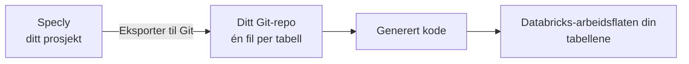

# Modul 0: Oppsett

*Gjøres før kursdagen.*

**Du lærer**
- hvilke tre ting kurset bygger på: ditt eget Git-repo, ditt eget Specly-prosjekt og din egen Databricks-arbeidsflate
- hvordan Specly kobles til repoet ditt, og hvorfor det er trygt
- hvordan kildefilene havner i Databricks før du modellerer noe

**Tid:** ca. 30 minutter. **For hvem:** alle.
**Start her:** dette er første modul. Du trenger ikke noe startpunkt.
**Forutsetninger:** ingen. Du trenger en nettleser. Terminal er valgfritt.

---

## Slik henger det sammen

Kurset bygger én kjede. Du modellerer i Specly. Specly skriver modellen som filer i ditt eget Git-repo. Fra
filene lages koden, og koden bygger tabellene i Databricks.



I denne modulen lager du de tre boksene og kobler dem sammen. Du modellerer ingenting ennå.

<details><summary>Les mer: hvorfor eget repo, eget prosjekt og eget skjema i Databricks?</summary>

I et tidligere kurs delte alle ett skjema i Databricks. To deltakere kjørte samtidig og overskrev hverandres
tabeller. Nå har alle sitt eget. Du kan prøve og feile uten å ødelegge for andre.

Specly kan bare koble ett prosjekt til ett repo om gangen. Derfor har hver deltaker sitt eget repo.
</details>

---

## Velg spor

Du kan gjøre hele kurset i nettleseren. Terminal er et valg, ikke et krav. Begge sporene gir det samme resultatet.

| | Nettleserspor | Terminalspor |
|---|---|---|
| Du trenger | nettleser | nettleser, terminal, `git`, `gh` (GitHub CLI), `uv`, Databricks CLI, Data Contract CLI |
| Git | GitHub i nettleseren | en lokal kopi (klone) av repoet |
| Generere kode og kjøre | notebooks i Databricks | kommandoene `./generer`, `./kjor` og `./kurs` |
| Importen til Specly i modul 2 | et personlig tilgangstoken i Databricks | det samme |

Er du usikker, velg nettlesersporet.

**Velg ett spor, og hold deg til det.** Sporet du gjør steg 6 i, eier skjemaet ditt i Databricks. De to sporene kan
ikke dele et skjema:
- Gjør du oppsettet med notebooken og kjører `./kurs oppsett` eller `./kjor` i terminalen etterpå, stopper utrullingen
  med `SCHEMA_ALREADY_EXISTS`.
- Har du kjørt `./kjor` i terminalen, stopper notebookene `kurs_generer_kjor` og `kurs_til` med meldingen «Skjemaet …
  har allerede pipelinen … fra terminalsporet», før de har endret noe.

Det du gjør i Specly og på GitHub, er likt i begge spor. Har du blandet sporene likevel, står veien ut i
[løsningen](M0_losning.md) under «Typiske problemer».

**Token i modul 2, i begge spor.** «Importer fra Databricks» i Specly ber om et personlig tilgangstoken fra
Databricks. Du lager det i modul 2, steg 1. Får du ikke lage token i arbeidsflaten din, har modul 2 en omvei med en
CSV-fil.

<details><summary>Les mer: hva er en terminal, og hva er `uv`?</summary>

En terminal er et vindu der du skriver kommandoer i stedet for å klikke. Alle kommandoer i kurset står ferdig til å
kopieres, med én setning om hva de gjør.

`uv` er et lite verktøy som henter riktig Python selv. Du trenger ikke installere Python.

Databricks CLI er Databricks sitt kommandolinjeverktøy. Det ruller ut koden og starter pipelinen.

Data Contract CLI (`datacontract`) er et åpent verktøy som leser kontraktene og lager koden fra dem.

`gh` er GitHub sitt kommandolinjeverktøy. Kurset bruker det bare til å logge inn, slik at `git` får hente det private
repoet ditt.
</details>

---

## Steg 1: Kontoene

**Hva og hvorfor:** Du trenger tre innlogginger før noe annet: GitHub (der repoet bor), Databricks (der tabellene
bygges) og Specly (der du modellerer).

**Gjør:**
1. Har du ikke en GitHub-konto, lag en på github.com.
2. Logg inn i Databricks. Har du ingen arbeidsflate, registrer deg for Databricks Free Edition (gratis, med e-post).
3. Åpne invitasjonen til Specly fra kursholderen og godta den. Kurset bruker testmiljøet til Specly,
   `https://test.specly.no`.

**Riktig når:** du er logget inn på alle tre stedene.

---

## Steg 2: Ditt eget repo

**Hva og hvorfor:** Repoet er der modellen din lagres som filer. Det er ditt, i et åpent format. Du kan ta
modellen med deg ut av Specly. Kurset har et malrepo med alt du trenger: data, maler for koden og verktøyene.

**Gjør:** Åpne malrepoet kursholderen gir deg. Trykk «Use this template» → «Create a new repository». Velg din egen
konto som eier. La repoet være privat.

**Riktig når:** du har et repo på din egen GitHub-konto, med mappene `specly/`, `maler/`, `kilder/` og `databricks/`.

---

## Steg 3: Ditt eget Specly-prosjekt

**Hva og hvorfor:** Prosjektet er der du modellerer. Du lager det tomt. Oppsettet kurset bruker (tabelltypene raw,
bronze, sølv, gull dimensjon og gull fakta, flaggene, datatypene, feltene og reglene) ligger i repoet ditt, i
`specly/Config`. Specly henter det derfra når du kobler prosjektet til repoet i steg 4.

**Gjør:**
1. I Specly: «Alle prosjekter» → «Nytt prosjekt».
2. Dialogen heter «Opprett prosjekt». Øverst står organisasjonen prosjektet lages i, med knappen «Bytt». Er du med i
   flere organisasjoner, velg den kursholderen inviterte deg til. Gi prosjektet et navn med ditt navn i, for eksempel
   `Toppfart Kari`. Slug fylles ut av seg selv.
3. Hak av for «Dette prosjektet følger Open Data Contract Standard», og trykk «Opprett». Open Data Contract Standard
   (ODCS) er det åpne filformatet Specly skriver tabellene dine i. Du blir admin i ditt eget prosjekt.
4. Prosjektet åpner på «Oversikt», som bare viser. Trykk «Begynn å endre →» øverst (ved siden av branchnavnet `main`).
   Knappen kan også hete «Fortsett →», for eksempel når du kommer tilbake til prosjektet senere. Da kommer sidepanelet
   med «Import og eksport» og «Admin».

<details><summary>Les mer: hvorfor ingen prosjektmal?</summary>

Specly har prosjektmaler (feltet «Mal» i dialogen, når organisasjonen har maler). En mal tar bare med en del av
oppsettet (modul 1, steg 8). Repoet har hele oppsettet, så kurset henter det derfra. «Admin» er tomt til prosjektet er
koblet. Det er riktig.
</details>

**Riktig når:** prosjektet er laget, og du ser sidepanelet med «Import og eksport».

---

## Steg 4: Koble Specly til repoet

**Hva og hvorfor:** Når prosjektet er koblet til repoet, kan Specly skrive modellen din dit («Eksporter til Git») og
lese endringer derfra. Koblingen går gjennom Specly sin GitHub-app. Specly lagrer aldri et GitHub-token.

**Gjør:**
1. I Specly: åpne «Import og eksport» i sidepanelet og velg «Importer fra Git». Dialogen «Git-integrasjon» sier at
   prosjektet ikke er koblet ennå. Trykk «Koble til Git i prosjektinnstillingene». Du kommer til «Git-kobling».
2. Under «Repo»: velg «GitHub». Er Specly-appen ikke installert på kontoen din, trykk «Fortsett til GitHub». Står det
   «Bruk installasjonen på <kontoen din>», er appen installert fra før. Da må repoet ditt legges til i den
   installasjonen (punkt 3).
3. På GitHub: velg «Only select repositories» og bare repoet fra steg 2. Installer (eller lagre). GitHub kan be deg
   bekrefte med mobilen eller passordet.
4. Tilbake i Specly: velg repoet i listen («Specly er installert - velg hvilket repository prosjektet skal kobles
   til.») og trykk «Koble til repository».

> **Pass på:** Du må selv kunne administrere installasjonen av appen. På din egen GitHub-konto kan du det. Står repoet
> i en organisasjon du ikke eier, svarer Specly at du ikke administrerer installasjonen. Da må eieren koble prosjektet
> til, eller kursholderen gjøre det for deg.

<details><summary>Les mer: hva får Specly-appen se?</summary>

Appen ber om to ting: å lese og skrive filer (Contents) og å lese metadata. Med «Only select repositories» ser den
bare det ene repoet du valgte. Du trekker tilgangen tilbake ved å avinstallere appen på GitHub.

En vanlig eksport fra Specly er en commit, ikke en pull request. Bare forslag (modul 8) åpner en pull request, og
til det trenger appen også «Pull requests». Mangler den, får du en lenke til å åpne pull requesten selv.

Bare ett Specly-prosjekt kan være koblet til et repo om gangen.
</details>

**Riktig når:** Git-siden i Specly («Import og eksport» → «Importer fra Git») åpner seg uten feilmelding og viser
fanene «Mine endringer» og «Fra Git». Under «Prosjektinnstillinger» → «Git-kobling» står GitHub, repoet ditt og `main`.

---

## Steg 5: Oppsettet og ODCS-innstillingene

**Hva og hvorfor:** Når et tomt prosjekt kobles til, leser Specly repoet inn av seg selv: statusene, flaggene,
datatypene, feltene, tabelltypene, reglene og kildesystemene fra `specly/Config`. Men fire ODCS-innstillinger
(`specly/Config/odcs.json`) blir ikke med. De bestemmer hvor nedstrømsnavnet, utviklernotatet og oppstrømskolonnene står
i kontrakten. Er de ikke like, skriver Specly kontraktene i et annet format ved første eksport, og kodegenereringen
finner ikke nedstrømsnavnene. Derfor setter du dem selv, én gang.

**Gjør:**
1. «Admin» → «Open Data Contract Standard», fanen «Specly-felt».
   - Raden «Utviklernotat»: velg ODCS-destinasjonen `transformDescription` (skriv det i søkefeltet).
   - Raden «Oppstrømskolonner»: velg `transformSourceObjects`.
   - Raden «PK»: ta bort haken «Skriv primaryKeyPosition», og hak av «Gjør primærnøkkel required».
2. Fanen «ODCS-felt», under «Kolonne»: raden `businessName` («Forretningsnavn»): velg «Nedstrømsnavn (innebygd)».
   Hver endring lagres med en gang («ODCS-innstillingene er lagret»).
3. Åpne Git-siden («Import og eksport» → «Importer fra Git»). Kontroller at det ikke står noe om eldre format eller
   innstillinger. Er alt satt, står det «I synk: Specly og main er like.»
4. Gå tilbake til «Admin». Øverst står banneret «Dette prosjektet skal følge ODCS, men oppsettet er ikke kjørt ennå».
   Trykk «Oppsettet er gjort». Banneret forsvinner, uten noen kvittering. Dette punktet er lett å glemme, og banneret
   blir stående til du har trykket.

<details><summary>Les mer: hva du ser hvis en innstilling ikke er satt</summary>

Git-siden sier da «Git har filene i et eldre format» og «Innstillingene «columnBusinessNameSource» … er ikke som i
filene i Git», med en rad «Nytt filformat: N filer skrives på nytt». Ikke eksporter. Rett innstillingen som står nevnt,
og åpne Git-siden på nytt. Når meldingen er borte, er prosjektet likt repoet.
</details>

**Riktig når:**
- Menyen i «Admin» viser Statuser 6 (Ikke begynt, Under arbeid og I produksjon, for tabeller og for kolonner),
  Flagg 4, Tabelltyper 5 og Datatyper 7.
- Banneret om ODCS-oppsettet øverst i «Admin» er borte.
- Git-siden sier «I synk: Specly og main er like.», viser 0 under «Mine endringer» og «Fra Git», og har ingen melding
  om eldre format eller innstillinger. Under «Genererte filer» kan `specly/AGENTS.md` stå. Den er ikke en endring, og
  du kan la den være.

---

## Steg 6: Databricks klar

Her skiller sporene seg. Gjør bare det sporet du valgte.

### Nettlesersporet

**Hva og hvorfor:** Databricks kan hente repoet ditt som en Git-mappe. Da ligger notebookene og koden der, og
notebookene gjør det kommandoene gjør i terminalsporet. Notebookene heter `notebooks/kurs_oppsett`, `kurs_til`,
`kurs_generer_kjor`, `kurs_fyll` og `kurs_sjekk`. Fire av dem har felt for katalog og skjema, og noen har felt til
(modul, «Til», «Bekreft», «Full refresh»). `kurs_fyll` har bare feltet «Modul».
Feltene vises ikke før notebooken er kjørt én gang. Første kjøring bruker standardverdiene (katalog `workspace`, skjema
`toppfart`). I `kurs_fyll` og `kurs_sjekk` er standarden i feltet «Modul» «Velg modul»: første kjøring lager feltet og
stopper, og du velger modulen din før du kjører igjen. Etterpå ligger feltene i sidepanelet «Parameters», som du åpner med knappen «Show parameters».
Skjemaet `toppfart` er riktig for de fleste. Vil du ha et annet, setter du det før første kjøring: se «Les mer: et
annet skjema enn `toppfart`» under.

**Gjør:**
1. Koble GitHub-kontoen din til Databricks, slik at Databricks får lese det private repoet: «Settings» → «Linked
   accounts». Under «Git integration» trykker du «Add Git credential», velger GitHub og følger dialogen.
2. Legg repoet inn som en Git-mappe: «Workspace» i menyen til venstre → den blå knappen «Create» øverst til høyre →
   «Git folder». Valget finnes når du står i Workspace eller hjemmemappen din, ikke inne i en annen Git-mappe. Dialogen
   heter «Create Git folder». Lim inn adressen til repoet i «Git repository URL». «Git provider» blir GitHub og «Git
   folder name» blir navnet på repoet av seg selv. Trykk «Create Git folder». Det står «Creating Git folder in the
   background... This may take a few minutes.» Som regel går det fortere. Git-mappen åpner seg med branchnavnet `main`
   ved siden av mappenavnet.
3. Åpne `notebooks/kurs_oppsett` i Git-mappen. Se at det står «Serverless» øverst til høyre (det gjør det som
   regel av seg selv), og trykk «Run all». Notebooken lager skjemaet `toppfart` i katalogen `workspace`. Det er
   riktig for de fleste. Den tar et par minutter. Nederst står «Ferdig: skjemaet workspace.toppfart er satt opp.»

<details><summary>Les mer: et annet skjema enn `toppfart`</summary>

Du trenger et annet skjema hvis flere deler samme arbeidsflate, eller hvis terminalsporet allerede eier `toppfart`.
Skjemaet må settes før første «Run all». Ellers lager `kurs_oppsett` skjemaet `toppfart` og seks kildeskjemaer
(`toppfart_kilde_…`) før du har fått valgt.

1. Åpne `notebooks/kurs_oppsett`. Sidepanelet «Parameters» sier «No parameters».
2. Kjør bare den første kodecellen, den som begynner med kommentaren «Feltene»: hold pekeren over cellen og trykk ▶
   øverst til venstre i den. Cellen lager feltene og gjør ikke noe annet. Nå viser sidepanelet «Katalog», «Skjema»
   og «Volum».
3. Skriv skjemanavnet i «Skjema» og trykk Enter.
4. Trykk «Run all».

Gjør det samme i de andre notebookene første gang du åpner dem, og etter hver «Pull» (da er feltene borte igjen):
kjør cellen «Feltene», sett «Skjema», og trykk «Run all». `kurs_fyll` har ikke noe skjemafelt: den skriver bare i
Git-mappen.
</details>

<details><summary>Les mer: det du ser i Databricks underveis</summary>

- Øverst i notebooken står banneret «This file is part of a bundle. Switch to associated bundle.» Du kan overse det.
- Git-mappen viser også mappene `.git` og `.startpunkter`. La dem være.
- De andre notebookene installerer Data Contract CLI først. Da kan det komme rød tekst, for eksempel «Note: you may
  need to restart the kernel …» eller noe om «pip's dependency resolver» og `mlflow-skinny`. Den er ufarlig.
- Notebookene selv står ikke som endret i Git-vinduet etter at du har kjørt dem. (Databricks legger noen linjer
  øverst i en notebookfil når den kjøres på serverless. Kursets notebooker har de linjene fra før.) Det som står som
  endret, er filene notebookene skriver: modellen i `specly/` og koden i `databricks/pyspark/`.
</details>

<details><summary>Les mer: «Commit & Push» og «Pull» i Git-mappen</summary>

- Notebookene skriver filer i Git-mappen (modellen i `specly/` og koden i `databricks/pyspark/tabeller/`). De er ikke
  i GitHub før du har sendt dem dit: trykk på branchnavnet (`main`) ved siden av mappenavnet. Git-vinduet åpner seg på
  fanen «Changes» med listen over endrede filer. Skriv en melding i «Commit message (required)» og trykk
  «Commit & Push». Det står «Successfully committed and pushed changes to branch "main"».
- Første gang du genererer kode, står `databricks/pyspark/tabeller/.gitkeep` som slettet (D) i listen. Det er riktig:
  den holdt bare på den tomme mappen.
- «Pull», som modulene ber deg gjøre etter at Specly har eksportert, er knappen øverst til høyre i det samme vinduet.
  Databricks spør «Proceed with pulling?» (utdata i notebooker som endres, blir tømt). Trykk «Pull anyway». Filer du
  ikke har committet ennå, blir stående.
</details>

### Terminalsporet

**Hva og hvorfor:** Du kjører de samme stegene fra din egen maskin. Databricks CLI snakker med arbeidsflaten din.
Du logger inn én gang per verktøy.

Verktøyene må være installert først: `git`, `gh`, `uv`, Databricks CLI og Data Contract CLI. Tabellen under
«Les mer: installere verktøyene» viser hvordan.

**Gjør:**
```bash
gh auth login                              # logg inn i GitHub (spør i nettleseren), så git får hente det private repoet
git clone <adressen til repoet ditt>      # lokal kopi av repoet
cd <repoet>
databricks auth login --host <adressen til arbeidsflaten> --profile kurs   # logg inn i Databricks med profilen kurs
./kurs oppsett                             # lager skjema og volum, kopierer filene, lager kildetabellene
```

Adressen til arbeidsflaten er første del av adressen i nettleseren når du er logget inn i Databricks, for eksempel
`https://dbc-12345678-abcd.cloud.databricks.com`.

`./kjor` og `./kurs` bruker profilen `kurs`. Har du en profil med et annet navn fra før, setter du
`DATABRICKS_PROFILE` foran kommandoen: `DATABRICKS_PROFILE=minprofil ./kurs oppsett`.

<details><summary>Les mer: installere verktøyene</summary>

| Verktøy | Installasjon | Kontroll |
|---|---|---|
| `git` | https://git-scm.com/downloads | `git --version` |
| `gh` (GitHub CLI) | https://cli.github.com | `gh --version` |
| `uv` | https://docs.astral.sh/uv/getting-started/installation/ | `uv --version` |
| Databricks CLI | https://docs.databricks.com/dev-tools/cli/install.html | `databricks --version` |
| Data Contract CLI | `uv tool install datacontract-cli==1.2.10` (etter at `uv` er installert) | `datacontract --version` |

Skriver kontrollen ut et versjonsnummer, er verktøyet installert.

Data Contract CLI er verktøyet som lager koden fra kontraktene fra modul 2. Kurset bruker versjon 1.2.10. Mangler
det, stopper `./generer` med «Fant ikke Data Contract CLI».
</details>

> **Aldri del et token.** Ikke lim det inn i en chat, et dokument eller en fil i repoet. Innloggingen over lagrer det
> i Databricks CLI, ikke i repoet.

<details><summary>Les mer: hva `./kurs oppsett` gjør</summary>

Den lager skjemaet og volumet `landing` i arbeidsflaten din, kopierer kildefilene dit og lager kildetabellene du
importerer i modul 2: ett skjema per kilde (`toppfart_kilde_varius`, `toppfart_kilde_kassio` …) med én tabell per
kildetabell. Standard er katalog `workspace` og skjema `toppfart`. Til slutt skriver den antall rader per
kildetabell.

Et ekte prosjekt har ikke denne kommandoen. Der finnes kildene fra før.
</details>

**Riktig når (begge spor):** oppsettet er ferdig uten feil, og har skrevet antall rader per kildetabell.

---

## Steg 7: Se at dataene er der

**Hva og hvorfor:** Før du modellerer, sjekker du at filene og kildetabellene finnes. Da vet du at en feil senere
ikke skyldes oppsettet.

**Gjør:**
1. I Databricks: åpne Catalog. Finn katalogen `workspace`, skjemaet `toppfart` og volumet `landing`.
2. Åpne mappene `varius` og `kassio` i volumet.
3. Finn kildetabellene i skjemaene `toppfart_kilde_varius` og `toppfart_kilde_kassio`.

<details><summary>Les mer: hva er katalog, skjema og volum?</summary>

- **Katalog** er øverste nivå i Unity Catalog. I Databricks Free heter den `workspace`.
- **Skjema** er en mappe med tabeller. Kurset bruker `toppfart`.
- **Volum** er en mappe med filer. Det er omtrent som Files i et lakehouse i Microsoft Fabric. Filene fra kildene
  ligger der, slik de kom.
</details>

**Hva tror du?** Volumet har filer fra seks kilder for tre måneder. Hvor mange filer tror du det er til sammen?

<details><summary>Svar</summary>

457 filer. De fleste kildene leverer én fil om dagen per tabell. Varesystemet leverer bare ett fullt uttrekk den
1. hver måned. Kalenderen er én fil.
</details>

**Riktig når:** du ser filer i `landing/varius/vare/` (tre filer) og `landing/kassio/kvittering/` (92 filer), og
`toppfart_kilde_kassio` har `kvittering` og `kvitteringslinje` (views over filene).

---

## Sjekkliste før kursdagen

Nettleserspor:
- [ ] GitHub-konto
- [ ] Databricks-arbeidsflate eller Databricks Free, og du kan logge inn
- [ ] Invitasjon til Specly godtatt
- [ ] Eget repo laget fra malrepoet
- [ ] Specly-prosjekt laget, koblet til repoet, og ODCS-innstillingene satt (Git-siden viser 0 og 0, og banneret i
      «Admin» er borte)
- [ ] Repoet lagt inn som Git-mappe i Databricks, og oppsett-notebooken kjørt

Terminalspor (i stedet for den siste linjen over):
- [ ] `git`, `gh`, `uv`, Databricks CLI og Data Contract CLI installert
- [ ] `gh auth login` og `databricks auth login --host <adressen> --profile kurs` gjort
- [ ] `./kurs oppsett` kjørt uten feil

Begge spor:
- [ ] Du vet at du trenger et personlig tilgangstoken i Databricks i modul 2 (eller bruker CSV-omveien der)

Neste: [Modul 2: Raw fra kilden](M2.md). Er du admin, tar du [Modul 1: Prosjektoppsett](M1.md) først.
