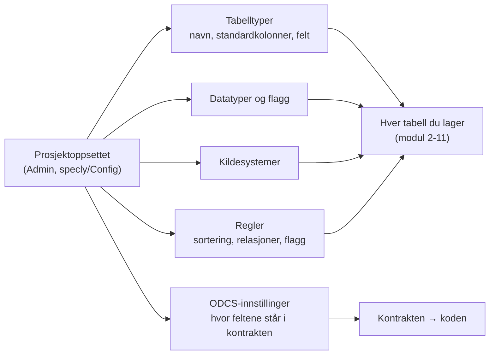

# Modul 1: Prosjektoppsett

*Valgfri. For den som skal sette opp Specly for andre (admin). Alle andre går rett til [modul 2](M2.md).*

**Du lærer**
- hva prosjektoppsettet er, og hvorfor det bestemmer så mye av modellen
- hva en tabelltype består av: navnemønster, standardkolonner og felt
- hvor nedstrømsnavnet havner i kontrakten (ODCS-innstillingene)
- datatyper, kildesystemer og reglene for sortering, relasjoner og flagg
- rollene i Specly, og hva Azure DevOps krever hos en kunde
- hva en prosjektmal inneholder, og hvorfor kurset ikke bruker en

**Tid:** ca. 40 minutter. **For hvem:** admin.
**Start her:** etter [modul 0](M0.md), i prosjektet ditt fra modul 0. Du trenger ikke noe eget prosjekt eller repo.
**Forutsetninger:** repo og Specly-prosjekt, koblet sammen. Lært i [modul 0](M0.md).

**Slik jobber du i denne modulen:** du ser og leser. Du endrer ikke oppsettet, for resten av kurset bygger på det.
Det eneste du lager, er en testtabell i steg 3, og den sletter du igjen.

---

## Hvor du er

I modul 0 koblet du et tomt prosjekt til repoet, og Specly hentet oppsettet derfra. Alt var klart: tabelltypene,
datatypene, flaggene, feltene og reglene. Noen har bestemt alt dette. I et ekte prosjekt er det prosjektets admin. Her
ser du hva som er bestemt, hvor det står, og hvorfor hvert valg er gjort.



**Prosjektoppsettet** er alt under «Admin» i Specly. I Git står det i `specly/Config/`, én JSON-fil per del. Modellen
(tabellene) bruker oppsettet. Er oppsettet godt, blir modellen lik overalt, uten at hver modellerer må huske alt.

---

## Steg 1: Oppsettet i Admin

**Hva og hvorfor:** «Admin» er der en admin bestemmer hva modellererne kan velge mellom. Du starter med å se hva
prosjektet ditt har.

**Gjør:** Åpne «Admin» i sidepanelet. Menyen viser hvor mange det er av hver del. Åpne «Tabelltyper» (under
«DATAMODELL»), «Datatyper» og «Flagg», og se hva som står der.

| I menyen | Antall | Hva |
|---|---|---|
| Tabelltyper | 5 | raw, bronze, sølv, gull dimensjon, gull fakta |
| Datatyper | 7 | steg 4 |
| Flagg | 4 | PK, BK, FK og Eget navn |
| Statuser | 6 | Ikke begynt, Under arbeid og I produksjon, for tabeller og for kolonner |
| Metadatafelt | 22 | feltene på tabeller, kolonner, kildesystemer og dataprodukter |

**Riktig når:** tallene i menyen er de samme som i tabellen.

---

## Steg 2: Det samme oppsettet i Git

**Hva og hvorfor:** Oppsettet er filer i Git, akkurat som modellen. Da du koblet det tomme prosjektet til repoet i
modul 0, leste Specly `specly/Config` inn av seg selv. Derfor har alle deltakerne nøyaktig det samme oppsettet, uten
at noen har klikket det inn.

**Gjør:** Åpne mappen `specly/Config/` i repoet ditt (på GitHub eller lokalt). Åpne `datatypes.json` og `flags.json`,
og finn igjen det du så i «Admin».

**Hva tror du?** En admin legger til en datatype i «Admin». Når står den i Git?

<details><summary>Svar</summary>

Når admin eksporterer («Import og eksport» → «Eksporter til Git»). Endringer i oppsettet står i listen under
«Admindata», ved siden av tabellene. Du ser det i modul 2, når kildesystemene får formatet sitt. Fram til eksporten
finnes endringen bare i Specly.
</details>

<details><summary>Les mer: hvorfor krever dette admin?</summary>

En endring i prosjektoppsettet fra Git kan som regel bare hentes inn av en admin. En utvikler kan hente inn tabeller,
men ikke endre datatyper, flagg, tabelltyper eller regler. Det er med vilje: oppsettet gjelder alle, og en feil der
rammer hele modellen. Innstillingen heter «Krev admin-godkjenning for endringer i admininnstillinger», og står under
«Prosjektinnstillinger» → «Git-kobling» (under «Eksport»). Den er på som standard. Er den av, kan også en utvikler
hente inn oppsettet.
</details>

**Riktig når:** du har funnet de sju datatypene og de fire flaggene i filene.

---

## Steg 3: Tabelltypen bronze

**Hva og hvorfor:** En tabelltype er formen på en tabell. Den bestemmer fire ting:

| Del | Bronze i kurset | Hvorfor |
|---|---|---|
| Navnemønster | `^brz__` | Specly gir alle tabeller som starter med `brz__`, typen bronze på én gang (modul 2) |
| Skilletegn | `__` | Navnet deles i lag, kilde og objekt: `brz` · `varius` · `vare` |
| Standardkolonner | `pk__{table_name}` (bigint, PK), `bk__{table_name}` (bigint), `sys__gyldig_fra` (timestamp), `sys__gyldig_til` (timestamp), `sys__kildesystem` (string) | Kolonnene hver bronze-tabell har, og som koden fyller. `{table_name}` byttes med tabellnavnet |
| Felt | kolonnefeltene Beskrivelse, Utviklernotat og Rensing. Vis nedstrømsnavn: på | Rensing gjøres bare i bronze (modul 3), så feltet hører bare til bronze |

**Gjør:**
1. «Admin» → «Tabelltyper» → bronze. Typen har fanene «Generelt», «Kolonnemaler» og «Metadatafelt». På «Generelt»
   finner du navnemønsteret («Regex for tabellnavn»), skilletegnet («Skilletegn for tabellnavn») og «Vis
   nedstrømsnavn».
2. Fanen «Kolonnemaler»: under «Standardkolonner» står de fem kolonnene, med Kolonnenavn, Datatype, Flagg og Påkrevd.
   Knappen «Legg til kolonne» lager en ny. Ikke trykk på den.
3. Fanen «Metadatafelt»: en liste med avkrysningsbokser («Kryss av for feltene tabeller av denne typen skal ha.
   Endringer lagres med en gang.»). Se hvilke felt bronze har. Ikke klikk i listen, for endringen lagres straks.
4. Gå tilbake til «Tabelltyper» og trykk «Ny tabelltype». Dette er skjemaet en admin fyller ut: «Start fra» (her
   «Tom»), Navn, Beskrivelse, «Regex for tabellnavn», «Skilletegn for tabellnavn» og «Vis nedstrømsnavn». Over knappen
   «Opprett tabelltype» står det: «Disse kolonnefeltene legges til fordi ODCS krever dem: Klassifisering,
   Utviklernotat, Datoeffektiv på, Beregning, Rensing, Beskrivelse». Lukk skjemaet uten å opprette noe.
5. Lag en testtabell: «Tabeller» i sidepanelet → «Opprett ny tabell». Klikk i navnet, skriv `brz__test__vare` og trykk
   Enter.

**Hva tror du?** Navnet `brz__test__vare` passer med navnemønsteret til bronze. Hvilken type har tabellen nå?

<details><summary>Svar</summary>

Ingen. Under navnet står «Ingen type». Navnemønsteret brukes først når noen ber om det, med «Tabelltype auto-tag»
(modul 2).

Velg bronze i velgeren under tabellnavnet («Ingen type»). Da lager Specly de fem standardkolonnene med en gang:
«5 standardkolonner opprettet». `pk__brz__test__vare` får flagget PK. På kolonnene ser du cellene Rensing og
Nedstrømsnavn, fordi bronze har de feltene. Gir du typen med «Tabelltype auto-tag» i stedet, får tabellen typen, og du
trykker «Opprett manglende» for kolonnene (som i modul 2).

Slett testtabellen etterpå. Specly spør «Er du sikker?» og sier at det ikke kan angres. Trykk «Slett tabell». Åpne
så Git-siden («Import og eksport» → «Importer fra Git»): «Mine endringer» skal vise 0.
</details>

<details><summary>Les mer: standardkolonnene og koden</summary>

Malen for bronze (`maler/pyspark/bronze.py.j2`) regner `pk__` og `bk__` av BK-kolonnene, og setter `sys__gyldig_fra` og
`sys__gyldig_til` for historikken. Forhåndssjekken stopper hvis en standardkolonne mangler («Standardkolonnen
sys__kildesystem for tabelltypen sølv mangler»). Navnene i oppsettet og i koden må derfor være like. Det er grunnen til at
oppsettet ikke er noe hver deltaker lager selv.
</details>

<details><summary>Les mer: slik lager en admin en tabelltype fra bunnen</summary>

I et prosjekt uten oppsett i Git fyller admin ut skjemaet «Ny tabelltype» med verdiene i tabellen over. Så legger
admin til standardkolonnene på fanen «Kolonnemaler» («Legg til kolonne»), og tar haken av feltene typen ikke skal ha,
på fanen «Metadatafelt». For bronze er det Beregning, Datoeffektiv på og Klassifisering, som Specly legger til av seg
selv.
</details>

**Riktig når:** du har sett navnemønsteret, de fem standardkolonnene og de tre kolonnefeltene på bronze, testtabellen
fikk dem, og testtabellen er slettet.

### Sammenlign med Git

**Gjør:** Åpne `specly/Config/table_types.json` i repoet ditt. Finn oppføringen `"name": "bronze"`. Finn igjen det du
så i Specly: `regexPattern`, `delimiter`, `columnTemplates`, `columnFields` og `showDownstreamName`.

**Hva tror du?** Oppføringen har også en `uuid`. Hva ville vært forskjellig hvis du hadde laget bronze selv, i et
annet prosjekt?

<details><summary>Svar</summary>

Bare `uuid` (og kanskje beskrivelsen og rekkefølgen). Navnemønster, skilletegn, `columnTemplates`, `columnFields` og
`showDownstreamName` ville vært like. Tabelltypen er den samme, laget to steder. Det er derfor oppsettet ligger i
Git: alle prosjekter får nøyaktig den samme tabelltypen, med samme `uuid`.
</details>

---

## Steg 4: Datatyper og kildesystemer

**Hva og hvorfor:** Datatypene er listen modellererne velger fra. Kildesystemene sier hvor dataene kommer fra, og hvordan
filene ser ut.

**Gjør:** Se på «Admin» → «Datatyper», og på «Kildesystemer» i sidepanelet (databaseikonet).

| Datatype | Brukes til |
|---|---|
| `string` | tekst |
| `int` | numre fra kildene, antall, kalenderdeler |
| `bigint` | nøklene `pk__`, `bk__`, `fb__`, `fk__` |
| `decimal(10,2)` | beløp i kroner |
| `date` | dato |
| `timestamp` | tidspunkt, alltid i UTC |
| `boolean` | sann/usann |

Navnet på datatypen er det koden bruker (`CAST(… AS DECIMAL(10,2))`). Derfor er det få, og de heter som i Databricks.
Specly sjekker ikke verdiene. Datatypen er en etikett, og koden gjør den til en type.

Kildesystemene har egne felt (Filformat, Skilletegn, Desimaltegn, Datoformat, Tidsformat, Tidssone, Uttrekk). De er
laget under «Admin» → «Metadatafelt» som felt for objekttypen kildesystem. Du fyller dem ut i [modul 2](M2.md).

**Riktig når:** du vet hvorfor `decimal(10,2)` heter akkurat det, og hvor formatfeltene til kildesystemene kommer fra.

---

## Steg 5: Nedstrømsnavnet i kontrakten

**Hva og hvorfor:** ODCS er en åpen standard med faste felt. Specly har egne begreper (nedstrømsnavn, utviklernotat,
oppstrøm). ODCS-innstillingene bestemmer hvor hvert av dem står i kontrakten. Koden leser kontrakten, så valget her
bestemmer hva koden finner.

**Gjør:** «Admin» → «Open Data Contract Standard» (under «UTDATA») → fanen «Specly-felt» (de andre fanene er
«Egendefinerte egenskaper», «ODCS-felt» og «Innstillinger»). Finn Nedstrømsnavn.

| Specly-felt | I kontrakten (kurset) |
|---|---|
| Nedstrømsnavn | `businessName` på kolonnen |
| Utviklernotat | `transformDescription` på kolonnen |
| Oppstrømskolonner | `transformSourceObjects` på kolonnen |
| BK | `customProperties` → `businessKey` |
| Tabelltype, kildesystem | `customProperties` → `tableType`, `sourceSystem` på tabellen |
| Eier (dataprodukt) | `team.name` |

I Git står valgene i `specly/Config/odcs.json`. Det viktigste er `"columnBusinessNameSource": "downstreamName"`:
nedstrømsnavnet er det eneste som skrives til `businessName`. Specly sier det slik: «Nedstrømsnavnet er eneste kilde til
kolonnens businessName.»

**Hva tror du?** I modul 3 lager du bronze-tabellen `brz__varius__vare`. Der får kolonnen `VARETEKST` nedstrømsnavnet
`produktnavn`, altså navnet den skal ha i sølv. Hvor i kontrakten havner det? Åpne `specly/Config/odcs.json` og se
etter.

<details><summary>Svar</summary>

I `businessName` på kolonnen. Slik ser det ut i kontrakten `specly/Tables/bronze/brz__varius__vare.odcs.yaml` når
tabellen er laget i modul 3:

```yaml
      - id: …
        name: VARETEKST
        …
        businessName: produktnavn
```

`tools/modell.py` leser `businessName` som nedstrømsnavnet, fordi `odcs.json` sier det. Hadde innstillingen vært en annen,
ville nedstrømsnavnet stått et annet sted, og koden ville ikke funnet det. Derfor er ODCS-innstillingene en del av
oppsettet, og derfor satte du dem selv i modul 0, steg 5.
</details>

<details><summary>Les mer: et felt koblet til et ODCS-felt</summary>

Egendefinerte felt kan også kobles til ODCS-felt. I kurset: Beregning til `transformLogic`, Klassifisering til
`classification` og Eier (tabell) til `team.name` (modul 8), Granularitet til `dataGranularityDescription`, og
dataproduktets Begrensninger og Bruk til `description.limitations` og `description.usage` (modul 10). Et felt uten kobling
havner i `customProperties`, med feltets nøkkel i camelCase. Koblingen står på feltet (`odcsTarget` i
`metadata_field_definitions.json`).
</details>

**Riktig når:** du har funnet `columnBusinessNameSource` i `odcs.json`, og vet at nedstrømsnavnet står som
`businessName` i kontrakten.

---

## Steg 6: Reglene

**Hva og hvorfor:** Reglene gjør det modellererne ellers må huske. Du bruker dem fra [modul 2](M2.md), steg 2. Her ser
du hvor de står.

| Regel | I Specly | I Git | I kurset |
|---|---|---|---|
| Kolonnesortering | «Admin» → «Kolonnesorteringsregler» | `column_sorting_rules.json` | `pk__`, `bk__`, `fb__`/`fk__`, BK, resten alfabetisk, `sys__` sist |
| Relasjonsregler | «Admin» → «Relasjonsregler» | `relation_rules.json` | `fb__<tabell>` → `bk__<tabell>` i sølv, `fk__<tabell>` → `pk__<tabell>` fra fakta til dimensjon |
| Flaggregler | «Admin» → «Flagg» («Regler» ved hvert flagg) | `flag_rules.json` | PK på `pk__`, FK på `fb__` og `fk__` |

**Gjør:** Åpne `specly/Config/relation_rules.json`. Les `fromPattern` og `toPattern`.

**Hva tror du?** Hva betyr `{toTable}` i `"fromPattern": "^fb__{toTable}$"`?

<details><summary>Svar</summary>

Navnet på tabellen relasjonen går til. `fb__slv__produkt` i en sølvtabell matcher når `{toTable}` er `slv__produkt`, og
regelen lager relasjonen til `slv__produkt.bk__slv__produkt`. Det er navnestandarden skrevet som en regel:
en `fb__` har hele navnet på tabellen den peker på.
</details>

Reglene kjører ikke hver gang noen endrer en tabell. Specly sier selv når, på siden «Relasjonsregler»: «Reglene kjøres
ved import fra Databricks, fra diagramverktøylinjen og i Massekjøring». Ellers kjører du dem selv, på én tabell eller
på alle (modul 2). Det er et valg i Specly: en regel som endrer modellen uten at noen ser det, er vanskelig å følge
med på.

**Riktig når:** du vet hvor hver regel står, og hva `{toTable}` betyr.

---

## Steg 7: Roller, og Git hos en kunde

**Hva og hvorfor:** Admin bestemmer hvem som kan gjøre hva, og kobler prosjektet til Git. Hos en kunde er det ofte flere
personer involvert.

| Rolle i Specly | Kan |
|---|---|
| Leser (Viewer) | se, søke og eksportere. Ingen endringer |
| Bidragsyter (Contributor) | foreslå endringer i beskrivelser og andre felt, som en pull request (modul 8) |
| Utvikler (User) | endre modellen, hente inn fra og eksportere til Git, lage brancher |
| Admin | i tillegg prosjektoppsettet, medlemmene og Git-koblingen |

En organisasjonsadmin er admin i alle prosjektene i organisasjonen. Bare organisasjonsadmin kan lage prosjektmaler.

**GitHub** kobles med Specly sin GitHub-app (modul 0). Den som kobler til, må kunne installere appen på kontoen eller
organisasjonen.

**Azure DevOps** har ingen app. Specly trenger en **service principal** (en identitet for et program) i kundens
Entra-tenant. Det krever som regel tre personer hos kunden:

| Hvem | Gjør |
|---|---|
| Noen som kan registrere apper i Entra ID (ofte IT, rollen Application Developer eller høyere) | lager appregistreringen («App registrations» → «New registration»), kopierer tenant-ID og client ID, og lager en client secret |
| Eier av Azure DevOps-organisasjonen (eller Project Collection Administrator) | legger service principalen til som bruker («Organization settings» → «Users»), med tilgangsnivå Basic. Den tar en lisens som en vanlig bruker |
| Prosjektadmin i Azure DevOps | legger den til i prosjektet, og lager webhooken («Project settings» → «Service hooks») med adressen og passordet Specly viser |

Så limer admin i Specly inn tenant-ID, client ID og client secret («Test tilkobling»), og velger organisasjon, prosjekt og
repo.

<details><summary>Les mer: hva kunden bør vite om sikkerheten</summary>

Fra Specly sin egen hjelp: bruk en egen app uten API-tillatelser, legg den bare til i det ene prosjektet, og gi client
secreten kort utløpstid. Secreten lagres kryptert i Specly og vises aldri igjen. Tilgangen trekkes tilbake ved å slette
secreten i Entra, eller fjerne service principalen fra Azure DevOps.

Ikke bruk «Test»-knappen for webhooken i Azure DevOps. Den sender eksempeldata Specly ikke kjenner, og gir 401 selv når
alt er riktig. Push en commit i stedet.

En Azure DevOps-organisasjon uten Entra-tenant (en ren Microsoft-konto) kan ikke kobles. Azure DevOps Server (on-prem)
støttes ikke.
</details>

**Riktig når:** du kan forklare hvem hos en kunde som må gjøre hva før Specly kan kobles til Azure DevOps.

---

## Steg 8: Prosjektmaler

**Hva og hvorfor:** En prosjektmal er et øyeblikksbilde av oppsettet til et prosjekt. Nye prosjekter kan lages fra den.
Kurset bruker ingen mal. De andre deltakerne kan hoppe over denne modulen fordi de fikk hele oppsettet fra Git i
modul 0. Her ser du hvorfor kurset ikke bruker en mal.

Specly sin hjelpetekst sier at malen tar med:

| Med i malen | Ikke med |
|---|---|
| datatyper, flagg, statuser, egendefinerte felt, tabelltyper, kildesystemer, personroller og personer, relasjonsregler, kolonnesorteringsregler, kravet til tabellnavngiving | tabeller, diagrammer, dataprodukter, begreper, Git-kobling, valideringsmiljøer, instruksjoner til KI-agenter |

**Gjør:** Sammenlign med `specly/Config/` i repoet ditt:

| Fil i `specly/Config/` | Hva |
|---|---|
| `datatypes.json` | de sju datatypene |
| `flags.json` | PK, BK, FK og Eget navn |
| `table_types.json` | raw, bronze, sølv, gull dimensjon, gull fakta |
| `metadata_field_definitions.json` | feltene: Rensing, Beregning, Radfilter, Historikk, Datoeffektiv på, formatfeltene for kildesystemer, Eier, Klassifisering, Granularitet, og dataproduktfeltene Begrensninger, Bruk og Forbruker |
| `source_systems.json` | kildesystemene |
| `table_statuses.json`, `column_statuses.json` | statusene |
| `column_sorting_rules.json`, `relation_rules.json`, `flag_rules.json` | reglene |
| `odcs.json` | ODCS-innstillingene (steg 5) |
| `table_naming.json` | tabellnavn uten database og skjema (`off`) |

**Hva tror du?** Malen tar med «tabelltyper» og «egendefinerte felt». Tar den med alt du har sett på i denne modulen?

<details><summary>Svar</summary>

Nei. Malen tar bare med en del av hver ting:

| Med | Ikke med |
|---|---|
| navnene og beskrivelsene på datatyper, flagg, statuser og kildesystemer | flaggreglene, ODCS-innstillingene (`odcs.json`), formatfeltene og regex-mønsteret på kildesystemene, hvilket flagg som er primærnøkkel |
| feltene: navn, nøkkel, type og valg | hvor feltet står i kontrakten (Beregning til `transformLogic`, Klassifisering til `classification`), hjelpeteksten, «Kan arves fra forretningsbegrep», kravene fra modul 8 |
| tabelltypene: navn, mønster, skilletegn, standardkolonner | hvilke felt tabelltypen har, «Vis nedstrømsnavn» |

Og alt får nye UUID-er, som ikke er de samme som i `specly/Config` i Git.

Det betyr: et prosjekt fra malen er en god start, men ikke likt kursets oppsett. Det som gjør det likt, er oppsettet i Git,
slik prosjektet ditt fikk det i modul 0. Det er grunnen til at kurset henter oppsettet fra Git, og ikke fra en mal.
</details>

<details><summary>Les mer: slik lager en organisasjonsadmin malen</summary>

«Alle prosjekter» → «Organisasjonsinnstillinger» → «Prosjektmaler» → «Ny mal fra prosjekt» («Lagrer statuser, tabelltyper,
datatyper, flagg, metadatafelt, relasjonsregler, kolonnesorteringsregler, personer og kildesystemer fra standardbranchen i
prosjektet du velger.»). Velg «Kildeprosjekt», og «Opprett mal».

Senere endringer i malen påvirker ikke prosjekter som allerede er laget. Endres oppsettet i kurset, må malen lages på
nytt, og deltakere med eldre prosjekter henter endringen fra Git.
</details>

**Riktig når:** du vet hva malen inneholder, og hvorfor en deltaker i kjerneløpet ikke trenger denne modulen.

---

## Ferdig når

- [ ] Du har funnet oppsettet begge steder: i «Admin» og i `specly/Config`
- [ ] Du har sett hva tabelltypen bronze består av, og testtabellen fikk standardkolonnene (og er slettet igjen)
- [ ] Du vet hvor nedstrømsnavnet står i kontrakten, og hvilken innstilling som bestemmer det
- [ ] Du vet hvor datatypene, kildesystemene og reglene står, i Specly og i `specly/Config`
- [ ] Du kan forklare de fire rollene, og hva Azure DevOps krever hos en kunde
- [ ] Du vet hva en prosjektmal inneholder, og hvorfor kurset henter oppsettet fra Git

Løsning: [M1_losning.md](M1_losning.md). Neste: [Modul 2: Raw fra kilden](M2.md).
