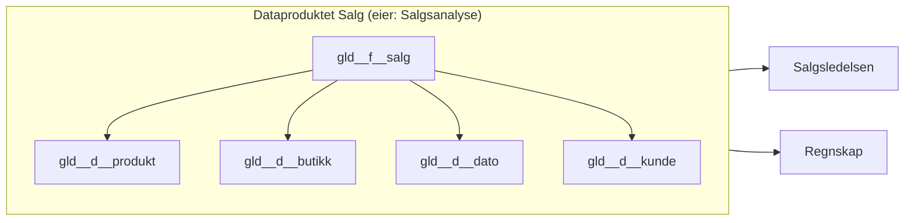

# Modul 10: Dataprodukt

**Du lærer**
- hva et dataprodukt er: tabeller samlet som én leveranse, med eier, forbrukere og kjente begrensninger
- å samle tabellene i en stjerne med ett klikk, ut fra relasjonene
- å skrive begrensningene slik at forbrukeren forstår dem
- hvor dataproduktet står i Git: én fil i det åpne formatet ODPS (Open Data Product Standard)

**Tid:** ca. 20 minutter. **For hvem:** forvalter og eier.
**Start her:** fortsetter du fra modul 9, er du klar. Ellers: sett startpunktet `M10`
(`./kurs til M10`, eller `notebooks/kurs_til` med «Til» = `start/M10`). Stegene står i
[Slik setter du et startpunkt](start.md).

Modulen gjelder en modell med nettbutikken (modul 6) og kunden (modul 7): `start/M10`, eller din egen etter modul
2–9. Stjernen har da fire dimensjoner: produkt, butikk, dato og kunde. Kommer du rett fra modul 5, har du tre.

**Forutsetninger:**
- stjernen `gld__f__salg` med dimensjonene, og diagrammet `Salg`. Laget i [modul 5](M5.md).
- eier som team. Lært i [modul 8](M8.md) (ikke nødvendig).

---

## Spørsmålet

Salgssjefen skal dele salgstallene med regnskap og med ledergruppen. Hun spør:

> «Hva får de, egentlig? Hvem spør de hvis noe er rart? Og hva skal de *ikke* bruke tallene til?»

Tabellene alene svarer ikke på det. Et **dataprodukt** samler tabellene som hører sammen, og sier hvem som eier dem, hvem
som bruker dem, og hva de ikke dekker. Det er dataproduktet du snakker med forretningen om, ikke enkelttabellene.



---

## Steg 1: Lag dataproduktet

**Hva og hvorfor:** Et dataprodukt har et navn og en beskrivelse som sier hva det er til. Beskrivelsen er det første en
forbruker leser.

**Gjør:**
1. «Dataprodukter» i sidepanelet (kubeikonet) → «Nytt dataprodukt». Dialogen heter «Opprett nytt dataprodukt». Navn:
   `Salg`, «Opprett». Dataproduktet åpnes.
2. Fyll ut beskrivelsen (feltet under navnet) og Eier (feltet «Team eller person» ved siden av status og versjon).
   Feltene har ingen «Lagre»-knapp: de lagres når du klikker utenfor feltet.

| Felt | Verdi |
|---|---|
| Beskrivelse | Salget i Toppfart på varelinjenivå, som en stjerne med produkt, butikk, dato og kunde. Svarer på omsetning og returer per butikk, varegruppe og periode. |
| Eier | Salgsanalyse |

Har du ikke gjort modul 7, skriver du «produkt, butikk og dato».

Under navnet står en grå linje: «Ikke konfigurert: Påkrevd, Unik mangler et koblet flagg, så kontrakten lastes ned uten
disse feltene.» Den gjelder nedlasting av kontrakten (se «Les mer» i steg 5). Se bort fra den.

<details><summary>Les mer: eier på dataproduktet og på tabellene</summary>

Eieren av dataproduktet er fritekst i Specly («Team eller person»). Bruk det samme teamnavnet som på tabellene i modul 8.
Eier av produktet svarer for helheten: at tabellene henger sammen, og at begrensningene stemmer. Eier av en tabell svarer
for tabellen. Ofte er det det samme teamet.
</details>

**Riktig når:** dataproduktet Salg finnes, med beskrivelse og eier.

---

## Steg 2: Legg til tabellene

**Hva og hvorfor:** En stjerne er en fakta og dimensjonene den peker på. Specly kan finne dem for deg, ut fra
relasjonene. Det er raskere enn å legge dem til én og én, og du glemmer ingen.

**Gjør:**
1. Legg til `gld__f__salg`: skriv navnet i feltet «Søk tabeller…» i sidepanelet, og trykk «Legg til +» ved tabellen
   under «Legg til fra prosjektet». Tabellen står nå under «I dataproduktet (1)». («Opprett ny» over søkefeltet lager en
   ny tabell. Det er ikke det du vil.)
2. Trykk knappen «Legg til tabeller med relasjon eller lineage» i sidepanelet. Den kommer når dataproduktet har minst
   én tabell. Dialogen har samme navn. (Du kommer til den samme dialogen fra listen «TABELLER» lenger ned på siden:
   «⋯» helt til høyre på raden til `gld__f__salg` → «Legg til relaterte…».)
3. «Retning» = «Tabeller med relasjon» (valgt), «Dybde» = «1 hopp» (valgt, og låst). Under står «4 tabeller vil bli lagt
   til»: de fire dimensjonene, alle haket av. Trykk «Legg til valgte tabeller». Specly sier «4 tabeller lagt til».

   > **Pass på:** i «⋯»-menyen på raden står «Slett tabell permanent» nederst, i rødt. Den sletter tabellen fra
   > modellen, ikke bare fra dataproduktet. Det du vil, er «Fjern fra dataprodukt».

**Hva tror du?** Hva ville skjedd med «Oppstrøm (lineage)» og «Alle hopp» i stedet?

<details><summary>Svar</summary>

Da hadde du fått alt faktaen henter data fra, helt tilbake til raw. Det er sju tabeller: `slv__salgslinje`, de tre
bronzetabellene den leser (to fra kassen og én fra nettbutikken) og de tre i raw. Uten modul 6 er det fem. Men ingen av
dimensjonene, for faktaen henter ikke data fra dem: den peker på dem med relasjoner. Det er riktig lineage, men ikke
det forbrukeren skal ha. Et dataprodukt er det du leverer, ikke alt det er laget av.

«Tabeller med relasjon» er låst til ett hopp. Dialogen sier hvorfor: relasjonene i en modell henger så tett sammen at
flere hopp ville dratt inn hele modellen.
</details>

**Riktig når:** dataproduktet har `gld__f__salg`, `gld__d__produkt`, `gld__d__butikk`, `gld__d__dato` og (fra modul 7)
`gld__d__kunde`.

---

## Steg 3: Diagrammet

**Hva og hvorfor:** Stjernediagrammet fra modul 5 viser hvordan tabellene henger sammen. Det hører med i leveransen.

**Gjør:** I sidepanelet, under tabellene, står «Diagrammer» med en liste over diagrammene i prosjektet. Trykk «Legg til
+» ved `Salg` (diagrammet fra modul 5). Knappen blir «Fjern –», og det står «Diagrammer 1».

Har du ikke diagrammet (startpunktene har ingen diagrammer): «Opprett ny» under «Diagrammer» i sidepanelet. Dialogen «Opprett nytt diagram» («Opprett et nytt
diagram med tabellene fra dette dataproduktet»): navn `Salg`, «Opprett». Specly åpner diagrammet. Tabellene ligger oppå
hverandre: menyen ☰ → «Ordne» → «Arranger (relasjoner)» (modul 4). Gå tilbake til dataproduktet.

**Riktig når:** diagrammet `Salg` står ved «Diagrammer» under «VISES I» på dataproduktet, og øverst ved siden av «5
tabeller».

---

## Steg 4: Forbrukere, bruk og begrensninger

**Hva og hvorfor:** Prosjektoppsettet har tre egne felt for dataprodukter. Lært i [modul 1](M1.md). De står under
«METADATA» på dataproduktet. Ser du dem ikke, trykk «Vis mer · 3 felt til».

| Felt | Hva det er | I ODPS-filen |
|---|---|---|
| Forbruker | hvem som bruker produktet. Flere verdier | `customProperties` → `forbruker` |
| Bruk | hva produktet er ment for, i én setning | `description.usage` |
| Begrensninger | hva produktet ikke dekker, og kjente svakheter | `description.limitations` |

ODPS (Open Data Product Standard) er formatet Specly skriver dataproduktet i. Mer om det i steg 5.

**Gjør:** Fyll ut Forbruker og Bruk under «METADATA». Forbruker er en liste: skriv én verdi, Enter, og neste. Hver
verdi blir en merkelapp med ×.

| Felt | Verdi |
|---|---|
| Forbruker | Salgsledelsen, Regnskap, Ukerapporten «Omsetning per butikk» |
| Bruk | Omsetning og returer per butikk, varegruppe og uke. |

**Din tur:** Skriv begrensningene. Tenk på det du lærte i modul 5 (og 6 og 7, hvis du har gjort dem). Hva bør
regnskapet vite før de bruker tallene? Skriv korte setninger, én ting per setning.

En god begrensning er konkret og sier hva forbrukeren skal gjøre i stedet. «Dataene kan inneholde feil» hjelper ingen.

Feltet er tre linjer høyt, og teksten ruller inne i det. Dra i nedre høyre hjørne for å gjøre det større. Klikk
utenfor feltet når du er ferdig, og se at hele teksten står der, til siste punktum.

<details><summary>Svar: begrensningene</summary>

> Gjelder 1. august til 31. oktober 2026. Varer som ikke finnes i varesystemet (varenummer 9999) ligger under produktet
> «Ukjent». Varegruppen er slik den er i dag, ikke slik den var da varen ble solgt. Kjøp uten medlemskort har kunden
> «Mangler» (-2). enhetspris_belop kan ikke summeres; bruk belop for omsetning. Beløpene er med mva.

Hver setning er noe vi fant underveis:
- **9999:** varelinjene som får `-1` i `fk__gld__d__produkt` (modul 5).
- **Varegruppen i dag:** SCD1 i produktdimensjonen (modul 5).
- **Uten medlemskort:** linjene som får `-2` i `fk__gld__d__kunde` (modul 7). Det er 15 141 av dem.
- **enhetspris_belop:** ikke additiv.
- **Med mva:** kassen fører beløpene med mva. Regnskap tenker ofte uten.

Har du ikke gjort modul 6: legg til «Inneholder bare salg i butikkene.» Har du ikke gjort modul 7: stryk setningen om
medlemskort.
</details>

<details><summary>Les mer: finner du ikke feltene?</summary>

Feltene hører til prosjektoppsettet. Mangler de, kan admin lage dem: «Admin» → «Metadatafelt» → fanen «Dataprodukt» →
«Koble felt fra biblioteket» (eller «Nytt felt» i fanen «Felt»). For hvert felt velger du hvor det havner i ODPS under
«ODCS-eksport»: Begrensninger til `description.limitations`, Bruk til `description.usage`. Forbruker trenger ingen
kobling: et felt uten kobling havner i `customProperties`.
</details>

**Riktig når:** dataproduktet har forbrukere, bruk og begrensninger.

---

## Steg 5: Dataproduktet i Git

**Hva og hvorfor:** Dataproduktet er en del av modellen, og går til Git som alt annet. Specly skriver det som én fil i
**ODPS** (Open Data Product Standard), en standard fra samme miljø som ODCS. ODCS beskriver én tabell. ODPS beskriver produktet og
peker på tabellene med navn.

**Gjør:**
1. Eksporter til Git. Det står «Specly er 1 endring foran Git.» Under «DATAPRODUKTER» står `Salg` med «NY» og «Tas med:
   dataprodukt i gld__d__kunde, …» (de fem tabellene). Laget du diagrammet nå, står det under «DIAGRAMMER». Etter
   eksporten har Git den nye filen `specly/DataProducts/Salg.odps.yaml`. Diagrammet ligger i
   `specly/Diagrams/Salg.json`, som finnes fra før hvis du laget det i modul 5.
2. Åpne `specly/DataProducts/Salg.odps.yaml`.

<details><summary>Slik ser filen ut</summary>

```yaml
apiVersion: v1.1.0
kind: DataProduct
id: Salg
name: Salg
description:
  purpose: Salget i Toppfart på varelinjenivå, som en stjerne med produkt, butikk, dato og kunde. Svarer på omsetning og returer per butikk, varegruppe og periode.
  limitations: Gjelder 1. august til 31. oktober 2026. Varer som ikke finnes i varesystemet … Beløpene er med mva.
  usage: Omsetning og returer per butikk, varegruppe og uke.
team:
  name: Salgsanalyse
outputPorts:
  - name: Salg
customProperties:
  - property: speclyId
    value: …
  - property: tables
    value:
      - gld__d__butikk
      - gld__d__dato
      - gld__d__kunde
      - gld__d__produkt
      - gld__f__salg
  - property: diagrams
    value:
      - Salg
  - property: forbruker
    value:
      - Salgsledelsen
      - Regnskap
      - Ukerapporten «Omsetning per butikk»
```

| Linje | Kommer fra |
|---|---|
| `description.purpose` | Beskrivelse |
| `description.limitations`, `description.usage` | feltene Begrensninger og Bruk |
| `team.name` | Eier |
| `outputPorts` | én port for hele produktet. Specly skiller ikke mellom tabeller inn og tabeller ut |
| `speclyId` | dataproduktets id i Specly. Behold den, så blir et nytt navn en omdøping |
| `tables`, `diagrams` | medlemmene, med navn |
| `forbruker` | feltet Forbruker, som ikke er koblet til et ODPS-felt |
</details>

**Hva tror du?** Endres kontraktene til tabellene også?

<details><summary>Svar</summary>

Ja, med én linje i hver av de fem kontraktene: `dataProduct: Salg`, mellom `status` og `schema`. Den er bare til
informasjon. Medlemskapet står i `tables` i ODPS-filen, ikke i kontrakten.

<!-- OMVEI-ODPS-TABELLER start: fjernes når Specly-feilen er rettet (docs/kursholder.md). Setningen som sto her før:
«Vil du legge en tabell til eller ta den ut av produktet fra Git, endrer du `tables` i ODPS-filen, ikke kontrakten.» -->
Legg tabeller til og ta dem ut i Specly, ikke i Git. Det er en kjent feil i Specly: da modulen ble prøvd, ble en
tabell som var tatt ut av `tables` i Git, stående i dataproduktet etter «Hent inn», og neste eksport skrev den tilbake
i filen.
<!-- OMVEI-ODPS-TABELLER slutt -->
</details>

<details><summary>Les mer: last ned hele produktet som én kontrakt</summary>

«Last ned datakontrakt» øverst til høyre på dataproduktet gir én ODCS-kontrakt med alle tabellene i produktet. «Tabellkontrakter (ZIP)» gir én
kontrakt per tabell, pluss produktets. Disse skrives aldri til repoet. De er for å gi produktet til noen som ikke har
Specly eller repoet, for eksempel en leverandør.
</details>

**Riktig når:** `specly/DataProducts/Salg.odps.yaml` finnes i Git, med de fem tabellene, ett diagram, eier og
begrensninger, og `limitations` slutter med «Beløpene er med mva.»

Du trenger ikke generere og kjøre i denne modulen. Dataproduktet endrer ikke koden, og ingenting endres i Databricks.

---

## Steg 6: Slik ser forbrukeren det

**Hva og hvorfor:** En forbruker åpner ikke Git. Hun leser dataproduktet i «Oversikt», lesemodusen fra modul 8.

**Gjør:**
1. Klikk «Til Oversikt» øverst til høyre. Oversikt har et kort for hver del av modellen. Klikk på kortet
   «Dataprodukter» (det står 1 på det).
2. `Salg` står i listen med eieren «Salgsanalyse» og 5 tabeller. Åpne det. Det er dette en leser ser: beskrivelse,
   eier, tabeller, diagram og, under «METADATA», begrensninger, bruk og forbrukere.
3. Se på Begrensninger. Boksen er tre linjer høy også her, så leseren må rulle inne i den for å se slutten. Det er
   enda en grunn til å skrive det viktigste først.
4. Finn spørsmålet «Hva mangler beskrivelse eller eier?» i Oversikt (i sidepanelet heter det «Mangler beskrivelse
   eller eier»). Svaret skal være «Alle dataprodukter har beskrivelse og eier.»
5. Trykk «Fortsett →» ved `main` øverst for å komme tilbake til Utvikling.

Oversikt viser `main`. Jobber du på en annen Specly-branch, ser du dataproduktet først når branchen er slått inn i
`main`.

I listen står `Salg` med fasen «Ikke på branch», og under «Hva er live nå?» står det som «Live». Begge deler betyr at
dataproduktet ligger på `main`, og at ingen branch endrer det nå.

**Riktig når:** du har sett dataproduktet i Oversikt, og er tilbake i Utvikling.

---

## Ferdig når

- [ ] Dataproduktet Salg finnes, med beskrivelse og eier
- [ ] Det har tabellene i stjernen og diagrammet `Salg`
- [ ] Forbruker, Bruk og Begrensninger er fylt ut, og begrensningene er konkrete
- [ ] `specly/DataProducts/Salg.odps.yaml` finnes i Git, og du vet at medlemskapet står der, ikke i kontraktene

Sammenlign med fasit: `./kurs sjekk M10` (eller `notebooks/kurs_sjekk` med «Modul» = `M10`). Du er i mål når den
skriver «Kontraktene stemmer med fasit.», «Begrepene stemmer med fasit (4 begreper, 17 koblede kolonner).»,
«Dataproduktet stemmer med fasit (Salg med 5 tabeller).», «Fasittest (modul 2-10): 106 riktige, 0 feil.» og «Taggene
stemmer med fasit.»

Fra denne modulen ser sjekken også på dataproduktet, slik det står i `specly/DataProducts/Salg.odps.yaml` i Git: at
det finnes, at det har de fem tabellene og ingen andre, eieren, og at Beskrivelse, Bruk, Begrensninger og Forbruker
er fylt ut. Den ser ikke på hva du har skrevet i tekstfeltene. Det ser du over selv: `limitations` skal slutte med
«Beløpene er med mva.», og `diagrams` skal ha `Salg`. Sjekken leser Git, så eksporter fra Specly (og `git pull`
eller «Pull») først.

Nettlesersporet: etter «Pull» er feltet «Modul» borte. Første «Run all» lager feltet og stopper uten å sjekke noe
(«Velg modul»). Velg `M10` i
sidepanelet «Parameters» (rull ned i listen: `M9` til `M11` ligger under kanten) og trykk «Run all» igjen. Se [Notebookene etter «Pull»](start.md#notebookene-etter-pull).

Løsning: [M10_losning.md](M10_losning.md). Neste: [Modul 11: Lagerbeholdning](M11.md).
