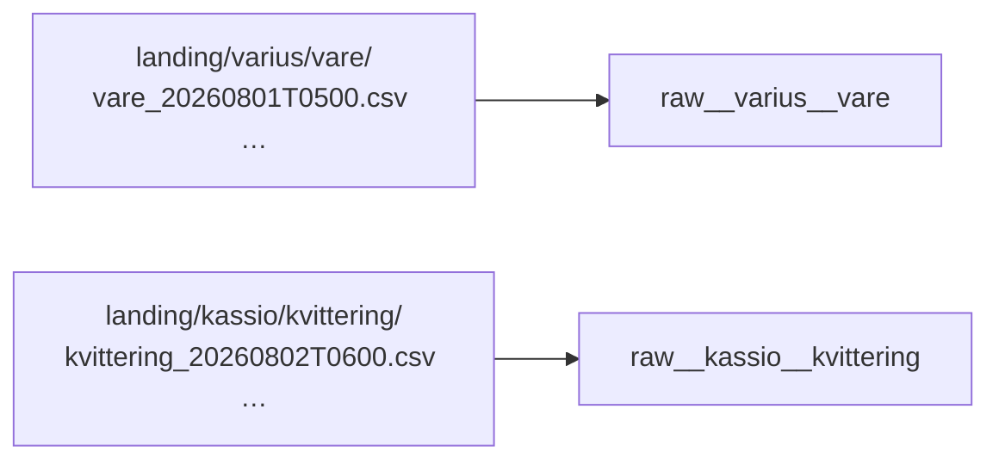
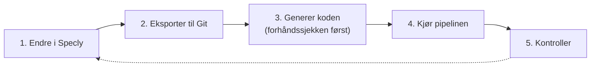

# Modul 2: Raw fra kilden

**Du lærer**
- å hente tabeller inn i Specly fra Databricks («Importer fra Databricks»)
- å gi mange tabeller samme tabelltype og kildesystem på én gang, etter navnemønster
- hva koden trenger å vite om en kilde (format, skilletegn, desimaltegn, datoformat), og hvor det står
- rundturen: fra en endring i Specly til en tabell i Databricks
- å lese kontrakten (YAML) og finne linjen den gir i koden

**Tid:** ca. 35 minutter. **For hvem:** alle.
**Start her:** fortsetter du rett fra modul 0, er du klar. Vil du starte på nytt: sett startpunktet `M2`
(`./kurs til M2`, eller `notebooks/kurs_til` med «Til» = `start/M2`). Stegene står i
[Slik setter du et startpunkt](start.md).
**Forutsetninger:** repo, Specly-prosjekt og Databricks er klare. Lært i [modul 0](M0.md). I steg 1 trenger du et
personlig tilgangstoken i Databricks, i begge spor. Steget viser hvordan du lager det, og en omvei hvis du ikke kan.

---

## Hvor du er

Toppfart Sport AS har to kilder du starter med: varesystemet **Varius** (varer, varegrupper, aktører) og
kassesystemet **Kassio** i butikkene (kvitteringer og kvitteringslinjer). Tabellnavnet bruker navnet på systemet (`varius`),
ikke typen system (varesystem): en kjede kan ha to varesystemer, men bare ett heter Varius. Filene ligger allerede i
volumet `landing` i Databricks-arbeidsflaten din. I denne modulen lager du raw-laget: én tabell per kildetabell, med filene slik de
kom.



**Raw** betyr «filene slik de kom». Alle leveransene ligger oppå hverandre. Raw endrer ingenting i verdiene. Den
legger bare til fire systemkolonner som sier når, fra hvilken fil og fra hvilket kildesystem raden kom.

---

## Steg 1: Importer kildetabellene fra Databricks

**Hva og hvorfor:** Du skal ikke skrive inn kolonnene selv. Kurset har laget kildetabeller i Databricks med samme
kolonner som filene. Specly kan lese dem og lage tabellene for deg. Slik starter mange ekte prosjekter også: kilden
finnes, og modellen begynner med det som er der.

**Gjør:**
1. Lag et personlig tilgangstoken i Databricks, hvis du ikke har et: «Settings» → «Developer» → raden «Access
   tokens» → «Manage», og lag et nytt token. Kopier det når det vises. Det brukes bare i nettleseren din.
2. I Specly: «Import og eksport» i sidepanelet → «Importer fra Databricks». Dialogen heter «Importer fra Databricks
   Unity Catalog». Lim inn adressen til arbeidsflaten i «Arbeidsområde-URL» (uten skråstrek til slutt) og tokenet i
   «Personal Access Token», og trykk «Koble til Databricks».
3. Velg katalogen `workspace` og skjemaet `toppfart_kilde_varius`. Velg de tre tabellene (`vare`, `varegruppe`,
   `aktor`) og importer.
4. Gjør det samme for `toppfart_kilde_kassio` (`kvittering`, `kvitteringslinje`).

> **Tokenet** lagres bare i nettleserøkten, ikke i prosjektet. Lim det aldri inn i en chat, et dokument eller en fil.

<details><summary>Les mer: klikksti</summary>

- «Importer fra Databricks» står under «Importer» i sidepanelet «Import og eksport» (ikonet med en pil inn i en
  mappe).
- Specly sin hjelpetekst i dialogen sier «Generer en token under Brukerinnstillinger → Utvikler → Tilgangstokener».
  Det er de norske navnene på Settings → Developer → Access tokens.
- Etter tilkoblingen velger du katalog («Velg katalog») og skjema («Velg skjema»), haker av tabellene og trykker
  «Importer N tabeller». Specly viser en «Forhåndsvisning av import» før noe lagres.
- Kildetabellene er views over filene i `landing`. Specly leser bare navn, kolonner og typer, aldri dataene.

> **Pass på:** Spør importen om den skal endre tabellnavngivingen i prosjektet, lar du haken stå av. Tabellene skal
> hete `kvittering`, ikke `workspace.toppfart_kilde_kassio.kvittering`. Har de fått det lange navnet likevel, si fra
> til kursholderen.
</details>

<details><summary>Les mer: omvei uten token («Importer fra CSV»)</summary>

Får du ikke lage et token i arbeidsflaten din, kan du hente de samme tabellene fra en fil. Repoet ditt har filen
`kilder/kildetabeller_m2.csv`, med de fem tabellene og de 28 kolonnene. Last den ned fra GitHub (eller bruk den lokale
kopien). I Specly: «Import og eksport» → «Importer fra CSV», velg filen og importer. Specly svarer «IMPORT VELLYKKET!
Importerte 5 tabeller med 28 kolonner».

Resultatet er det samme som med «Importer fra Databricks». Tabellene står med «Ingen status». Det har ingenting å si
for resten av kurset.
</details>

**Riktig når:** du har fem nye tabeller i Specly (`vare`, `varegruppe`, `aktor`, `kvittering`, `kvitteringslinje`),
med kolonnene fra filene (for eksempel `VARENR`, `VARETEKST`,
`VGRP` … i vare, og `storeId`, `receiptNo`, `soldAt` … i kvittering). Alle kolonnene er tekst (`string`).

---

## Steg 2: Navn og tabelltype

**Hva og hvorfor:** Navnet på en tabell sier lag, kilde og objekt: `raw__varius__vare`, `raw__kassio__kvittering`.
To understreker skiller delene. Mønsteret gjør to ting:
- Specly kan gi alle tabeller som starter med `raw__`, tabelltypen raw på én gang.
- Koden finner filene i `landing` ut fra kildesystemet og objektet i navnet.

Tabelltypen raw gir tabellen fire standardkolonner: `sys__lastet_tidspunkt`, `sys__kildefil`,
`sys__ukjente_kolonner` og `sys__kildesystem`. Du lager dem ikke selv.

**Gjør:**
1. Gi hver tabell raw-navnet sitt: `raw__varius__vare`, `raw__varius__varegruppe`,
   `raw__varius__aktor`, `raw__kassio__kvittering`, `raw__kassio__kvitteringslinje`. Klikk i navnet på tabellsiden, skriv
   og trykk Enter.
2. Gi alle fem tabelltypen raw på én gang: «Import og eksport» → «Massekjøring» (brett ut) → kortet «Tabelltype
   auto-tag» → «Kjør». Specly spør «Kjøre på alle tabeller?». Trykk «Kjør».
3. Åpne én av tabellene. Står det «Mangler 4 standardkolonner fra tabelltypen «raw»», trykk «Opprett manglende». Gjør
   det på alle fem.
4. Merk alle fem som **unntatt fra sortering**: på tabellsiden, menyen «⋯» øverst til høyre → velg «Unntatt fra
   sortering». Teksten «Unntatt fra sortering» står da under navnet på tabellen.

<details><summary>Les mer: klikksti</summary>

Kortet «Tabelltype auto-tag» sier «Tildel tabelltype til utaggede tabeller basert på navnemønster» og «5 utaggede
tabeller er kandidater». Etter «Kjør» kommer meldingen «Kjøring fullført» med «Tilordnet 5». Tabelltypen står
etterpå under navnet på tabellen, der det sto «Ingen type».

Varselet om standardkolonnene kommer fordi tabellene ble laget uten dem. «Opprett manglende» svarer med «4
manglende kolonner opprettet».

Alternativet er å velge tabelltype i velgeren under navnet på hver tabell («Ingen type»). Da lager Specly
standardkolonnene med en gang og sier «4 standardkolonner opprettet». Det er fem klikk i stedet for ett, men virker
like godt.
</details>

### Regler i prosjektet

**Hva og hvorfor:** Prosjektet har regler som gjør modellen lik overalt, uten at du må huske alt selv. De står i
Admin (og i `specly/Config` i Git):

| Regel | Hva den gjør i kurset |
|---|---|
| Kolonnesortering | `pk__` først, så `bk__`, så `fb__`/`fk__`, så kolonnene med BK-flagg, så resten alfabetisk, og `sys__` til slutt |
| Relasjonsregler | `fb__slv__<tabell>` kobles til `bk__slv__<tabell>`, og `fk__gld__d__<tabell>` til `pk__gld__d__<tabell>` |
| Flaggregler | kolonner som starter med `pk__` får PK, og `fb__` og `fk__` får FK |

Reglene kjører ikke av seg selv når du endrer en tabell. Du kjører dem selv. Du kan kjøre dem på én tabell (menyen
«Bruk regler» over kolonnene på tabellsiden: «Bruk flaggregler», «Finn relasjoner», «Finn forretningsbegrep», «Kjør alle» og «Sorter kolonner»), på
tabellene i et diagram (☰ → «Ordne» → «Bruk regler»), eller på alle tabeller under «Import og eksport» →
«Massekjøring». Sortering spør alltid først («Sortere kolonnene?», «Dette kan ikke angres med Ctrl+Z.»). På siden
«Relasjonsregler» i Admin står det at relasjonsreglene også kjøres ved import fra Databricks.

**Raw er unntatt fra sortering med vilje.** En raw-tabell skal se ut som filen: samme kolonner, i samme rekkefølge.
Da kjenner du igjen filen når du ser på tabellen, og koden leser CSV-filene i den rekkefølgen kolonnene står. Sorteres
raw alfabetisk, havner `VARETEKST` der `VARENR` skulle vært. Det er nettopp derfor Specly har «Unntatt fra sortering»:
de fleste tabeller blir bedre av en fast rekkefølge, men noen skal speile noe utenfor modellen. Specly hopper over
disse tabellene i massekjøringen. Sorterer du én av dem for hånd, står det i tillegg «Tabellen er markert som at den
ikke skal sorteres.» i dialogen. Trykk «Avbryt». Du ser markeringen rett under tabellnavnet: «raw · ⇅ Unntatt fra
sortering».

Henter du inn endringer fra Git (for eksempel etter et startpunkt), sjekker Specly reglene mot det som kom inn. Det
står i [Slik setter du et startpunkt](start.md#regeldialogen).

**Riktig når:** fem tabeller med navn som starter med `raw__`, tabelltype raw, «Unntatt fra sortering», og de fire
`sys__`-kolonnene nederst i hver av dem.

---

## Steg 3: Første rundtur, og en feil med vilje

Fra nå går hver endring den samme veien. Den kalles **rundturen**. Her går du den grundig én gang. Senere moduler
viser den bare som en kort sjekkliste.



Modellen din er ikke ferdig ennå. Tabellene vet ikke hvilket kildesystem de kommer fra. Du går rundturen likevel,
for å se hva som skjer når noe mangler.

### 3a. Eksporter til Git

**Hva og hvorfor:** Koden lages fra det som står i Git. Det som bare ligger i Specly, blir ikke til tabeller. Eksporten
skriver én fil per tabell, en **datakontrakt** i det åpne formatet ODCS (Open Data Contract Standard).

**Gjør:**
1. I Specly: «Import og eksport» → «Eksporter til Git». Git-siden åpner på «Mine endringer». Under «Tabeller» står de
   fem tabellene dine.
2. Står det noe under «Genererte filer» (for eksempel `specly/.specly/schemas/…`, `specly/AGENTS.md` og
   `specly/README.md`), tar du haken av alt der. Det er filer Specly lager selv. De hører ikke til endringen din.
   Hakene kommer tilbake ved neste eksport. Finnes ikke overskriften, er de genererte filene allerede like i Git.
3. Står det et banner om at «Git har filene i et eldre format», og en bryter «Skriv nytt filformat»: la bryteren stå
   av.
4. Skriv en melding i «Commit-melding (påkrevd)», for eksempel `Raw for Varius og Kassio`, og trykk «Commit og push
   5 endringer til Git».

<details><summary>Les mer: de genererte filene, og når de skal med til Git</summary>

| Fil | Hva den er |
|---|---|
| `specly/AGENTS.md`, `specly/README.md` | Specly sin beskrivelse av filformatet, for mennesker og for KI-verktøy som Claude |
| `specly/.specly/specly.py` | sjekken av repoet (`python specly/.specly/specly.py check`), brukt når modellen endres i Git |
| `specly/.specly/schemas/…` | JSON-skjemaene sjekken bruker |

De endrer seg når Specly blir oppdatert, eller når prosjektoppsettet endres. Under arbeidet tar du haken av dem, så
hver commit bare viser endringen i modellen. Men de hører til prosjektet. **Ta dem med i den siste eksporten før du
avslutter arbeidet**, og alltid før branchen slås sammen med en annen (for eksempel `main`). Da er Git og Specly like,
neste person får sjekken som passer til Specly-versjonen, og «Mine endringer» starter på 0 neste gang.
</details>

> **Pass på:** Tallene under «Mine endringer» (på fanen, i listen og på knappen) stemmer ikke alltid med hverandre.
> Stol på listen.

**Riktig når:** Specly sier «Eksport fullført» («5 filer skrevet · branch main»), og «Mine endringer» viser 0.

### 3b. Generer koden

**Hva og hvorfor:** Genereringen leser kontraktene og lager én kodefil per tabell. Først kjører
**forhåndssjekken**. Mangler modellen noe koden trenger, stopper den med en norsk melding. Da lages ingenting, og
ingenting sendes til Databricks. Det er billig å finne feil her.

**Gjør (terminalsporet):**
```bash
git pull          # hent det Specly nettopp skrev
./generer         # forhåndssjekk, så kode fra kontraktene
```

**Gjør (nettlesersporet):** I Git-mappen i Databricks: hent siste versjon fra GitHub («Pull», se modul 0, steg 6).
Åpne notebooken `notebooks/kurs_generer_kjor`, se at det står «Serverless» øverst til høyre, og trykk «Run all». Første
gang har notebooken ingen felt, og bruker skjemaet `toppfart`. (Bruker du et annet skjema: kjør cellen «Feltene»
først og sett «Skjema», som i modul 0, steg 6.) Stopper den med «Modellen har ingen tabeller ennå», har «Pull» ikke
hentet eksporten din: se at steg 3a gikk gjennom, gjør «Pull», og kjør på nytt. Den kjører forhåndssjekken først, og stopper der hvis noe mangler.

**Hva tror du?** Hva sier forhåndssjekken?

<details><summary>Svar</summary>

Den stopper, med én linje per tabell:

```
STOPP: kontraktene mangler noe koden trenger (5 ting). Ingenting er generert eller sendt til Databricks.
  - raw__kassio__kvittering: Tabellen har ikke kildesystem, så koden vet ikke filformat og tekstformat. I Specly: gi tabellen et kildesystem under «Kildesystemer» (modul 2, steg 4).
  …
```

I notebooken står den samme teksten, og cellen blir rød med `AssertionError`. Det er riktig.

Koden kan ikke lese en fil før den vet hvordan filen ser ut. Er det CSV eller JSON? Hvilket tegn skiller feltene? Det
står på kildesystemet, ikke på tabellen. Neste steg fikser det.
</details>

**Riktig når:** du har sett meldingen, og forstår hva den ber deg gjøre.

---

## Steg 4: Kildesystemet og kildearket

**Hva og hvorfor:** Når en ny kilde skal inn, får en dataingeniør ofte et **kildeark**: hvem som eier systemet, når
dataene er klare, formatet, og kjente svakheter. Kurset har et kildeark per kilde i mappen `kilder/`.

Koden trenger bare formatet. Det legger du på **kildesystemet** i Specly, én gang. Alle tabellene fra kilden bruker
det. Resten av kildearket er god dokumentasjon, men ikke noe koden leser.

**Gjør:**
1. Åpne kildearkene `kilder/varius.md` og `kilder/kassio.md`. Finn format-delen.
2. I Specly: åpne «Kildesystemer». Prosjektet har kildesystemene `varius` og `kassio`. Fyll ut feltene koden
   trenger, fra kildearket. Står det verdier der allerede, kontroller dem mot kildearket. Filformat og Uttrekk er
   nedtrekkslister, resten skriver du. **Din tur:** finn verdiene selv. («Din tur» betyr at du finner svaret selv.
   Det står i løsningen.)

   | Felt | varius | kassio |
   |---|---|---|
   | Filformat | ? | ? |
   | Skilletegn | ? | ? |
   | Desimaltegn | ? | ? |
   | Datoformat | ? | (ingen datoer) |
   | Tidsformat | (ingen tidspunkt) | ? |
   | Tidssone | | ? |
   | Uttrekk | ? | ? |

3. Koble tabellene til kildesystemet med navnemønster: skriv et regex-mønster i «Regex-mønster» på hvert kildesystem
   (`__varius__` for varius, `__kassio__` for kassio). Mønsteret lagres når du går ut av feltet. Når begge har
   mønster, trykk «Auto-tagg tabeller» ved siden av feltet, og bekreft med «Auto-tagg tabeller».

<details><summary>Les mer: hvorfor står formatet på kildesystemet, ikke på tabellen?</summary>

Varesystemet skriver `1299,00` med desimalkomma og datoer som `05.09.2026`. Det gjelder alle tabellene fra
varesystemet. Står det ett sted, kan det ikke bli ulikt i to tabeller. Bronze bruker det samme feltet i modul 3, når
`UTPRIS` blir et tall.

Datoformatet skrives som et Spark-mønster: `dd.MM.yyyy` betyr dag, måned og år med punktum.
</details>

<details><summary>Les mer: klikksti</summary>

«Kildesystemer» i sidepanelet (databaseikonet), og velg kildesystemet i listen. Detaljsiden har navn, farge,
beskrivelse, «Regex-mønster» med knappen «Auto-tagg tabeller», og feltene Filformat, Skilletegn, Desimaltegn,
Datoformat, Tidsformat, Tidssone og Uttrekk. Hvert felt har en hjelpetekst (ⓘ).

«Auto-tagg tabeller» spør «Auto-tagge tabeller?» og sier at det «gjelder alle kildesystemer i prosjektet». Derfor
setter du mønster på begge før du kjører. Svaret er «Tilordnet 5».

Samme jobb finnes også under «Import og eksport» → «Massekjøring» → «Kildesystem auto-tag». På siden til et
kildesystem kan du dessuten legge til én og én tabell, med «Legg til +» ved tabellen i panelet til venstre.

Tabellsiden viser ikke kildesystemet. Du ser det i listen «Kildesystemer», i kolonnen «Tabeller».

> **Pass på:** Panelet til venstre på kildesystem-siden oppdateres ikke alltid etter «Auto-tagg tabeller». Tabellene
> kan stå med «Legg til +» selv om de er lagt til. Last siden på nytt.
</details>

**Riktig når:** listen «Kildesystemer» viser 3 tabeller på `varius` og 2 på `kassio`, og begge kildesystemene har
formatfeltene utfylt.

---

## Steg 5: Rundturen igjen, helt til Databricks

**1. Endre i Specly.** Gjort i steg 4.

**2. Eksporter til Git**, som i steg 3a. Denne gangen er det 7 endringer: de fem tabellene, og kildesystemene
`kassio` og `varius` under «Admindata». Knappen heter «Commit og push 7 endringer til Git».

**3. Generer**, som i steg 3b. Nå skal forhåndssjekken si `Forhåndssjekk (kode): ingen mangler.` og
`5 tabeller generert`. Linjen `Forhåndssjekk (styring): ikke slått på` er også riktig. Den sjekken kommer i modul 8.

**Se virkningen.** Åpne kontrakten `specly/Tables/raw/raw__varius__vare.odcs.yaml` (lokalt eller på GitHub). Finn
disse linjene nederst:

```yaml
    customProperties:
      - property: tableType
        value: raw
      - property: sourceSystem
        value: varius
```

Åpne så den genererte koden `databricks/pyspark/tabeller/raw__varius__vare.py`. **Din tur:** finn linjen som kom av hvert
valg.

| Valget ditt i Specly | Finn i koden |
|---|---|
| Tabelltypen raw | hvilken mal filen er laget med (øverst i filen) |
| Navnet `raw__varius__vare` og kildesystemet `varius` | stien til filene i `landing` |
| Filformat og skilletegn på kildesystemet | hvordan filene leses |
| Kolonnene fra importen | listen `KOLONNER` |

<details><summary>Les mer: hva er Data Contract CLI og malene?</summary>

`./generer` gjør tre ting. Først samler den det som går på tvers av kontraktene (kildesystemenes format, oppstrøm,
relasjoner). Så kjører forhåndssjekken. Til slutt lager Data Contract CLI (`datacontract export`, et åpent verktøy)
én fil per kontrakt med en Jinja-mal per tabelltype (`maler/pyspark/raw.py.j2`).

Koden kaller en liten felles plattformpakke (`databricks/pyspark/plattform/`). Den gjør det som alltid er likt.
Malen fyller bare inn det som er spesielt for tabellen. Du endrer aldri den genererte koden for hånd. Neste
generering overskriver den.
</details>

**4. Kjør pipelinen.**

**Gjør (terminalsporet):**
```bash
./kjor          # genererer på nytt, ruller ut til Databricks og kjører pipelinen
```

**Gjør (nettlesersporet):** «Pull» i Git-mappen, og kjør `notebooks/kurs_generer_kjor` på nytt. Nå går den videre:
den lager koden, ruller ut pipelinen og kjører den. Notebooken venter og viser resultatet.

<details><summary>Les mer: den genererte koden og Git</summary>

Etter genereringen har repoet endrede filer under `databricks/pyspark/`: fem nye filer i `tabeller/`,
`tabeller/.gitkeep` er slettet, og `plattform/tags_data.py` er endret. Det er den genererte koden. Den lages på nytt
fra kontraktene hver gang, så du mister ingenting om du lar den ligge. Vil du at Git skal vise koden som kjører,
committer og pusher du den: `git add databricks && git commit -m "Generert kode" && git push` i terminalsporet,
«Commit & Push» i Git-mappen i nettlesersporet.
</details>

<details><summary>Les mer: hva er en pipeline i Databricks?</summary>

En pipeline (deklarativ pipeline i Lakeflow, tidligere kalt DLT) er en samling tabelldefinisjoner som Databricks bygger i riktig
rekkefølge. Hver genererte fil er én tabell. Pipelinen heter `Specly-kurs toppfart` (i nettlesersporet
`Specly-kurs toppfart (notebook)`) og finnes under Jobs & Pipelines. Der ser du grafen over tabellene og loggen fra
hver kjøring.
</details>

**Hva tror du?** Varesystemet har levert tre filer med 150 varer i hver. Hvor mange rader får `raw__varius__vare`?

<details><summary>Svar</summary>

450. Raw stabler alle leveransene. Den samme varen står én gang per uttrekk. Det er bronze som ser at to rader er den
samme varen (modul 3).
</details>

**Riktig når:** kjøringen ender med at pipelinen er ferdig (`COMPLETED`), og du ser fem nye tabeller i skjemaet
`toppfart`.

---

## Steg 6: Kontroller

**Hva og hvorfor:** Grønn kjøring betyr at koden virket. Om dataene ble som du ventet, ser du bare ved å se på dem.

**Gjør:** Åpne SQL-editoren i Databricks. Lag en ny spørring (+). Editoren åpner ellers den spørringen du brukte
sist, med katalogen og skjemaet den hadde. Velg katalog `workspace` og skjema `toppfart`. Kjør:

```sql
SELECT sys__kildefil, count(*) AS rader
FROM raw__varius__vare
GROUP BY sys__kildefil
ORDER BY sys__kildefil
```

```sql
SELECT count(*) AS rader, count(DISTINCT sys__kildefil) AS filer
FROM raw__kassio__kvittering
```

**Riktig når:**

| Spørring | Forventet |
|---|---|
| Rader per fil i `raw__varius__vare` | 3 filer, 150 rader i hver |
| `raw__kassio__kvittering` | 19 845 rader fra 79 filer. 92 filer kom, men 13 er tomme og gir ingen rader |
| `raw__kassio__kvitteringslinje` | 38 613 rader fra 79 filer (13 tomme) |
| `raw__varius__aktor` | 50 rader (16, 17 og 17) |
| `raw__varius__varegruppe` | 36 rader (12 i hver fil) |

**Tenk over:** Noen kassefiler har 0 rader. Hvorfor? Og hvorfor er det ingen fil fra 13. september kl. 06?
(Svarene på «Tenk over» står i løsningen, i denne og de neste modulene.)

Sammenlign med fasit: `./kurs sjekk M2` (eller notebooken `notebooks/kurs_sjekk` med «Modul» = `M2`). Du er i mål når
den skriver «Kontraktene stemmer med fasit.» og «Fasittest (modul 2-2): 16 riktige, 0 feil.»

I notebooken: første «Run all» sjekker ingenting. Den lager feltet «Modul» og stopper med meldingen «Ingenting er
sjekket. Velg modulen din …». Feltet ligger nå i sidepanelet «Parameters» (knappen «Show parameters»). Velg `M2`, vent
til knappen «Run all» er tilbake, og trykk «Run all» igjen. Slik er det også etter hver «Pull» i de neste modulene.
Melder sjekken at tabeller som `brz__varius__vare` mangler, står «Modul» på en senere modul enn du er kommet til.

---

## Ferdig når

- [ ] Fem raw-tabeller i Specly, med tabelltype raw, kildesystem, «Unntatt fra sortering» og de fire `sys__`-kolonnene
- [ ] Kildesystemene `varius` og `kassio` har formatet fra kildearket
- [ ] Du har sett forhåndssjekken stoppe, og vet hva meldingen betydde
- [ ] Du kan peke på linjen i `raw__varius__vare.py` som kom av kildesystemet
- [ ] Radene i Databricks stemmer med tabellen i steg 6

## Rundturen som sjekkliste

Denne bruker du i resten av kurset:

1. Endre i Specly.
2. «Import og eksport» → «Eksporter til Git». Ta haken av det som står under «Genererte filer». Commit og push.
3. `git pull && ./generer` (nettlesersporet: «Pull» i Git-mappen). Stopper den, rett i Specly og start på 2.
4. `./kjor` (nettlesersporet: `notebooks/kurs_generer_kjor`, som gjør 3 og 4 i ett).
5. Kontroller i SQL-editoren, og til slutt `./kurs sjekk M<n>` (eller `notebooks/kurs_sjekk`).
6. Når du er ferdig for dagen: eksporter én gang med haken på «Genererte filer» (se «Les mer» i steg 3a).

Løsning: [M2_losning.md](M2_losning.md). Neste: [Modul 3: Bronze](M3.md).
