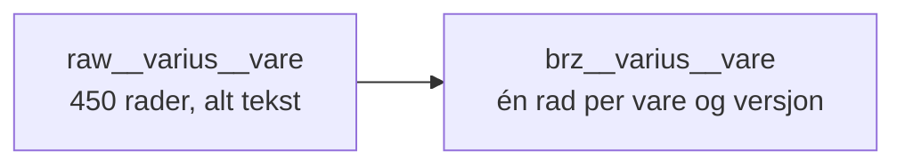

# Modul 3: Bronze

**Du lærer**
- å lage en tabell med kolonner fra en **oppstrømstabell**, mange kolonner på én gang
- **BK-flagget**: hvilke kolonner som gjør en rad unik, og hvordan koden regner nøklene `bk__` og `pk__` av dem
- **rensing** og **datatype**, og hvor i den genererte koden de blir til kode
- **nedstrømsnavn**: navnet kolonnen skal ha i sølv, bestemt ett sted
- hvorfor bronze tar vare på alle versjoner av en rad (historikk)

**Tid:** ca. 45 minutter. **For hvem:** de som skal modellere.
**Start her:** fortsetter du fra forrige modul, er du klar. Ellers: sett startpunktet `M3`
(`./kurs til M3`, eller `notebooks/kurs_til` med «Til» = `start/M3`). Stegene står i
[Slik setter du et startpunkt](start.md).
**Forutsetninger:**
- raw-tabellene og kildesystemene, og rundturen. Lært i [modul 2](M2.md).

---

## Hvor du er

Raw har filene slik de kom: tekst, ledende nuller, desimalkomma, og alle leveransene oppå hverandre. Bronze rydder
opp, men forandrer ikke hva tabellen er.



**Bronze har én tabell per raw-tabell, med de samme kolonnene.** Kolonnene beholder kildens navn (`VARENR`, ikke
`varenummer`). Bronze gjør fire ting:

| Jobb | Eksempel |
|---|---|
| Renser | `' 004711 '` → `4711` |
| Gir riktig type | `'1299,00'` (tekst) → `1299.00` (tall) |
| Regner nøkkel | `bk__` og `pk__` fra BK-kolonnene |
| Tar vare på historikken | ny versjon når en verdi endrer seg mellom to leveranser |

Bronze slår ikke sammen tabeller og døper ikke om kolonner. Den felles modellen for bedriften lages først i sølv
(modul 4).

---

## Steg 1: Lag `brz__varius__vare` med alle kolonnene fra raw

**Hva og hvorfor:** Du lager den første bronze-tabellen grundig. Kolonnene skal ha samme navn som i raw, og hver av
dem skal vite hvilken raw-kolonne den kommer fra. Det heter **oppstrøm**. Med oppstrøm vet koden hvor verdien
kommer fra, og du kan følge en kolonne fra fil til rapport.

Du skriver ikke kolonnene inn. Du henter alle sju fra `raw__varius__vare` i én dialog.

**Gjør:**
1. I Specly: «Tabeller» i sidepanelet. Trykk den blå knappen «+ Opprett ny tabell» øverst til høyre. Det kommer en
   tom rad i listen med feltet «Navn på ny tabell…». Skriv `brz__varius__vare` og trykk Ctrl+Enter («opprett og
   åpne»). Specly sier «Tabell opprettet» og åpner tabellen. Står navnet fortsatt i redigering, trykk Enter. Velg
   tabelltype `bronze` i velgeren under navnet («Ingen type»). Specly lager standardkolonnene og sier
   «5 standardkolonner opprettet».
2. Gi tabellen kildesystemet `varius`. Mønsteret `__varius__` fra modul 2 passer også på bronze-navnet, så det holder
   å åpne «Kildesystemer» → `varius` og trykke «Auto-tagg tabeller» på nytt.
3. Trykk «Legg til ny kolonne fra oppstrømstabell». Søk på `raw__varius__vare`: listen viser alle kolonnene i
   tabellen. Hak av de sju kildekolonnene (`VARENR`, `VARETEKST`, `VGRP`, `LEVNR`, `MERKE`, `UTPRIS`, `STATUS`). Ikke
   `sys__`-kolonnene: bronze har sine egne. La «Opprett 7 kolonner» stå valgt under «Opprettelsesmodus», og trykk
   knappen «Opprett 7 kolonner». Dialogen blir stående med «Opprettet nettopp: …». Lukk den med «Lukk».
4. Nye kolonner havner nederst, etter `sys__`-kolonnene. Sorter dem etter prosjektets regler: «Bruk regler» over
   kolonnene → «Sorter kolonner» (nederst i menyen). Specly spør «Sortere kolonnene?». Trykk «Sorter». Da står `pk__`
   og `bk__` øverst, kildekolonnene alfabetisk, og `sys__` nederst (se «Regler i prosjektet» i [modul 2](M2.md)).
   Sorteringen kan ikke angres. I bronze er det trygt å sortere: fasit er sortert på samme måte.

<details><summary>Les mer: to knapper heter «Opprett ny tabell»</summary>

Sidepanelet har også en knapp «Opprett ny tabell» (under «Grupper etter type»). Den lager tabellen med en gang, med
navnet «Ny tabell 1» merket: skriv navnet og trykk Enter. Den blå knappen er raskere når du skal lage flere tabeller
etter hverandre. Under feltet står tastene: «↵ opprett · Ctrl+↵ opprett og åpne · Esc ferdig».
</details>

<details><summary>Les mer: standardkolonnene i bronze</summary>

| Kolonne | Hva |
|---|---|
| `pk__brz__varius__vare` | Primærnøkkel: ett tall per versjon av raden |
| `bk__brz__varius__vare` | Forretningsnøkkelen som hash av BK-kolonnene. Lik for alle versjoner av samme vare |
| `sys__gyldig_fra`, `sys__gyldig_til` | Når versjonen gjaldt |
| `sys__kildesystem` | Kildesystemet raden kom fra |

Du endrer eller sletter dem aldri. Koden fyller dem.
</details>

<details><summary>Les mer: klikksti i dialogen</summary>

Dialogen heter «Opprett kolonne med oppstrøm». Søkefeltet har teksten «Søk i kolonner og nedstrømsnavn…», men søket
treffer også tabellnavnet. Når tabellen ikke har oppstrøm ennå, står det «Ingen oppstrømstabeller ennå». Etter første
valg står «Legger også til raw__varius__vare som oppstrømstabell». Valgene blir stående mens du søker på noe annet.

Til høyre står «Kolonner som opprettes». Merket «+ datatype» ved hver kolonne er ikke en knapp. Datatypen velger du i
tabellen etterpå (steg 2). Med to eller flere valgt kan du velge «Opprett 1 beregnet kolonne» i stedet for én kolonne
per kilde (brukes i modul 4).

Fanen «Oppstrømstabeller» i samme dialog lar deg legge til tabellen med navn først.
</details>

**Riktig når:** `brz__varius__vare` har tabelltype bronze, kildesystem varius, de fem standardkolonnene og sju
kolonner med samme navn som i raw. Alle sju har oppstrøm i `raw__varius__vare` og datatypen `string`.

---

## Steg 2: BK, rensing og datatype

**Hva og hvorfor:**
- **BK** (forretningsnøkkel) er kolonnen eller kolonnene som sammen gjør raden unik i kilden. For en vare er det
  varenummeret. Koden regner `bk__` som en hash av BK-kolonnene. BK-flagget står derfor på `VARENR`, aldri på `bk__`.
- **Rensing** gjør verdiene like før de sammenlignes. Varesystemet skriver `004711`. Kassen skriver `4711`. Uten rensing
  treffer de aldri hverandre.
- **Datatype** gjør tekst til det den er: et heltall, et beløp, en dato. Formatet (desimalkomma) står allerede på
  kildesystemet. Du skriver aldri typeomgjøringen (cast) selv.

**Gjør:**

| Kolonne | Flagg | Rensing | Datatype |
|---|---|---|---|
| `VARENR` | BK | `trim`, `fjern_ledende_nuller` | string |
| `VARETEKST` | | `trim` | string |
| `VGRP` | | `trim`, `store_bokstaver` | string |
| `LEVNR` | | | int |
| `MERKE` | | `trim`, `tom_til_null` | string |
| `UTPRIS` | | | decimal(10,2) |
| `STATUS` | | `trim` | string |

- Flagget: trykk «+ Legg til flagg» i cellen «Flagg» på raden `VARENR`, hak av BK og trykk «Ferdig». Raskere: skriv
  `BK` i søket i listen, trykk Enter og Escape. Kolonnen får et lite merkelapp-ikon. (Nøkkel-ikonet på `pk__` er PK.)
- Rensing er cellen «+ Rensing» på raden (rull tabellen mot høyre). Du kan velge flere. Søkefeltet tømmes ikke etter
  et valg, så slett teksten før du søker på den neste. Valgte rensinger flytter seg øverst i listen, så se etter før
  du klikker igjen.
- Datatypen velger du i cellen «Datatype». Skriv `int` eller `decimal` i søket og trykk Enter.
- Åpner ikke listen seg når du klikker i en celle rett etter at du lukket den forrige, vent et sekund og klikk igjen.
- Til slutt: «Bruk regler» → «Sorter kolonner» en gang til. Kolonnen med BK-flagg flyttes da opp, rett under `bk__`.

<details><summary>Les mer: hvorfor er `VARENR` tekst og ikke et tall?</summary>

Nøkler som skal treffe hverandre, må ha samme type og format, fordi hashen bruker verdiene som tekst. `VARENR`
(renset), `sku` i kassen og varenummeret i de andre kildene er alle tekst uten ledende nuller. Hadde én av dem vært et
tall, ville `4711` og `'4711'` gitt to ulike hasher.
</details>

<details><summary>Les mer: rensingene</summary>

| Rensing | Gjør |
|---|---|
| `trim` | fjerner mellomrom foran og bak |
| `tom_til_null` | `''`, `N/A`, `NA` og `-` blir tomt (NULL) |
| `fjern_ledende_nuller` | `004711` → `4711` |
| `store_bokstaver` | `fri02` → `FRI02` |
| `ja_nei_til_boolsk` | `J` → sann, `N` → usann |

De kjøres alltid i denne rekkefølgen, uansett hvilken rekkefølge du velger dem i. Så settes typen.
</details>

**Riktig når:** `VARENR` har BK-ikonet og står rett under `bk__brz__varius__vare`, de fem tekstkolonnene har
rensing, `LEVNR` er `int` og `UTPRIS` er `decimal(10,2)`.

---

## Steg 3: Nedstrømsnavn

**Hva og hvorfor:** Sølv bruker forretningens navn på norsk: `varenummer`, ikke `VARENR`. Navnet bestemmes **ett
sted**: som nedstrømsnavn på bronze-kolonnen. Kolonnen heter fortsatt `VARENR` i bronze. Nedstrømsnavnet er bare
beskjeden til neste lag. Når du henter kolonnen inn i sølv (modul 4), får den navnet av seg selv.

**Gjør:** Klikk i cellen «Nedstrømsnavn» på hver rad, skriv navnet og trykk Tab. Cellen viser kolonnens eget navn i
grått så lenge den er tom. Bruk Tab, ikke Enter: Enter lagrer ikke alltid. Klikker du rett på neste rad før feltet er
lukket, må du klikke en gang til.

| Kolonne | Nedstrømsnavn |
|---|---|
| `VARENR` | `varenummer` |
| `VARETEKST` | `produktnavn` |
| `VGRP` | `produktgruppekode` |
| `LEVNR` | `leverandornummer` |
| `MERKE` | `merke` |
| `UTPRIS` | `utpris_belop` |
| `STATUS` | `statuskode` |

<details><summary>Les mer: navnereglene</summary>

Fra «Standarder for dataplattformen» på [specly.no/laer](https://specly.no/laer/standarder-for-dataplattformen):
- små bokstaver og understrek, ingen æ, ø, å
- ingen forkortelser fra sølv og opp (`varenummer`, ikke `varenr`)
- kode og navn skilles (`produktgruppekode`, `produktgruppenavn`)
- beløp slutter på `_belop`

Forhåndssjekken håndhever de reglene som kan sjekkes maskinelt, fra sølv og opp.
</details>

**Hva tror du?** Hva skjer hvis du heller døper `VARENR` om til `varenummer` her i bronze?

<details><summary>Svar</summary>

Forhåndssjekken stopper:

```
brz__varius__vare: Kolonnen varenummer heter ikke det samme som raw-kolonnen VARENR. Bronze beholder kildens navn; det nye navnet er nedstrømsnavnet. I Specly: gi kolonnen navnet VARENR, og skriv varenummer som nedstrømsnavn.
```

Bronze beholder kildens navn. Da kan du alltid finne igjen kolonnen i kildearket og i filen.
</details>

**Riktig når:** alle sju kolonnene har nedstrømsnavn.

---

## Steg 4: Eksporter, generer og se koden

Lært i [modul 2](M2.md): eksporter, generer, kjør, kontroller. Her gjør du de to første. Pipelinen kjører du i steg 6
(i nettlesersporet kjører notebooken den allerede nå).

1. Eksporter til Git. Står det noe under «Genererte filer», tar du haken av, som i modul 2.
2. `git pull && ./generer` (nettlesersporet: «Pull» i Git-mappen, så `notebooks/kurs_generer_kjor`, som også kjører
   pipelinen). Forventet: `ingen mangler` og 6 tabeller.

**Se virkningen.** Åpne `specly/Tables/bronze/brz__varius__vare.odcs.yaml` og finn `VARENR`:

```yaml
      - name: VARENR
        physicalType: string
        logicalType: string
        businessName: varenummer
        transformSourceObjects:
          - raw__varius__vare.VARENR
        customProperties:
          - property: businessKey
            value: true
          - property: rensing
            value:
              - trim
              - fjern_ledende_nuller
```

Nedstrømsnavnet står i `businessName`, oppstrømmen i `transformSourceObjects`, BK og rensing i `customProperties`.

Åpne `databricks/pyspark/tabeller/brz__varius__vare.py`. **Din tur:** finn linjen som kom av hvert valg.

| Valget ditt i Specly | Finn i koden |
|---|---|
| Datoformat og desimaltegn på kildesystemet | `KILDEFORMAT = …` |
| Datatypen `decimal(10,2)` på `UTPRIS` | kallet som gjør tekst til tall |
| Rensingen på `VARENR` | linjen med `fjern_ledende_nuller` |
| Oppstrømmen | hvilken tabell som leses |
| BK på `VARENR` | hvilken kolonne historikken regnes per |
| Uttrekk `Fullt` på kildesystemet | hvordan historikken vet at en rad som mangler, er borte |

Nedstrømsnavnet står ikke i bronze-koden. **Tenk over:** hvorfor ikke?

<details><summary>Les mer: hvor gjøres casten?</summary>

`Rens("UTPRIS", til_type="decimal(10,2)")` sier bare hva som skal skje. Selve jobben gjør én felles funksjon,
`cast_til` i `databricks/pyspark/plattform/bronze.py`. Den bytter desimalkomma med punktum og gjør teksten om til et
tall. En verdi som ikke lar seg gjøre om, blir tom (NULL). Den stopper ikke hele kjøringen.

Alle bronze-tabeller bruker den samme funksjonen. Vil plattformen gjøre det annerledes, endres det ett sted.
</details>

**Riktig når:** du kan peke på linjen for hvert valg i tabellen.

---

## Steg 5: De fire andre bronze-tabellene

**Hva og hvorfor:** Nå vet du hvordan. De to kassetabellene lager du selv: én tabell, alle kolonnene fra raw i
én dialog, så flagg, rensing, type og nedstrømsnavn. Det er tolv kolonner, så regn med 10–15 minutter. Modul 4 bygger
videre på dem. De to andre varius-tabellene lages på samme måte. Kurset legger dem inn for deg. Hva `fyll` gjør, og hvorfor
det bare går an i et kurs: [Om `fyll`](start.md#om-fyll).

**Gjør:**
1. Lag `brz__kassio__kvittering` og `brz__kassio__kvitteringslinje` etter de to tabellene merket «lag selv» under.
   Søket på `raw__kassio__kvittering` viser begge kassetabellene, og `storeId` og `receiptNo` står i begge. Hak av
   under riktig overskrift (`RAW__KASSIO__KVITTERING` eller `RAW__KASSIO__KVITTERINGSLINJE`). Mønsteret `__kassio__`
   på kildesystemet `kassio` passer på begge. Kjør «Auto-tagg tabeller» når begge finnes. Når flaggene er satt:
   «Bruk regler» → «Sorter kolonner» på hver av dem.
2. Eksporter til Git. Legg så inn de to varius-tabellene:

   **Gjør (terminalsporet):**
   ```bash
   git pull
   ./kurs fyll M3     # legger inn brz__varius__varegruppe og brz__varius__aktor fra fasit
   git add specly && git commit -m "fyll M3" && git push
   ```

   `./kurs fyll` skriver «specly.py check: 0 feil» og et antall advarsler om kolonner uten beskrivelse (`description`).
   Advarslene stopper ingenting. Kurset ber deg ikke skrive beskrivelser nå.

   **Gjør (nettlesersporet):** «Pull» i Git-mappen. Åpne `notebooks/kurs_fyll` og trykk «Run all». Første kjøring
   stopper og ber deg velge modul. Velg «Modul» = `M3` i sidepanelet «Parameters» og trykk «Run all» igjen. Commit og
   push i Git-mappen. (Se [Notebookene etter «Pull»](start.md#notebookene-etter-pull) hvis feltet mangler eller
   Databricks klager på compute.)
3. I Specly: «Import og eksport» → «Importer fra Git». Fanen «Fra Git» viser de to tabellene under «KOMMER INN · 2».
   Trykk knappen «Hent inn til …» (den slutter med koden for siste commit i Git). Meldingen
   nederst til høyre sier at branchen står på den nye koden fra Git («Main står nå på …»), og «Reglene sjekkes når
   du går til Utvikling». Tabellene fra fasit følger reglene allerede, så Specly skal ikke foreslå noen endringer.

   Se over de to tabellene i Specly, og sammenlign med tabellene under.

**`brz__varius__varegruppe`** fra `raw__varius__varegruppe` (legges inn)

| Kolonne | Flagg | Rensing | Datatype | Nedstrømsnavn |
|---|---|---|---|---|
| `VGRP` | BK | `trim`, `store_bokstaver` | string | `produktgruppekode` |
| `VGRP_TEKST` | | `trim` | string | `produktgruppenavn` |
| `HOVEDGRP` | | `trim` | string | `hovedgruppe` |

**`brz__varius__aktor`** fra `raw__varius__aktor` (legges inn)

| Kolonne | Flagg | Rensing | Datatype | Nedstrømsnavn |
|---|---|---|---|---|
| `AKTNR` | BK | | int | `aktornummer` |
| `AKTTYPE` | | `trim`, `store_bokstaver` | string | (ingen) |
| `NAVN` | | `trim` | string | `aktornavn` |
| `KOMMUNE` | | `trim`, `tom_til_null` | string | `kommune` |
| `AAPNET_DT` | | `trim`, `tom_til_null` | date | `apnet_dato` |
| `ORGNR` | | `trim`, `tom_til_null` | string | `organisasjonsnummer` |

**`brz__kassio__kvittering`** fra `raw__kassio__kvittering` (lag selv)

| Kolonne | Flagg | Rensing | Datatype | Nedstrømsnavn |
|---|---|---|---|---|
| `storeId` | BK | | int | `butikknummer` |
| `receiptNo` | BK | `trim` | string | `salgsnummer` |
| `soldAt` | | | timestamp | `salg_tidspunkt` |
| `memberNo` | | `trim`, `tom_til_null` | string | `medlemsnummer` |
| `paymentType` | | `trim`, `store_bokstaver` | string | (ingen) |

**`brz__kassio__kvitteringslinje`** fra `raw__kassio__kvitteringslinje` (lag selv)

| Kolonne | Flagg | Rensing | Datatype | Nedstrømsnavn |
|---|---|---|---|---|
| `storeId` | BK | | int | `butikknummer` |
| `receiptNo` | BK | `trim` | string | `salgsnummer` |
| `lineNo` | BK | | int | `linjenummer` |
| `sku` | | `trim`, `fjern_ledende_nuller` | string | `varenummer` |
| `qty` | | | int | `antall` |
| `unitPrice` | | | decimal(10,2) | `enhetspris_belop` |
| `discount` | | | decimal(10,2) | `rabatt_belop` |

Rekkefølgen du setter BK-flaggene i, betyr ingenting. «Sorter kolonner» stiller BK-kolonnene alfabetisk
(`lineNo`, `receiptNo`, `storeId`), og slik står de i fasit.

**Tenk over** (svar i løsningen):
- `AKTNR` får nedstrømsnavnet `aktornummer`, ikke `butikknummer`. Hvorfor? (Du bruker svaret i modul 4.)
- Kassen skriver `sku` uten ledende nuller allerede. Hvorfor renser du den likevel med `fjern_ledende_nuller`?
- Hvorfor har `AKTTYPE` og `paymentType` ikke noe nedstrømsnavn?

<details><summary>Les mer: hvorfor er nøkkelen til kvitteringslinjen tre kolonner?</summary>

Et kvitteringsnummer er unikt per butikk, ikke i hele kjeden. En linje er unik først når du vet butikk, kvittering og
linjenummer. Glemmer du én av dem, regner koden samme `bk__` for to ulike linjer, og den ene forsvinner som om den var
en eldre versjon av den andre.
</details>

**Riktig når:** fem bronze-tabeller, alle med kildesystem, BK, og nedstrømsnavn på kolonnene som skal videre.

---

## Steg 6: Kjør og kontroller

Generer (forventet: 10 tabeller) og kjør. Lært i [modul 2](M2.md). Du trenger ikke eksportere først: etter «Hent inn»
er Specly og Git like. Har du endret noe i Specly etterpå, eksporterer du det først.

**Hva tror du?** `raw__varius__vare` har 450 rader: 150 varer i tre uttrekk. Hvor mange rader får `brz__varius__vare`?

<details><summary>Svar</summary>

153. Hver vare har én rad per versjon. 147 varer var like i alle tre uttrekkene og har én versjon. Tre varer endret seg
og har to versjoner hver:
- `004711` fikk ny pris 1. oktober
- `003178` byttet varegruppe 1. september
- `006652` ble utgått 1. oktober

150 av radene gjelder nå (`sys__gyldig_til` = 9999-12-31).
</details>

**Gjør:** Kjør i SQL-editoren:

```sql
SELECT VARENR, UTPRIS, sys__gyldig_fra, sys__gyldig_til
FROM brz__varius__vare
WHERE VARENR = '4711'
ORDER BY sys__gyldig_fra
```

```sql
SELECT count(*) AS med_ledende_null FROM brz__varius__vare WHERE VARENR LIKE '0%'
```

```sql
SELECT (SELECT count(*) FROM raw__kassio__kvitteringslinje) AS raw,
       (SELECT count(*) FROM brz__kassio__kvitteringslinje) AS bronze
```

**Hva tror du?** Kvitteringslinjene har én rad mindre i bronze enn i raw. Hvorfor?

<details><summary>Svar</summary>

Den samme linjen står to ganger i én fil (`kvitteringslinje_20260822T0600.csv`). Den har samme BK (butikk,
kvittering, linje) og de samme verdiene. Bronze ser at det er én rad, ikke to.
</details>

```sql
SELECT AKTNR, NAVN, AAPNET_DT FROM brz__varius__aktor WHERE AKTNR = 106
```

Radtallene i tabellen under kan du telle selv med `SELECT count(*) FROM <tabell>`. Sjekken nederst teller dem også.

**Riktig når:**

| Kontroll | Forventet |
|---|---|
| `4711` | 2 rader: `1299.00` fra 2026-08-01 05:00 til 2026-10-01 05:00, og `1399.00` fra 2026-10-01 05:00 til 9999-12-31 |
| `VARENR` med ledende null | 0 |
| Kvitteringslinjer raw / bronze | 38 613 / 38 612 |
| `brz__varius__vare` / `brz__varius__varegruppe` / `brz__varius__aktor` | 153 / 12 / 17 rader |
| `brz__kassio__kvittering` | 19 845 rader |
| `AAPNET_DT` for `AKTNR = 106` (Lillehammer) | 2026-09-05, som dato |

Sammenlign med fasit: `./kurs sjekk M3` (eller `notebooks/kurs_sjekk` med «Modul» = `M3`). Du er i mål når den
skriver «Kontraktene stemmer med fasit.» og «Fasittest (modul 2-3): 30 riktige, 0 feil.»

Nettlesersporet: etter «Pull» er feltet «Modul» borte. Første «Run all» lager feltet og stopper uten å sjekke noe
(«Velg modul»). Velg `M3` i
sidepanelet «Parameters» og kjør på nytt. Se at utskriften sier «modul 2-3». Mer i
[Notebookene etter «Pull»](start.md#notebookene-etter-pull).

---

## Ferdig når

- [ ] Fem bronze-tabeller med kildesystem, BK, rensing, datatyper og nedstrømsnavn
- [ ] Du kan peke på cast-kallet, rensingen og nøkkelen i `brz__varius__vare.py`
- [ ] `4711` (`004711` i kilden) har to versjoner, og kvitteringslinjen har én rad mindre enn i raw
- [ ] Du kan forklare hvorfor bronze beholder kildens navn

Løsning: [M3_losning.md](M3_losning.md). Neste: [Modul 4: Sølv](M4.md).
