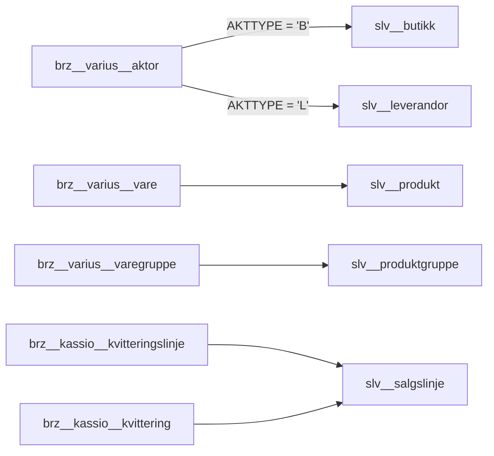

# Modul 4: Sølv

**Du lærer**
- hvorfor sølv er den felles modellen for bedriften, og ikke følger kildene tabell for tabell
- **Radfilter**: én kildetabell blir to sølvtabeller (butikk og leverandør)
- flagget **«Eget navn»**, og hvorfor forhåndssjekken stopper uten det
- **relasjoner**: to kildetabeller blir én (kvittering og kvitteringslinje), og koblinger med `fb__`
- **Beregning** for en verdi som regnes ut, og dine første **diagrammer**

**Tid:** ca. 75 minutter. **For hvem:** de som skal modellere.
**Start her:** fortsetter du fra forrige modul, er du klar. Ellers: sett startpunktet `M4`
(`./kurs til M4`, eller `notebooks/kurs_til` med «Til» = `start/M4`). Stegene står i
[Slik setter du et startpunkt](start.md).
**Forutsetninger:**
- rundturen. Lært i [modul 2](M2.md).
- oppstrøm, BK, nedstrømsnavn og bronze. Lært i [modul 3](M3.md).

---

## Hvor du er

Bronze har én tabell per kildetabell, med kildens navn. Sølv er der den **felles modellen** for bedriften starter:
én tabell per forretningsobjekt, uansett hvilken kilde det kom fra, med forretningens navn på norsk.



Sølv følger ikke kildene tabell for tabell:
- **Én kildetabell blir to.** `aktor` har både butikker og leverandører. De er to ulike ting for bedriften.
- **To kildetabeller blir én.** Kassen sender kvitteringshodet (raden i `kvittering` med tidspunkt, butikk og
  medlem) og linjene hver for seg. For forretningen er en
  salgslinje én ting, med tidspunkt og butikk.

Du lager `slv__butikk`, `slv__leverandor` og `slv__salgslinje` selv. `slv__produkt` og `slv__produktgruppe` legges
inn for deg.

<details><summary>Les mer: hvorfor en felles modell?</summary>

Uten en felles modell bygger hver rapport sin egen versjon av «butikk» eller «salg», rett fra kildene. Da får du ulike
tall for det samme. I sølv bestemmes det én gang hva en butikk er, og hva den heter. Les «Felles datamodell» på
[specly.no/laer](https://specly.no/laer/felles-datamodell).
</details>

---

## Steg 1: `slv__butikk` med radfilter

**Hva og hvorfor:** Butikkene ligger i `brz__varius__aktor` sammen med leverandørene. `AKTTYPE` sier hvilken som er hva
(`B` butikk, `L` leverandør). Et **Radfilter** sier hvilke rader en tabell tar med. Det er SQL, og det er ett av bare to
steder du skriver uttrykk selv.

**Gjør:**
1. «Opprett ny tabell». Navn `slv__butikk`, tabelltype `sølv`. Specly sier «5 standardkolonner opprettet».
2. «Legg til ny kolonne fra oppstrømstabell». Søk på `brz__varius__aktor` og hak av `AKTNR`, `NAVN`, `KOMMUNE` og
   `AAPNET_DT`. Se at listen viser «→ blir aktornummer» osv. Det er nedstrømsnavnene fra modul 3. Trykk «Opprett 4
   kolonner», så «Lukk».
3. Kolonnene heter nå `aktornummer`, `aktornavn`, `kommune` og `apnet_dato`, med datatypene fra bronze. Men i denne
   tabellen er alle aktørene butikker. Gi to av dem et presist navn: klikk i navnet, skriv `butikknummer` og
   `butikknavn`, og trykk Tab. Lenkeikonet ved navnet blir brutt («Kolonnenavn er ikke synkronisert»). Ikke klikk på
   det: da får kolonnen nedstrømsnavnet tilbake.
4. BK på `butikknummer`.
5. Finn feltet **Radfilter** under «Sølv-felt» over kolonnelisten (trykk «Vis mer» hvis feltene er skjult). Skriv
   `AKTTYPE = 'B'`, og klikk utenfor feltet. Feltet «Union av» ved siden av lar du stå tomt.
6. «Bruk regler» → «Sorter kolonner» → «Sorter», som i modul 3. Gjør det til en vane når en tabell har fått kolonnene
   og flaggene sine: da står kolonnene som i fasit.

<details><summary>Les mer: hvorfor kan Radfilter bruke `AKTTYPE`, som ikke er en kolonne i `slv__butikk`?</summary>

Radfilteret virker på radene før de blir sølvrader, med kolonnenavnene i oppstrømstabellene. `AKTTYPE` finnes i
`brz__varius__aktor`. Kolonnen trengs ikke i sølv: i `slv__butikk` er alle butikker.
</details>

**Hva tror du?** Du har gitt to kolonner et annet navn enn nedstrømsnavnet fra bronze. Hva sier forhåndssjekken?

Finn ut: eksporter og generer (lært i [modul 2](M2.md)).

<details><summary>Svar</summary>

Den stopper:

```
STOPP: kontraktene mangler noe koden trenger (2 ting). Ingenting er generert eller sendt til Databricks.
  - slv__butikk: Kolonnen butikknummer har oppstrøm brz__varius__aktor.AKTNR, som har nedstrømsnavnet «aktornummer». En kolonne heter det samme som nedstrømsnavnet, ellers synes ikke en glemt omdøping. I Specly: gi kolonnen navnet aktornummer, rett nedstrømsnavnet på brz__varius__aktor.AKTNR, eller sett flagget «Eget navn» på butikknummer når navnet skal avvike med vilje.
  - slv__butikk: Kolonnen butikknavn har oppstrøm brz__varius__aktor.NAVN, som har nedstrømsnavnet «aktornavn». …
```

Regelen er at et navn bestemmes ett sted: som nedstrømsnavn i laget før. Det hindrer at noen døper om en kolonne ved
et uhell, eller glemmer å gjøre det. Men her er omdøpingen meningen. `AKTNR` skal hete `butikknummer` her og
`leverandornummer` i leverandørtabellen. Det kan ikke ett nedstrømsnavn si.
</details>

**Gjør så:** Gi `butikknummer` og `butikknavn` flagget **«Eget navn»** (klikk i cellen «Flagg», hak av «Eget navn»,
«Ferdig»). Se at `butikknummer` har begge ikonene etterpå: BK og «Eget navn». Skriv i Utviklernotat hvorfor (rull mot
høyre, klikk i cellen, skriv, og klikk utenfor cellen), for eksempel:
«Nedstrømsnavnet til AKTNR er det generelle aktornummer. Radfilteret gjør at alle aktørene her er butikker.»
Ikke bruk Tab i Utviklernotat: Tab flytter deg til Beregning i samme rad, og det du skriver videre, havner der.
Eksporter og generer på nytt.

<details><summary>Les mer: hvorfor står flagget på sølvkolonnen?</summary>

Det er sølvkolonnen som avviker. Bronze-kolonnen har et riktig, generelt navn. Flagget sier «denne kolonnen heter
noe annet med vilje». Den som leser modellen senere, ser at det er et valg og ikke en feil. Utviklernotatet sier
hvorfor. Ingen mal leser notatet. Det er for mennesker.
</details>

**Riktig når:** `slv__butikk` har `butikknummer` (BK, «Eget navn»), `butikknavn` («Eget navn»), `kommune` og
`apnet_dato`, Radfilter `AKTTYPE = 'B'`, og forhåndssjekken sier `ingen mangler`.

---

## Steg 2: `slv__leverandor`, raskt

**Din tur.** Lag `slv__leverandor` på samme måte, fra `brz__varius__aktor` (svaret står i løsningen):
- Radfilter for leverandører
- `leverandornummer` (BK) og `leverandornavn`, begge med «Eget navn» og et utviklernotat
- `organisasjonsnummer` (navnet kommer av seg selv)
- «Sorter kolonner» til slutt

**Riktig når:** tre kolonner pluss standardkolonnene, og forhåndssjekken sier `ingen mangler`.

---

## Steg 3: Produktene legges inn for deg

**Hva og hvorfor:** `slv__produkt` og `slv__produktgruppe` lages på samme måte som butikk. Du har lært det, så kurset
legger dem inn for deg.

Hva `fyll` gjør, og hvorfor det bare går an i et kurs: [Om `fyll`](start.md#om-fyll).

**Gjør:**
1. Eksporter først alt du har gjort til Git. Da er arbeidet ditt trygt i Git før `fyll` legger til filer, og
   «Mine endringer» er tom når du henter inn.
2. Terminalsporet:
   ```bash
   git pull                      # det du nettopp eksporterte
   ./kurs fyll M4                # legger slv__produkt og slv__produktgruppe inn i specly/Tables
   git add specly && git commit -m "fyll M4" && git push
   ```
   Skriver `./kurs fyll` «fix --apply-rules ville endret N kontrakter», har du tabeller der reglene i Specly ville
   endret flagg eller kolonnerekkefølge. Som regel er det en tabell du ikke har sortert. Det er ikke en feil, og det
   stopper ingenting.

   Nettlesersporet: «Pull» i Git-mappen. Åpne `notebooks/kurs_fyll` og trykk «Run all». Første kjøring stopper og ber
   deg velge modul. Velg «Modul» = `M4` i sidepanelet «Parameters», og trykk «Run all» igjen. Commit og push i
   Git-mappen. (Se [Notebookene etter «Pull»](start.md#notebookene-etter-pull) hvis feltet mangler eller Databricks
   klager på compute.)
3. I Specly: «Import og eksport» → «Importer fra Git». Fanen «Fra Git» viser de to tabellene og de to relasjonene i
   `slv__produkt` under «KOMMER INN · 4». Se over listen, og trykk knappen «Hent inn til …» (den slutter med koden for
   siste commit i Git). Meldingen nederst til høyre sier «Main står nå på …»
   og «Reglene sjekkes når du går til Utvikling». Tabellene fra fasit følger reglene, så Specly skal ikke foreslå
   noen endringer.

**Se på `slv__produkt`.** Åpne tabellen fra «Tabeller» i sidepanelet. Du skal ikke endre noe, bare se. Den har to
kolonner du ikke har sett før:
- `fb__slv__produktgruppe` (oppstrøm `brz__varius__vare.VGRP`, relasjon til `slv__produktgruppe.bk__slv__produktgruppe`)
- `fb__slv__leverandor` (oppstrøm `brz__varius__vare.LEVNR`, relasjon til `slv__leverandor.bk__slv__leverandor`)

Og `er_aktiv`, som regnes ut med feltet Beregning (`statuskode = 'A'`). Beregning lærer du i steg 6.

<details><summary>Les mer: hva er en `fb__`?</summary>

En `fb__` peker på en annen sølvtabells forretningsnøkkel (`bk__`). Navnet er `fb__` pluss hele navnet på tabellen den
peker på.

Koden regner `bk__slv__produktgruppe` som en hash av `produktgruppekode`. Den regner `fb__slv__produktgruppe` i
`slv__produkt` som en hash av `VGRP` på samme rad. Samme verdi gir samme hash. Derfor treffer de hverandre, uten at
koden slår noe opp.

`produktgruppekode` står også i `slv__produkt`. Lesbare nøkler står ved siden av hashen. Da ser du hvilken verdi
raden hadde, også når den ikke traff.
</details>

**Riktig når:** sølv har fire tabeller: `slv__butikk`, `slv__leverandor`, `slv__produkt` og `slv__produktgruppe`.

---

## Steg 4: Relasjonen mellom kvitteringslinje og kvittering

**Hva og hvorfor:** Salgslinjen skal ha tidspunktet og medlemmet fra kvitteringshodet. Da må koden vite hvilket hode
en linje hører til: samme butikk og samme kvitteringsnummer. Det sier du med en **relasjon**: en strek fra kolonnene i
én tabell til kolonnene i en annen. Relasjoner tegnes i et diagram, så du lager ditt første diagram nå.

**Gjør:**
1. «Diagrammer» i sidepanelet, og trykk «+» ved «Diagrammer». Gi diagrammet navnet `Kasse` og trykk Enter.
2. Legg inn de to raw-tabellene og de to bronze-tabellene fra kassen. Sidepanelet kutter lange tabellnavn fra
   venstre, så raw og bronze ser like ut («…kassio__kvitteringslinje» to ganger). Velg derfor «Grupper etter type»
   for tabellisten i sidepanelet først. Søk så på `kassio` under «Alle tabeller», og trykk «legg til +» på de fire.
   Du kan også bruke dialogen «Legg til tabeller»: den viser hele navnet og tabelltypen. Søk `kassio`, hak av de
   fire, og trykk «Legg til 4 tabeller». Haken «Ta med direkte relaterte tabeller» kan stå.
3. Rydd med menyen ☰ øverst til høyre. Den åpner på fanen «Visning». Trykk «Ordne» → «Arranger (relasjoner)»
   (meldingen sier «Diagrammet er arrangert»), og «Tilpass».
4. Lag relasjonen fra `brz__kassio__kvitteringslinje` til `brz__kassio__kvittering`. Klikk linjetabellen, så den blå
   ⊕-knappen på kanten av den, og så kvitteringstabellen. Dialogen «Opprett relasjon» åpner seg.
5. Rett kolonneparet. Specly foreslår `bk__brz__kassio__kvitteringslinje` → `pk__brz__kassio__kvittering` (merket
   «foreslått»). Bytt begge til `storeId`. Trykk så «+ Legg til kolonnepar». Det kommer en ny rad med to nedtrekk
   som sier «Velg en kolonne». Velg `receiptNo` i begge (nedtrekkene har søk: skriv `receiptNo` og trykk Enter).
   Forhåndsvisningen under skal vise `storeId, receiptNo` på begge sider:
   - `storeId` → `storeId`
   - `receiptNo` → `receiptNo`
6. Kontroller kardinaliteten: «Null eller flere (0..N)» ved kvitteringslinjen, «Nøyaktig én (1)» ved kvitteringen.
   Trykk «Opprett relasjon». Knappen er grå til begge nedtrekkene i det nye paret er valgt. Meldingen sier «Relasjon
   opprettet: brz__kassio__kvitteringslinje → brz__kassio__kvittering».

> **Pass på:** «Opprett relasjon» gjetter kolonneparet, og mellom to bronze-tabeller gjetter den feil. Sjekk paret
> hver gang. Står retningen feil, trykk ⇆ («Bytt retning»): kvitteringslinjen skal stå til venstre, under «holder
> fremmednøkkelen».

> **Tips:** Et diagram blir lettere å lese når hvert lag har sin plass, for eksempel raw til venstre, bronze i midten
> og sølv til høyre.

<details><summary>Les mer: klikksti</summary>

«+» ved «Diagrammer» lager diagrammet med en gang, med navnefeltet «Nytt diagram» merket. En tom side tilbyr «Rundt
én tabell», «Fra dataprodukt» og «Kopier fra diagram». Tabeller legger du inn fra sidepanelet med «legg til +».
Klikker du en tabell i diagrammet, kommer ⊕ på høyre kant. Dialogen «Opprett relasjon» sier «Specly har gjettet
koblingen. Sjekk og trykk Opprett.» og har kardinalitetsknappene `1`, `0..1`, `1..N` og `0..N` på hver side.
«+ Legg til kolonnepar» gir en ny rad med to nedtrekk og et × til høyre som fjerner raden igjen.
</details>

<details><summary>Les mer: alt du kan gjøre i et diagram</summary>

Et diagram er en visning. Tabellene finnes i prosjektet uansett, og et diagram kan vise et utvalg av dem. Det du gjør
med plassering og visning, ser alle som åpner diagrammet i Specly. Til Git går bare tabellene og plasseringen
(`specly/Diagrams/<navn>.json`), ikke notater, tegning eller visningsvalg.

**På lerretet:**
- **Flytt en tabell:** dra i tittelen. Dra i kanten eller hjørnet for å endre bredde og høyde (dobbeltklikk gir
  automatisk bredde igjen).
- **Relasjon:** klikk en tabell, så ⊕ på kanten, og så tabellen den skal peke på. Holder du over en strek, merkes
  endene «KILDE» og «MÅL». Dobbeltklikk på streken for å endre relasjonen (tabeller, kolonner, kommentar,
  kardinalitet) eller «Slett relasjon».
- **Notat:** verktøyet «Notat» («Legg til notat») i verktøylinjen, så klikk på lerretet. Det kommer en gul lapp med
  «Skriv et notat …». Bruk det til det diagrammet ikke sier selv: et spørsmål til kilden, en kjent svakhet, hva som
  gjenstår. Hold notatet kort: lappen vokser ikke med teksten. Du kan også lime inn et bilde, og tegne med «Penn»
  (seks farger og fire tykkelser nederst, søppelbøtta fjerner alt blekk) og «Viskelær».
- **Tabellhandlinger:** klikk en tabell, så «⋯» nederst til høyre på den (eller høyreklikk tabellen): «Vis tabell»,
  «Vis spesifikasjon», «Utforsk lineage», «Hent alle relaterte tabeller», «Tilbakestill størrelse», «Fjern fra diagram»
  (tabellen blir værende i prosjektet) og «Slett fra prosjekt» (sletter tabellen, pass på). ↗ i tabelltittelen går til
  tabellsiden.

**I menyen ☰ («Diagramverktøy») øverst til høyre**, med fanene «Ordne», «Visning» og «Filter»:
- **Ordne:** «Arranger (relasjoner)», «Arranger (rutenett)», «Arranger (horisontalt)» og «Rydd opp overlapp».
  «Lås posisjoner» hindrer at andre flytter tabellene. «Bruk regler» åpner dialogen «Bruk relasjonsregler». Der
  velger du hvilke relasjonsregler som skal lage relasjoner mellom tabellene i diagrammet («fb__ peker på bk__» og
  «fk__ peker på pk__»), og trykker «Bruk 2 regler». Den setter ikke flagg og sorterer ikke.
- **Detaljnivå:** «Alle kolonner», «Kompakt» (bare tabellnavn og antall kolonner) eller «Bare navn».
- **Kolonnefelt** (knappen «Felt 3/8» i verktøylinjen, eller «Kolonnefelt» i «Visning»): hvilke felt som står på hver
  kolonnerad. For eksempel datatype, flagg og nedstrømsnavn i bronze, eller Beregning i sølv. Felt som bare finnes i
  én tabelltype, står under «Fra tabelltype · sølv». Under «Rekkefølge» flytter du dem med pilene: «Øverst vises
  lengst til venstre i tabellen.»
- **Relasjoner:** «Av», «Fremhev» (strekene får farge og kardinalitet, de andre kolonnene dempes) eller «Bare
  nøkler» (bare nøkkelkolonnene vises, resten slås sammen til «+ 15 kolonner»). Hurtigtast F. «Fest linjer til rader»
  lar streken gå fra `fb__`-raden til `bk__`-raden, ikke fra kortet.
- **Fargelegg etter** tabelltype, kildesystem, tabellstatus eller et metadatafelt, med «Vis tegnforklaring». Er
  fargene ikke satt, står det «Sett farger →» ved valget, og alt blir grått.
- **Vis som** «Lerret» eller «Nabolag» (én tabell i fokus, naboene ved siden av, «2 hopp» ut).
- **Filter:** skjul eller vis bare kolonnerader med et bestemt flagg (PK, BK, FK) eller en kolonnestatus, skjul
  tabeller med en bestemt tabellstatus, eller tomme tabeller. Det finnes ikke filter på kolonnenavn (`sys__`).
- **Eksporter** det synlige eller hele diagrammet som PNG eller SVG, til en presentasjon eller et kildeark.

</details>

**Riktig når:** diagrammet `Kasse` viser én strek fra kvitteringslinjen til kvitteringen, over to kolonnepar.

---

## Steg 5: `slv__salgslinje`

**Hva og hvorfor:** Én rad per varelinje, med det som hører til linjen fra begge kassetabellene.

> **Pass på:** `storeId` og `receiptNo` finnes i begge kassetabellene. Hent dem fra **kvitteringslinjen**. Koden
> starter fra tabellen den første BK-kolonnen kommer fra. Den kalles **hovedtabellen**, og den avgjør hva én rad er.

**Gjør:**
1. «Opprett ny tabell», navn `slv__salgslinje`, tabelltype `sølv`.
2. «Legg til ny kolonne fra oppstrømstabell». Hak av:
   - søk `brz__kassio__kvitteringslinje`: `storeId`, `receiptNo`, `lineNo`, `sku`, `qty`, `unitPrice`, `discount`
   - søk `brz__kassio__kvittering`: `soldAt`, `memberNo` (valgene fra første søk blir stående)

   Dialogen lister kolonnene slik de står i bronze (`lineNo`, `receiptNo`, `storeId` først). Kolonnene lages i den
   rekkefølgen du haker av, men rekkefølgen betyr ingenting: du sorterer tabellen i steg 7.

   Trykk «Opprett 9 kolonner», så «Lukk». Navnene kommer av seg selv: `butikknummer`, `salgsnummer`, `linjenummer`,
   `varenummer`, `antall`, `enhetspris_belop`, `rabatt_belop`, `salg_tidspunkt`, `medlemsnummer`.
3. BK på `butikknummer`, `salgsnummer` og `linjenummer`.

**Hva tror du?** Du har ikke sagt noe om hvordan kvitteringslinjen og kvitteringen skal kobles i denne tabellen.
Hvordan vet koden det?

<details><summary>Svar</summary>

Fra relasjonen du lagde i steg 4. Koden ser at `slv__salgslinje` henter kolonner fra to bronze-tabeller, finner den
ene relasjonen mellom dem, og kobler på `storeId` og `receiptNo`. Uten relasjonen stopper forhåndssjekken:

```
slv__salgslinje: Oppstrømstabellen brz__kassio__kvittering har ingen relasjon til hovedtabellen brz__kassio__kvitteringslinje, så koden vet ikke hvordan de skal kobles (det må være nøyaktig én). I Specly: lag én relasjon mellom brz__kassio__kvittering og brz__kassio__kvitteringslinje (kolonnene som skal være like).
```
</details>

**Riktig når:** ni kolonner med navnene over, og BK på `butikknummer`, `salgsnummer` og `linjenummer`.

---

## Steg 6: To kolonner som regnes ut

**Hva og hvorfor:** Noen verdier finnes ikke i kilden, men regnes ut. Det skriver du i feltet **Beregning**, med
kolonnenavnene i tabellen selv. Det er det andre stedet du skriver SQL. Hver beregnet kolonne skal ha et
**Utviklernotat** som forklarer den for mennesker.

| Kolonne | Datatype | Beregning |
|---|---|---|
| `salg_dato` | date | `to_date(from_utc_timestamp(salg_tidspunkt, 'Europe/Oslo'))` |
| `belop` | decimal(10,2) | `antall * enhetspris_belop - rabatt_belop` |

**Gjør:**
1. `salg_dato` har én kilde. Trykk «Legg til kolonne», skriv `salg_dato` og trykk Tab. Velg datatypen `date`. Trykk
   blyanten i cellen «Oppstrømskolonne», søk `brz__kassio__kvittering` og velg `soldAt`. La «Behold nåværende
   kolonnenavn og datatype (ikke hent nedstrømsnavnet fra kilden)» stå på, og trykk «Lagre endringer».
2. `belop` har tre kilder. Bruk «Legg til ny kolonne fra oppstrømstabell», som lager kolonnen og kildene samlet: søk
   `brz__kassio__kvitteringslinje`, hak av `qty`, `unitPrice` og `discount`, og velg «Opprett 1 beregnet kolonne» under
   «Opprettelsesmodus». Da kommer feltet «Navn på den beregnede kolonnen» og et nedtrekk «Ingen datatype». Skriv
   `belop` og velg `decimal(10,2)`. Trykk «Opprett og legg til ny» (knappen er grå til navnet er skrevet), så «Lukk».
3. Skriv Beregning og Utviklernotat i cellene på begge radene (rull mot høyre, klikk i cellen, skriv, og klikk utenfor
   cellen). Se på overskriften før du klikker: kolonnene i tabellen flytter seg sidelengs når en ny rad kommer til,
   så det er lett å treffe nabocellen.

**Tenk over** (svar i løsningen): Hvorfor regnes `salg_dato` fra `salg_tidspunkt`, og ikke fra datoen i filnavnet? Og hvorfor i
`Europe/Oslo`, når alle tidspunkt lagres i UTC?

<details><summary>Les mer: hvorfor oppstrøm på en beregnet kolonne?</summary>

Koden bruker Beregning, ikke oppstrømmen, for disse to kolonnene. Men oppstrømmen viser hvor verdien kommer fra. Den
som lurer på hva `belop` bygger på, kan følge den tilbake til kassefilen. `./kurs sjekk M4` sammenligner også
oppstrømmen med fasit.
</details>

<details><summary>Les mer: hvorfor ikke byggeklossene i Specly sin Beregning?</summary>

Specly har en egen felttype for Beregning med faste byggeklosser som Specly kan sjekke. Ingen av dem gir en dato i en
tidssone, og regning med tre ledd går ikke. Kurset bruker derfor et tekstfelt med SQL. Forhåndssjekken sjekker at
navnene i uttrykket er kolonner i tabellen.
</details>

**Riktig når:** `salg_dato` (date) og `belop` (decimal(10,2)) har Beregning og Utviklernotat.

---

## Steg 7: Koblingene `fb__slv__produkt` og `fb__slv__butikk`

**Hva og hvorfor:** Salgslinjen skal peke på produktet og butikken i sølv. Lært i steg 3: en `fb__` er en hash av den
naturlige nøkkelen, og treffer `bk__` i tabellen den peker på.

**Gjør:**
1. «Legg til kolonne». Navn `fb__slv__produkt`, datatype `bigint`. Trykk blyanten i «Oppstrømskolonne», velg
   `brz__kassio__kvitteringslinje.sku`, la «Behold nåværende kolonnenavn og datatype …» stå på, og «Lagre endringer».
   Søket på `sku` treffer også raw-tabellen (under «ANDRE TABELLER»). Velg treffet under «OPPSTRØMSTABELLER».
2. Det samme for `fb__slv__butikk`, med oppstrøm `brz__kassio__kvitteringslinje.storeId`. Søket på `storeId` gir fire
   treff: to i bronze og to i raw. Velg kvitteringslinjen i bronze.
3. Gi begge flagget **FK**.
4. Lag et diagram `Sølv` med de fem sølvtabellene (søk `slv__`). Tegn relasjonen fra
   `slv__salgslinje.fb__slv__produkt` til `slv__produkt.bk__slv__produkt`, og fra `slv__salgslinje.fb__slv__butikk`
   til `slv__butikk.bk__slv__butikk`. Kardinalitet: `0..N` ved salgslinjen, `0..1` ved produktet og butikken. Her
   foreslår Specly riktig par og riktig kardinalitet. Kontroller, og trykk «Opprett relasjon».
5. Åpne `slv__salgslinje` og trykk «Bruk regler» → «Sorter kolonner» → «Sorter». `fb__`-kolonnene flyttes opp under
   `bk__`, og BK-kolonnene stilles alfabetisk: `butikknummer`, `linjenummer`, `salgsnummer`. Slik står de i fasit.

**Hva tror du?** Hva er forskjellen på `varenummer` og `fb__slv__produkt` i samme rad? Trenger du begge?

<details><summary>Svar</summary>

`varenummer` er verdien fra kassen (`4711`). `fb__slv__produkt` er hashen av den samme verdien, som treffer
`bk__slv__produkt`. Hashen kobler, nummeret kan du lese. Treffer ikke koblingen, ser du på `varenummer` hvilket
nummer det var.
</details>

> **Pass på rekkefølgen:** lag relasjonen før du genererer. En `fb__` uten relasjon stopper forhåndssjekken:
> «Kolonnen fb__slv__produkt er en koblingsnøkkel, men har ingen relasjon, så koden vet ikke hva den peker på.»

<details><summary>Les mer: la reglene gjøre det neste gang</summary>

Prosjektet har en relasjonsregel som kobler `fb__slv__<tabell>` til `bk__slv__<tabell>`, med `0..N` og `0..1`, og en
flaggregel som gir `fb__`-kolonner FK (se «Regler i prosjektet» i [modul 2](M2.md)). Når kolonnene finnes, kan
du trykke «Bruk regler» → «Kjør alle» på `slv__salgslinje`. Da setter Specly FK-flagget og lager relasjonene (punkt 3
og 4 over), og sorterer kolonnene (`fb__` rett etter `bk__`). Du lager relasjonene for hånd her for å se hva de er.
Senere bruker du regelen.

«Bruk flaggregler» gir «2 kolonner oppdatert, 1 hadde allerede flagget», og «Finn relasjoner» gir «2 nye
relasjoner opprettet»: `fb__slv__butikk → slv__butikk.bk__slv__butikk` og `fb__slv__produkt →
slv__produkt.bk__slv__produkt`, begge `0..N` / `0..1`. Kommentaren på relasjonen må du skrive selv.
</details>

<details><summary>Les mer: betyr rekkefølgen på BK-kolonnene noe?</summary>

Koden regner `bk__` og `pk__` som en hash av BK-kolonnene i den rekkefølgen de står i tabellen. En annen rekkefølge
gir andre hash-verdier, men like mange rader og de samme koblingene: ingen annen tabell peker på
`bk__slv__salgslinje`. `./kurs sjekk` ser bort fra rekkefølgen. Kurset ber deg likevel sortere, så tabellen og koden
din blir lik fasit og løsningen.
</details>

**Riktig når:** begge `fb__`-kolonnene har oppstrøm, flagget FK og en relasjon til `bk__` i tabellen de peker på, og
tabellen er sortert.

---

## Steg 8: Diagram for varesystemet

**Din tur.** Lag et diagram `Varesystem` med raw- og bronze-tabellene fra Varius (søk `varius`, seks tabeller). Det
trenger ingen relasjoner. Det viser bare hva kilden består av.

Prøv noe fra menyen ☰:
- «Fargelegg etter» → «Tabellstatus», med «Vis tegnforklaring». Tabeller uten status står som «Uten verdi».
  (Tabelltypene har ingen farger før noen setter dem med «Sett farger →».)
- «Kolonnefelt» med nedstrømsnavnet. Da ser du hva hver bronze-kolonne heter videre.

Legg et notat med det du vil spørre eieren av Varius om (kildearket `kilder/varius.md` har kjente svakheter).
Notatet blir i Specly. Det går ikke med til Git.

**Riktig når:** tre diagrammer: `Kasse`, `Varesystem` og `Sølv`.

---

## Steg 9: Kjør og kontroller

Rundturen (lært i [modul 2](M2.md)):

1. Eksporter til Git.
2. Generer. Forventet: `ingen mangler` og 15 tabeller.
3. Åpne `databricks/pyspark/tabeller/slv__salgslinje.py`. Finn hovedtabellen, koblingen til kvitteringen (den kom av
   relasjonen), `nokkel_av(…sku)` for `fb__slv__produkt`, og de to beregningene. Linjene står i løsningen.
4. Kjør.
5. Kontroller.

**Hva tror du?** Lillehammer åpnet lørdag 5. september. Hva er det første `salg_tidspunkt` der, i UTC?

<details><summary>Svar</summary>

2026-09-04 22:05:07 UTC. Det er 00:05 natt til 5. september i norsk tid. Med datoen fra UTC ville det første salget på
Lillehammer stått på dagen før butikken åpnet. Derfor regnes `salg_dato` i `Europe/Oslo`.
</details>

**Gjør:**

```sql
-- alle versjoner
SELECT count(*) FROM slv__produkt
```

```sql
-- bare versjonene som gjelder nå
SELECT count(*) FROM slv__produkt WHERE sys__gyldig_til = TIMESTAMP'9999-12-31'
```

Sølv har alle versjonene fra bronze, så den første gir 153 og den andre 150 (lært i modul 3: tre varer har to
versjoner). Bytt tabellnavnet for å telle de andre sølvtabellene.

```sql
-- linjer der koblingen til produktet ikke traff
SELECT s.varenummer, s.salg_dato, count(*) AS linjer
FROM slv__salgslinje s
LEFT JOIN slv__produkt p ON p.bk__slv__produkt = s.fb__slv__produkt
                        AND p.sys__gyldig_til = TIMESTAMP'9999-12-31'
WHERE p.bk__slv__produkt IS NULL
GROUP BY s.varenummer, s.salg_dato
```

Linjen med `sys__gyldig_til` velger versjonen som gjelder nå. Uten den får en salgslinje to treff for varene som har
to versjoner.

```sql
-- Lillehammer
SELECT min(salg_dato) AS forste_salgsdato, min(salg_tidspunkt) AS forste_tidspunkt_utc, count(*) AS linjer
FROM slv__salgslinje
WHERE butikknummer = 106
```

```sql
-- salget lørdag 12. september, og når det kom
SELECT count(*) AS linjer, min(sys__gyldig_fra) AS kom
FROM slv__salgslinje
WHERE salg_dato = DATE'2026-09-12'
```

**Riktig når:**

| Kontroll | Forventet |
|---|---|
| `slv__salgslinje` | 38 612 rader |
| `slv__butikk` / `slv__leverandor` | 7 / 10 rader |
| `slv__produkt` | 153 rader, 150 gjeldende |
| `slv__produktgruppe` | 12 rader, alle gjeldende |
| `fb__slv__produkt` uten treff | 6 linjer, varenummer `9999`, salgsdato 2026-08-14 |
| Lillehammer | første salgsdato 2026-09-05, første tidspunkt 2026-09-04 22:05:07 UTC, 3 497 linjer |
| Salgsdato 2026-09-12 | 521 linjer, som kom 2026-09-14 09:30 |

**Tenk over** (svar i løsningen): Varenummer `9999` finnes ikke i varesystemet. Skal linjene kastes, eller stå? Hva ville skjedd med
omsetningen om de ble kastet?

Sammenlign med fasit: `./kurs sjekk M4` (eller `notebooks/kurs_sjekk` med «Modul» = `M4`). Du er i mål når den
skriver «Kontraktene stemmer med fasit.» og «Fasittest (modul 2-4): 43 riktige, 0 feil.»

Nettlesersporet: etter «Pull» er feltet «Modul» borte. Første «Run all» lager feltet og stopper uten å sjekke noe
(«Velg modul»). Velg `M4` i
sidepanelet «Parameters» og kjør på nytt. Se at utskriften sier «modul 2-4». Mer i
[Notebookene etter «Pull»](start.md#notebookene-etter-pull).

---

## Ferdig når

- [ ] `slv__butikk` og `slv__leverandor` med Radfilter og «Eget navn», og du har sett forhåndssjekken stoppe uten flagget
- [ ] `slv__produkt` og `slv__produktgruppe` lagt inn av kurset og hentet inn i Specly
- [ ] Relasjonen mellom kvitteringslinje og kvittering, og `slv__salgslinje` med Beregning og to `fb__`
- [ ] Tre diagrammer: `Kasse`, `Varesystem`, `Sølv`
- [ ] Tallene i steg 9 stemmer

Løsning: [M4_losning.md](M4_losning.md). Neste: [Modul 5: Første stjerne](M5.md).
