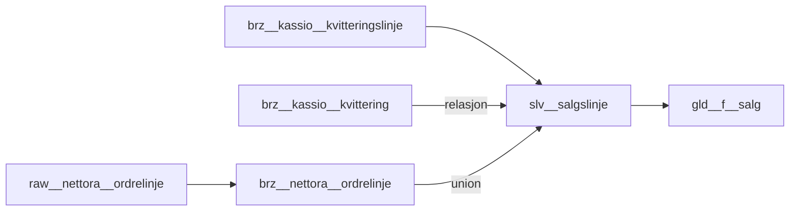

# Modul 6: Ny kilde, nettbutikken

**Du lærer**
- å ta inn en ny kilde rett i den felles modellen: nettbutikken i den samme `slv__salgslinje` som kassen
- **union**: én sølvtabell med rader fra to kilder, og feltet **«Union av»**
- **Beregning etter unionen**: verdier som bare den ene kilden mangler (butikk og rabatt), og `salgskanal`
- å endre modellen **via Git**: kopiere en kontrakt, gi kopien nye id-er og sjekke den med `specly.py`, pushe og hente inn
- at gull ikke endres: faktaen har nettsalget etter neste kjøring

**Tid:** ca. 60 minutter. **For hvem:** de som skal modellere.
**Start her:** fortsetter du fra modul 5, er du klar. Ellers: sett startpunktet `M6`
(`./kurs til M6`, eller `notebooks/kurs_til` med «Til» = `start/M6`). Stegene står i
[Slik setter du et startpunkt](start.md).
**Forutsetninger:**
- rundturen. Lært i [modul 2](M2.md).
- oppstrøm, BK og nedstrømsnavn. Lært i [modul 3](M3.md).
- hovedtabell, relasjoner, `fb__` og Beregning. Lært i [modul 4](M4.md).
- faktaen og dimensjonene. Lært i [modul 5](M5.md).

---

## Spørsmålet

Salgssjefen skriver:

> «Hvor stor del av salget skjer på nett, og hvordan utvikler det seg?»

Faktaen fra modul 5 har bare salget i butikkene. Nettbutikken (`nettora`) er en egen kilde som ikke er tatt inn. Den
leverer én JSON-fil per dag med ordrelinjer (kildearket `kilder/nettora.md`).

Det enkleste ville vært en egen faktatabell for nett. Men da må hver rapport slå sammen to tabeller, og hver rapport
gjør det litt forskjellig. I sølv er en salgslinje en salgslinje, uansett hvor den kom fra. Derfor kommer nettbutikkens
linjer inn i den samme `slv__salgslinje`.



Planen:
1. Raw for nettbutikken via Git: du kopierer en kontrakt.
2. Bronze legges inn for deg (samme håndverk som i modul 3).
3. Unionen i `slv__salgslinje`: oppstrøm fra nettbutikken (via Git), så «Union av» og Beregning (i Specly).
4. Kjør, og svar salgssjefen. Gull endrer du ikke.

---

## Steg 1: Raw for nettbutikken, via Git (ca. 15 minutter)

**Hva og hvorfor:** Til nå har du endret modellen i Specly. Men modellen er filer i ditt eget Git-repo, i et åpent
format. Du kan endre dem med en editor, med et skript eller med Claude, og hente endringen inn i Specly. Det er nyttig
når mye skal gjøres likt: en ny tabell som ligner en du har, eller samme endring i mange kolonner.

`raw__nettora__ordrelinje` ligner `raw__kassio__kvitteringslinje`: en raw-tabell med tekstkolonner og de fire
`sys__`-kolonnene. Du kopierer den og endrer kopien.

**Gjør (terminalsporet):**
1. `git pull`, så kopier kontrakten:
   ```bash
   cp specly/Tables/raw/raw__kassio__kvitteringslinje.odcs.yaml specly/Tables/raw/raw__nettora__ordrelinje.odcs.yaml
   ```
2. Endre kopien, for hånd eller med Claude:
   - `id:` øverst og begge `name:` blir `raw__nettora__ordrelinje`
   - `description` på tabellen: «Ordrelinjene fra nettbutikken, én fil per dag, slik filene kom.»
   - `sourceSystem` blir `nettora`
   - kolonnene (alle `string`) blir kolonnene i nettbutikkens fil, i den rekkefølgen: `order_id`, `line_no`,
     `customer_id`, `ordered_at`, `product_code`, `quantity`, `price`. Behold de fire `sys__`-kolonnene nederst.

**Hva tror du?** Kjør `uv run --no-project --with pyyaml python specly/.specly/specly.py check`. Hva sier den om kopien?

<details><summary>Svar</summary>

Den sier «24 feil» øverst, og én feil per tabell og kolonne som har samme id i to filer. Den første lyder:

```
specly/Tables/raw/raw__kassio__kvitteringslinje.odcs.yaml:7  lint.uuid.duplicate  Tabellen raw__kassio__kvitteringslinje har samme id som raw__nettora__ordrelinje i specly/Tables/raw/raw__nettora__ordrelinje.odcs.yaml. Den ene er en kopi: gi kopien en ny uuid v4, og la id-en stå der den sto først. Får originalen en ny id, leser Specly det som at tabellen er slettet og en ny laget.
```

Hver id gir to feil, én i hver fil (originalen først), så kopien gir 24 feil i alt. Meldingen sier «uuid v4», men du
skal ikke lage id-ene selv. Du sletter dem i kopien, og punkt 4 lar `specly.py fix` skrive nye.

Id-en (`id:` på `schema` og på hver kolonne) er det Specly kjenner en tabell og en kolonne på, ikke navnet. Det er
derfor en omdøping i Git blir en omdøping i Specly, og ikke en sletting og en ny tabell. To tabeller med samme id
blander Specly sammen. En kopi har originalens id-er, og derfor må de bort.
</details>

3. Slett alle `id:`-linjene med en uuid i kopien: den under `schema:` og den på hver kolonne, tolv i alt. Står `id:`
   først i et listeelement, flytter du `-` til linjen under:
   ```yaml
   # før                      # etter
   - id: 0a6b97b7-…           - name: order_id
     name: order_id             physicalType: string
     physicalType: string
   ```
4. La `specly.py` skrive nye id-er, og sjekk igjen:
   ```bash
   uv run --no-project --with pyyaml python specly/.specly/specly.py fix --add-ids --changed-from main
   uv run --no-project --with pyyaml python specly/.specly/specly.py check
   ```
   `fix` skriver «la til id … på raw__nettora__ordrelinje» for tabellen og for hver kolonne, tolv id-er i alt.
   `check` skal si `0 feil`. Den har fortsatt mange advarsler, og det er ventet: rundt 150 om kolonner uten
   beskrivelse (`lint.column.noDescription`), og kanskje noen om sortering (`rules.sort.wouldReorder`). De gjelder
   tabellene du har laget i kurset, og stopper ingenting. Advarslene `lint.uuid.missing` for den nye tabellen skal
   være borte.

   Sier `check` `format.differs` om en linje i kopien, viser meldingen hvordan Specly ville skrevet linjen. Rett den
   slik (for eksempel `description:` uten anførselstegn rundt teksten).

   Ikke commit ennå: steg 2 legger til bronze i samme omgang.

> **Forutsetning for `fix --add-ids`:** du må ha eksportert fra Specly minst én gang etter at prosjektet ble koblet
> til repoet, og hentet eksporten med `git pull`. Eksporten skriver `projectId` inn i `specly/.specly.json`, og
> `fix` regner id-ene ut fra den. Har du gjort modul 2–5, er det i orden. Stopper `fix` med «specly/.specly.json har
> ingen projectId», eksporterer du én gang fra Specly, kjører `git pull`, og prøver igjen. Du kan også la Specly
> skrive id-ene: se punkt 3 i steg 2.

> **Pass på:** kjør `fix` før du committer. `--changed-from main` gir id bare til det som er nytt siden `main`. Har du
> allerede committet kopien på `main`, er den ikke ny lenger.

<details><summary>Les mer: hvilke id-er skriver `fix`?</summary>

De samme som Specly selv ville laget: en uuid regnet ut fra prosjektet, kontraktens `id` og navnene. To som kjører
`fix` på den samme filen, får de samme id-ene. Derfor skal kontraktens `id` øverst være det nye navnet før du kjører
`fix`. `specly/AGENTS.md` (avsnittet «Identity») forklarer det for den som skriver filer selv, også Claude.

Uten id kjenner Specly en kolonne bare på navnet. Det virker, men får kolonnen et nytt navn i Git senere, blir det en
sletting og en ny kolonne. Derfor advarer `check` om manglende id (`lint.uuid.missing`).
</details>

**Gjør (nettlesersporet):**
1. Åpne repoet ditt i GitHub, gå til mappen `specly/Tables/raw/` og klikk `raw__kassio__kvitteringslinje.odcs.yaml`.
   Trykk kopi-ikonet («Copy raw file») i verktøylinjen over filen.
2. Gå tilbake til mappen `specly/Tables/raw/`. Trykk «Add file» → «Create new file». Stien til mappen står allerede
   foran navnefeltet, så skriv bare `raw__nettora__ordrelinje.odcs.yaml`. Lim inn innholdet i feltet under.
3. Gjør endringene i punkt 2 i terminalsporet, og slett id-linjene som i punkt 3.
4. Trykk «Commit changes...» øverst til høyre. La «Commit directly to the `main` branch» stå valgt, og trykk «Commit
   changes».

Filen er nå i Git uten id-er. I nettlesersporet skriver Specly dem i steg 2. Vil du kjøre `check` i nettlesersporet
også: se «Les mer» under. Du kan også hoppe over den. Specly sier fra når du henter inn, hvis filen ikke kan leses.

<details><summary>Les mer: en terminal i nettlesersporet</summary>

Databricks har en terminal i nettleseren. Klikk branchnavnet (`main`) i Git-mappen, og trykk «Pull» så filen fra
GitHub kommer med. Trykk så «Web Terminal» i det samme vinduet. Terminalen åpner i en ny fane. Skriv:

```bash
cd kurs-toppfart          # navnet på Git-mappen din
python specly/.specly/specly.py check
```

Du trenger ikke installere noe.
</details>

**Riktig når:** kopien har de sju kolonnene fra nettbutikken, og ingen id-er fra originalen. I terminalsporet har
`fix` skrevet tolv nye, og `check` sier `0 feil`. I nettlesersporet har filen ingen `id:`-linjer med uuid ennå.

---

## Steg 2: Bronze legges inn for deg

**Hva og hvorfor:** `brz__nettora__ordrelinje` lages som bronze-tabellene i modul 3: BK, rensing, typer og
nedstrømsnavn. Kurset legger den inn. I nettlesersporet lar du til slutt Specly skrive id-ene til raw-tabellen
tilbake til Git.

Hva `fyll` gjør, og hvorfor det bare går an i et kurs: [Om `fyll`](start.md#om-fyll).

**Gjør:**
1. Terminalsporet:
   ```bash
   ./kurs fyll M6
   git add specly && git commit -m "Nettbutikken: raw via Git, bronze med fyll" && git push
   ```
   Nettlesersporet: «Pull» i Git-mappen. Åpne `notebooks/kurs_fyll` og trykk «Run all». Første kjøring stopper og ber
   deg velge modul. Velg «Modul» = `M6` i sidepanelet «Parameters», og trykk «Run all» igjen. Commit og push i
   Git-mappen. (Se [Notebookene etter «Pull»](start.md#notebookene-etter-pull) hvis feltet mangler.)
2. I Specly: «Import og eksport» → «Importer fra Git». Fanen «Fra Git» viser `brz__nettora__ordrelinje` og
   `raw__nettora__ordrelinje` under «KOMMER INN · 2», begge merket «NY». Trykk knappen «Hent inn til …»
   (den slutter med koden for siste commit i Git). Meldingen nederst til høyre sier «Main står nå på …» og
   «Reglene sjekkes når du går til Utvikling». Git-siden sier «I synk».
3. Nettlesersporet, og terminalsporet hvis du ikke kjørte `fix --add-ids` i steg 1: la Specly skrive id-ene til Git.
   Specly har gitt tabellen og kolonnene id-er, men en vanlig eksport skriver dem ikke tilbake til filen du laget.
   1. På Git-siden («Import og eksport» → «Eksporter til Git»), fanen «Mine endringer»: trykk lenken «Skriv alle
      kontrakter på nytt…», og så «Finn kontrakter som er ulike».
   2. Etter noen sekunder kommer raden «Nytt filformat: N filer skrives på nytt». `raw__nettora__ordrelinje.odcs.yaml`
      skal stå i listen. Det kan stå flere filer der (diagrammene og en fil under `Config`). Det er i orden.
   3. Slå på bryteren «Skriv nytt filformat», skriv en commit-melding, og trykk «Commit og push til Git».

**Riktig når:** Specly har `raw__nettora__ordrelinje` og `brz__nettora__ordrelinje`, og
`specly/Tables/raw/raw__nettora__ordrelinje.odcs.yaml` i Git har `id:` på tabellen og på hver kolonne.

**Se på nedstrømsnavnene i `brz__nettora__ordrelinje`.** Det er de som gjør unionen mulig:

| Kolonne i nettbutikken | Datatype | Nedstrømsnavn | Tilsvarende kolonne i kassen |
|---|---|---|---|
| `order_id` (BK) | string | `salgsnummer` | `receiptNo` |
| `line_no` (BK) | int | `linjenummer` | `lineNo` |
| `customer_id` | string | `medlemsnummer` | `kvittering.memberNo` |
| `ordered_at` | timestamp | `salg_tidspunkt` | `kvittering.soldAt` |
| `product_code` | string, uten ledende nuller | `varenummer` | `sku` |
| `quantity` | int | `antall` | `qty` |
| `price` | decimal(10,2) | `enhetspris_belop` | `unitPrice` |

Kildene har hver sin navnestil. Nedstrømsnavnet oversetter dem til det samme navnet i sølv (lært i modul 3).

**Tenk over:** Nettbutikken har ingen butikk og ingen rabatt. Hvilke kolonner i `slv__salgslinje` får da ingen verdi
fra nettbutikken?

---

## Steg 3: Unionen, del 1: oppstrøm fra nettbutikken (via Git)

**Hva og hvorfor:** Hver kolonne i `slv__salgslinje` skal få en oppstrømskolonne til, fra nettbutikken. Det er ti
kolonner og ti like endringer. I Git er det én linje per kolonne (to for `belop`), elleve linjer i alt. Det går også
i Specly (se «Les mer» etter punkt 4), men da er det fire klikk per kolonne.

**Gjør:**
1. Terminalsporet: `git pull`, og åpne `specly/Tables/solv/slv__salgslinje.odcs.yaml`
   i en editor. Nettlesersporet: åpne filen i GitHub og trykk blyanten («Edit this file»).
2. Legg til én linje under `transformSourceObjects` i disse ti kolonnene (to linjer i `belop`):

| Kolonne | Ny linje |
|---|---|
| `fb__slv__produkt` | `- brz__nettora__ordrelinje.product_code` |
| `linjenummer` | `- brz__nettora__ordrelinje.line_no` |
| `salgsnummer` | `- brz__nettora__ordrelinje.order_id` |
| `antall` | `- brz__nettora__ordrelinje.quantity` |
| `belop` | `- brz__nettora__ordrelinje.quantity` og `- brz__nettora__ordrelinje.price` |
| `enhetspris_belop` | `- brz__nettora__ordrelinje.price` |
| `medlemsnummer` | `- brz__nettora__ordrelinje.customer_id` |
| `salg_dato` og `salg_tidspunkt` | `- brz__nettora__ordrelinje.ordered_at` |
| `varenummer` | `- brz__nettora__ordrelinje.product_code` |

   For eksempel `salgsnummer`:
   ```yaml
        transformSourceObjects:
          - brz__kassio__kvitteringslinje.receiptNo
          - brz__nettora__ordrelinje.order_id
   ```
3. Terminalsporet: kjør `specly.py check` som i steg 1. Den skal si `0 feil` (advarslene om beskrivelser er de samme
   som før). Ingen nye kolonner, så ingen nye id-er. Nettlesersporet: trykk «Commit changes...» og «Commit changes» i
   GitHub. Vil du kjøre `check`, gjør du det i «Web Terminal» etter en «Pull» (se «Les mer» i steg 1).

**Hva tror du skjer?** Generer nå (`./generer`, eller `notebooks/kurs_generer_kjor` etter en «Pull» i
nettlesersporet). Hva sier forhåndssjekken?

<details><summary>Svar</summary>

Den stopper med «STOPP: kontraktene mangler noe koden trenger (8 ting)». Blant meldingene:

```
slv__salgslinje: Kolonnen salgsnummer har 2 oppstrømskolonner, men ingen Beregning, så koden vet ikke hvordan de skal kombineres. …
slv__salgslinje: Oppstrømstabellen brz__nettora__ordrelinje har ingen relasjon til hovedtabellen brz__kassio__kvitteringslinje, så koden vet ikke hvordan de skal kobles (det må være nøyaktig én). I Specly: lag én relasjon mellom brz__nettora__ordrelinje og brz__kassio__kvitteringslinje (kolonnene som skal være like). Skal radene fra brz__nettora__ordrelinje komme i tillegg til radene fra brz__kassio__kvitteringslinje, er tabellen en union: velg begge i «Union av».
```

To oppstrømstabeller kan bety to ting. I modul 4 hørte kvitteringen til linjen: den samme raden fikk kolonner fra
begge, koblet med en relasjon. Her er nettbutikkens linjer **andre rader**. De skal komme i tillegg. Det må du si på
tabellen. En relasjon mellom en kvitteringslinje og en nettordre finnes ikke.
</details>

4. Terminalsporet: commit og push («Unionen: oppstrøm fra nettbutikken»). I Specly: «Import og eksport» →
   «Importer fra Git». Siden åpner på «Mine endringer» med et banner om at Git har en ny endring. Gå til fanen «Fra
   Git». Listen «KOMMER INN · 10» viser én rad per kolonne (`slv__salgslinje › salgsnummer` osv.). Trykk knappen
   «Hent inn til …». `brz__nettora__ordrelinje` kommer av seg selv under «Oppstrømstabeller» på tabellen.

<details><summary>Les mer: det samme i Specly</summary>

Blyanten i «Oppstrømskolonne» tar flere kilder. Per kolonne: trykk blyanten, søk etter nettbutikkens kolonne (for
eksempel `order_id`), hak den av, og trykk «Lagre endringer». Høyre side viser da «VALGTE KILDER (2)» og «Type:
Beregnet». Ordet «Beregnet» betyr bare at kolonnen har flere kilder. I en union er det én kilde per gren, og da
trengs ingen Beregning (steg 4). Kontrakten blir den samme som med Git. Vil du ikke redigere YAML i nettleseren, er
dette veien i nettlesersporet. Eksporter etterpå.
</details>

**Riktig når:** kolonnene i `slv__salgslinje` har to oppstrømskolonner i Specly (`belop` har fem), og
forhåndssjekken stopper som i svaret over.

---

## Steg 4: Unionen, del 2: «Union av» og Beregning (i Specly)

**Hva og hvorfor:** Nå sier du at tabellen er en **union**: radene fra kassen og radene fra nettbutikken stables. Hver
tabell i «Union av» er en gren med sin egen hovedtabell. Kvitteringen kobles til grenen den har en relasjon til
(kassen), slik som før. En kolonne uten oppstrøm i en gren blir tom for den grenen.

Tre verdier mangler for nettbutikken. De regner du ut med **Beregning etter unionen**. `sys__kildesystem` sier hvor hver
rad kom fra (`kassio` eller `nettora`).

| Kolonne | Datatype | Beregning |
|---|---|---|
| `butikknummer` | int | `CASE WHEN sys__kildesystem = 'nettora' THEN 107 ELSE butikknummer END` |
| `rabatt_belop` | decimal(10,2) | `coalesce(rabatt_belop, 0)` |
| `fb__slv__butikk` | bigint | `nokkel(butikknummer)` |
| `salgskanal` (ny) | string | `CASE WHEN sys__kildesystem = 'nettora' THEN 'Nett' ELSE 'Butikk' END` |

**Gjør:**
1. Åpne `slv__salgslinje`. Finn **Union av** under «SØLV-FELT» over kolonnene (trykk «Vis mer» hvis feltene er
   skjult). Trykk «Legg til tabell» og klikk raden `brz__kassio__kvitteringslinje`. Listen lukkes etter hvert valg, så
   trykk «Legg til tabell» igjen og klikk `brz__nettora__ordrelinje`. Listen har bare bronze-tabeller.

   > **Pass på:** velg med musen. Trykk ikke Enter i søkefeltet: da velger Specly den øverste tabellen i listen, og
   > det er ofte feil tabell (fjern den i så fall med ×). Viser listen «Ingen resultater funnet», skriv navnet i
   > søkefeltet, så kommer tabellen fram.
2. Skriv Beregning og Utviklernotat på `butikknummer`, `rabatt_belop` og `fb__slv__butikk`. Kolonnene «Utviklernotat»
   og «Beregning» står langt til høyre: rull sidelengs, klikk i cellen og skriv. Oppstrømmen beholder du. Etter
   lagring viser cellen bare slutten av en lang Beregning. Hele teksten ser du på Git-siden under «Mine endringer».

   > **Pass på:** mens du skriver i en celle, blir raden høyere. Klikker du rett i en celle på en annen rad, flytter
   > radene seg når den første cellen lagres, og klikket havner på feil rad. Klikk et tomt sted i sidepanelet til
   > venstre (under tabellisten) for å lagre, og så i neste celle. Klikk ikke på tabellnavnet: da åpner navnet seg
   > for redigering (Escape tar deg ut igjen).
3. `salgskanal`: «Legg til ny kolonne fra oppstrømstabell», søk `sys__kildesystem`. Øverst står tre treff under
   «OPPSTRØMSTABELLER». Hak av den i `brz__kassio__kvitteringslinje` og den i `brz__nettora__ordrelinje`, ikke den i
   `brz__kassio__kvittering`. Velg «Opprett 1 beregnet kolonne» under «Opprettelsesmodus», skriv `salgskanal` i
   «Navn på den beregnede kolonnen», og velg datatypen `string` (søk etter den i listen). Trykk «Opprett og legg til
   ny», så «Lukk». Skriv Beregning, Utviklernotat og en beskrivelse («Butikk eller Nett.»).
4. «Bruk regler» → «Sorter kolonner», så `salgskanal` kommer på plass. Specly spør først («Sortere kolonnene?»,
   «Dette kan ikke angres med Ctrl+Z»), lært i [modul 2](M2.md). Trykk «Sorter». Har du ikke sortert tabellen før,
   flytter mange kolonner seg, og BK-kolonnene blir stående som `butikknummer`, `linjenummer`, `salgsnummer`. Det er
   riktig, og slik står de i fasit.

<details><summary>Les mer: hvorfor kan Beregning bruke kolonnens eget navn?</summary>

I en union regnes Beregning etter at radene er stablet. Bruker en Beregning kolonnens eget navn, er det verdien
kolonnen fikk fra grenene: `storeId` fra kassen, tom fra nettbutikken. `CASE WHEN … THEN 107 ELSE butikknummer END`
betyr da «107 for nettbutikken, ellers det kassen sa». Utenfor en union stopper forhåndssjekken en slik Beregning,
fordi kolonnen ikke har noen verdi å starte med.

Beregningene regnes i en rekkefølge der en Beregning som bruker en annen beregnet kolonne, kommer etter den. `belop`
(`antall * enhetspris_belop - rabatt_belop`) regnes etter `rabatt_belop`, så nettbutikkens linjer får riktig beløp.
</details>

<details><summary>Les mer: hvorfor `nokkel(butikknummer)` på `fb__slv__butikk`?</summary>

En `fb__` er hashen av oppstrømsverdiene (lært i modul 4). Nettbutikken har ingen butikk i kilden, så det finnes ingen
verdi å hashe i grenen. Nøkkelen må regnes etter at `butikknummer` har fått 107. `nokkel(…)` i Beregning gir den samme
hashen som koden ellers regner for en `fb__`. Da treffer `fb__slv__butikk` for nettbutikken `bk__slv__butikk` for
«Toppfart nettbutikk», butikk 107 i varesystemet.

`fb__slv__produkt` trenger ingen Beregning: begge grenene har et varenummer, og koden hasher det i hver gren.
</details>

<details><summary>Les mer: «Union av» i prosjektoppsettet og i Git</summary>

Feltet «Union av» ligger i prosjektoppsettet (`specly/Config/metadata_field_definitions.json`): et felt av
typen «Tabell» med «Tillat flere valg», bare for tabelltypen sølv og bare med bronze-tabeller i listen. Det står ved
siden av «Radfilter» under «SØLV-FELT».

Specly skriver det under `customProperties` på tabellen:
```yaml
      - property: unionAv
        value:
          - brz__kassio__kvitteringslinje
          - brz__nettora__ordrelinje
```
</details>

**Riktig når:** «Union av» har de to bronze-tabellene, fire kolonner har Beregning og Utviklernotat, og `salgskanal`
finnes.

---

## Steg 5: Rundtur, og se koden

1. Eksporter til Git.
2. Generer. Forventet: `ingen mangler` og 24 tabeller.
3. Åpne `databricks/pyspark/tabeller/slv__salgslinje.py`. **Din tur:** finn linjen som kom av hvert valg.

| Valget ditt | Finn i koden |
|---|---|
| «Union av» med to tabeller | to `Gren(…)` i `sett_sammen_union` |
| Relasjonen fra kvitteringslinjen til kvitteringen | `Kobling(…)`, bare i grenen for kassen |
| `butikknummer` uten oppstrøm i nettbutikken | `tom("int")` i grenen for nettbutikken |
| `nokkel(butikknummer)` | Beregningen på `fb__slv__butikk` |
| `fb__slv__produkt` med oppstrøm i begge | `nokkel_av(…sku)` i den ene grenen, `nokkel_av(…product_code)` i den andre |

4. Kjør.

**Hva tror du?**
- Du har ikke rørt `gld__f__salg`. Får faktaen nettsalget?
- Hvor mange rader har `slv__salgslinje` nå? (Kassen hadde 38 612.)

<details><summary>Svar</summary>

- Ja. Faktaen bygges fra `slv__salgslinje`, og bryr seg ikke om hvor linjen kom fra. `fk__gld__d__butikk` for
  nettbutikken treffer «Toppfart nettbutikk» i butikkdimensjonen, fordi `fb__slv__butikk` er hashen av 107. Det er
  gevinsten med en felles modell i sølv: en ny kilde krever ingen endring i gull.
- 44 245: 38 612 fra kassen og 5 633 fra nettbutikken.
</details>

**Riktig når:** pipelinen er ferdig, og `gld__f__salg` har 44 245 rader.

---

## Steg 6: Svar salgssjefen

```sql
-- andelen nettsalg per måned
SELECT d.ar, d.maned,
       sum(CASE WHEN b.butikknummer = 107 THEN f.belop END) AS nett,
       sum(f.belop) AS totalt,
       round(sum(CASE WHEN b.butikknummer = 107 THEN f.belop END) / sum(f.belop), 4) AS andel_nett
FROM gld__f__salg f
JOIN gld__d__dato   d ON d.pk__gld__d__dato   = f.fk__gld__d__dato
JOIN gld__d__butikk b ON b.pk__gld__d__butikk = f.fk__gld__d__butikk
GROUP BY d.ar, d.maned
ORDER BY d.ar, d.maned
```

Bytt `d.maned` med `d.uke` for utviklingen per uke.

**Riktig når:**

| Måned | Nett | Totalt | Andel nett |
|---|---|---|---|
| August | 1 567 039,25 | 13 342 605,90 | 11,74 % |
| September | 1 320 105,65 | 11 901 644,20 | 11,09 % |
| Oktober | 1 388 178,05 | 12 934 680,25 | 10,73 % |
| **Hele perioden** | **4 275 322,95** | **38 178 930,35** | **11,2 %** |

Svaret til salgssjefen: rundt 11 % av omsetningen er på nett, og andelen har gått litt ned fra august til oktober.

**Tenk over:**
- Uke 31 har en andel på 20,45 %. Uke 31 er bare 1. og 2. august, en lørdag og en søndag. Hvorfor blir andelen så høy
  da? (Kildearket for kassen sier noe om søndager.)
- Spørringen finner nettbutikken med `butikknummer = 107`. `slv__salgslinje` har `salgskanal`, men faktaen har den
  ikke. Hva ville du gjort for at analytikerne slipper å vite at 107 er nett?

---

## Steg 7: Kontroller det som er lett å glemme

```sql
-- nettbutikkens linjer etter unionen
SELECT salgskanal, sys__kildesystem, count(*) AS linjer, count(DISTINCT salgsnummer) AS salg,
       collect_set(butikknummer) AS butikker, sum(rabatt_belop) AS rabatt
FROM slv__salgslinje
GROUP BY salgskanal, sys__kildesystem
```

```sql
-- kjøp like etter midnatt: UTC-datoen er dagen før den norske
SELECT salgskanal, count(*) AS linjer, count(DISTINCT salgsnummer) AS salg
FROM slv__salgslinje
WHERE to_date(salg_tidspunkt) <> salg_dato
GROUP BY salgskanal
```

```sql
-- nøkler som ikke traff en dimensjon
SELECT count_if(fk__gld__d__butikk IN (-1, -2)) AS butikk,
       count_if(fk__gld__d__dato IN (-1, -2)) AS dato
FROM gld__f__salg
```

**Riktig når:**

| Kontroll | Forventet |
|---|---|
| `slv__salgslinje` | 44 245 rader |
| Nett | 5 633 linjer, 3 740 ordrer, bare butikk 107, rabatt 0, `sys__kildesystem` = `nettora` |
| Butikk | 38 612 linjer, `sys__kildesystem` = `kassio` |
| UTC-dato ulik norsk salgsdato | nett: 224 linjer i 150 ordrer. Butikk: 92 linjer i 44 kvitteringer (som i modul 4) |
| `fk__gld__d__butikk` og `fk__gld__d__dato` | aldri `-1` eller `-2`, heller ikke for nettbutikken |

**Tenk over:** Nettbutikken er åpen hele døgnet. Hvorfor har den så mange flere kjøp like etter midnatt enn butikkene?
Og hva ville skjedd med salget per dag om `salg_dato` var regnet i UTC?

Sammenlign med fasit: `./kurs sjekk M6` (eller `notebooks/kurs_sjekk` med «Modul» = `M6`). Du er i mål når den
skriver «Kontraktene stemmer med fasit.» og «Fasittest (modul 2-6): 91 riktige, 0 feil.»

Nettlesersporet: etter «Pull» er feltet «Modul» borte. Første «Run all» lager feltet og stopper uten å sjekke noe
(«Velg modul»). Velg `M6` i
sidepanelet «Parameters» og kjør på nytt. Se at utskriften sier «modul 2-6». Mer i
[Notebookene etter «Pull»](start.md#notebookene-etter-pull).

---

## Ferdig når

- [ ] `raw__nettora__ordrelinje` laget via Git, med nye id-er skrevet av Specly, og `check` uten feil (advarsler er ventet)
- [ ] `brz__nettora__ordrelinje` lagt inn med `fyll`
- [ ] `slv__salgslinje` er en union: oppstrøm fra begge, «Union av», Beregning på tre kolonner og `salgskanal`
- [ ] Gull er ikke endret, og faktaen har 44 245 rader
- [ ] Andelen nett er 11,2 %, og du kan forklare uke 31

Løsning: [M6_losning.md](M6_losning.md). Neste: [Modul 7: Kunden og historikk](M7.md).
