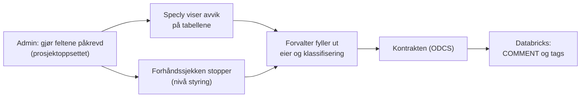

# Modul 8: Dokumentasjon og styring

**Du lærer**
- at krav til dokumentasjon er noe organisasjonen bestemmer, og at de står ett sted: i prosjektoppsettet
- å gjøre et felt påkrevd for en tabelltype, og å se hva som mangler: som avvik i Specly og i forhåndssjekken
- å fylle ut eier og klassifisering på mange tabeller og kolonner på én gang
- hvordan beskrivelse, eier og klassifisering havner i kontrakten (ODCS) og i Databricks (COMMENT og tags)
- kort om rollene Leser og Bidragsyter, og hvordan en bidragsyter foreslår en endring

**Tid:** ca. 45 minutter. Har du laget gull-tabellene selv i modul 5 og 7 uten å skrive beskrivelser, må du regne
med et kvarter til (steg 4e). **For hvem:** admin og forvalter.
**Start her:** fortsetter du fra modul 5, 6 eller 7, er du klar. Ellers: sett startpunktet `M8`
(`./kurs til M8`, eller `notebooks/kurs_til` med «Til» = `start/M8`). Stegene står i
[Slik setter du et startpunkt](start.md). `start/M8` er slutten av modul 7: den har også kundeklubben og
`gld__d__kunde`, så du har fem gull-tabeller, ikke fire.

Tallene i modulen avhenger av hvor du kommer fra. Der det betyr noe, står de for hvert tilfelle:

| Du kommer fra | Gull-tabeller | Kolonner i dem | Beskrivelser |
|---|---|---|---|
| startpunktet `start/M8` | 5 | 52 | alle er fylt ut |
| modul 7, med tabellene du har laget selv | 5 | 52 | mangler på det du laget selv, hvis du ikke skrev dem |
| modul 5, uten modul 6 og 7 | 4 | 41 | mangler på det du laget selv, hvis du ikke skrev dem |

**Forutsetninger:**
- rundturen (endre, eksporter, generer, kjør, kontroller). Lært i [modul 2](M2.md). Kommer du rett fra modul 0, står den
  som sjekkliste nederst i denne modulen.
- gull-tabellene `gld__f__salg`, `gld__d__produkt`, `gld__d__butikk` og `gld__d__dato`. Laget i [modul 5](M5.md). Du
  trenger ikke vite hvordan de ble laget.

---

## Spørsmålet

Toppfart har fått en ny personvern- og sikkerhetsansvarlig. Hun skriver:

> «Hvem eier tallene i salgsrapporten? Og hvilke kolonner er fortrolige? Jeg vil kunne se det i Databricks, ikke i et
> regneark.»

Modellen svarer ikke på det ennå. Tabellene kurset har lagt inn, har beskrivelser, men ingen eier og ingen
klassifisering. I denne modulen bestemmer admin at gull-tabellene **skal** ha det, og forvalteren fyller det ut.



---

## Steg 1: Beskrivelsene har vært med hele veien

**Hva og hvorfor:** Se først hva som finnes fra før. Tabellene kurset har lagt inn, har en beskrivelse på tabellen og
på hver kolonne. Den har gått til Databricks i hver kjøring, uten at du har tenkt på det. `gld__d__butikk` kom fra
kurset (`fyll` i modul 5, eller startpunktet), så den har beskrivelser hos alle.

**Gjør:**
1. I Databricks: Catalog → `workspace` → `toppfart` → `gld__d__butikk`. Se på fanen «Overview»: tabellen har en
   kommentar under «Description», og hver kolonne har en i kolonnen «Comment». Eller med SQL:
   ```sql
   SELECT column_name, comment FROM workspace.information_schema.columns
   WHERE table_schema = 'toppfart' AND table_name = 'gld__d__butikk' ORDER BY ordinal_position
   ```
2. Åpne kontrakten `specly/Tables/gull_dimensjon/gld__d__butikk.odcs.yaml` (nettlesersporet: i GitHub, eller i
   Git-mappen i Databricks). Finn `description:` på tabellen (nederst i `schema`) og på en kolonne.

**Hva tror du skjer?** Hvor kommer kommentaren i Databricks fra?

<details><summary>Svar</summary>

Fra beskrivelsen i Specly. Den skrives til `description` i kontrakten, og malen gjør den til `COMMENT`:

| I Specly | I kontrakten | I Databricks |
|---|---|---|
| Beskrivelsen under tabellnavnet | `schema[0].description` | tabellens kommentar |
| Beskrivelsen på kolonnen | `properties[].description` | kolonnens kommentar |

I den genererte koden ser du det i `databricks/pyspark/tabeller/gld__d__butikk.py`: `comment="Butikkdimensjonen: …"` og
`Kolonne("butikknavn", "string", "Navnet på butikken.")`.
</details>

<details><summary>Les mer: hvorfor er beskrivelsen så viktig?</summary>

Den som bruker en tabell i Databricks, ser sjelden Specly. Kommentaren i Catalog Explorer er ofte det eneste de leser.
En god beskrivelse sier hva én rad er, og hva som er spesielt («-1 når butikken ikke finnes»). Den gjentar ikke navnet.
</details>

**Riktig når:** du har sett kommentaren på `gld__d__butikk` og funnet linjen i kontrakten.

---

## Steg 2: Admin gjør feltene påkrevd

**Hva og hvorfor:** Prosjektoppsettet (fra `specly/Config`, modul 0) har allerede feltene **Eier** (på tabellen),
**Klassifisering** (på kolonnen) og **Granularitet** (på faktatabellen). De er forklart i [modul 1](M1.md). De har
vært valgfrie. Nå gjør admin dem
påkrevd for gull-tabellene. Det er en endring i prosjektoppsettet, ikke i én tabell. Den gjelder alle gull-tabeller,
også de som lages senere.

| Tabelltype | Påkrevd på tabellen | Påkrevd på hver kolonne |
|---|---|---|
| gull dimensjon | Eier | Beskrivelse, Klassifisering |
| gull fakta | Eier, Granularitet | Beskrivelse, Klassifisering |

Hvorfor bare gull? Gull er det andre bruker. Raw, bronze og sølv er plattformens egne lag. Krav der gir mye arbeid og
lite nytte. En annen organisasjon kan velge annerledes: kravene bestemmer dere selv.

**Gjør:**
1. Åpne «Admin» → «Metadatafelt» → fanen «Tabelltyper». Det er en matrise: feltene nedover, tabelltypene bortover.
   Endringene lagres med en gang.
2. I kolonnen «gull dimensjon»: klikk «Valgfri» ved Eier, Beskrivelse og Klassifisering, så det står «Påkrevd».
3. I kolonnen «gull fakta»: det samme, og i tillegg for Granularitet. Det blir sju klikk i alt.

<details><summary>Les mer: hva Specly sier</summary>

Hjelpeteksten ved matrisen: «Kryss av for feltene hver tabelltype skal ha. Endringer lagres med en gang. Et avkrysset
felt er valgfritt; klikk «Valgfri» for å gjøre det påkrevd for tabelltypen.»
Cellen har tre tilstander: ikke koblet, «Valgfri» og «Påkrevd». Et felt med «Påkrevd overalt (satt på feltet)» er
påkrevd for alle tabelltyper det er koblet til.

Kravene gir avvik (varsler) i Specly. De stopper aldri redigering eller eksport. Det gjør forhåndssjekken (steg 3).

Beskrivelse står i matrisen som et kolonnefelt, selv om det er innebygd. Kravet gjelder beskrivelsen på kolonnene.
Tabellbeskrivelsen kan ikke gjøres påkrevd i Specly. Forhåndssjekken krever den likevel når tabelltypen har krav.
</details>

<details><summary>Les mer: slik står kravet i Git</summary>

Neste eksport skriver kravet til `specly/Config/table_types.json`, på tabelltypen:

```json
"requiredFieldDefUuids": ["eier"],
"requiredColumnFieldDefUuids": ["description", "klassifisering"]
```

Navnet sier «Uuids», men Specly skriver feltets nøkkel. Det er dette forhåndssjekken leser. Ett sted for kravet: Specly
viser avvik ut fra det, og forhåndssjekken stopper ut fra det.

En endring i prosjektoppsettet fra Git krever admin når den hentes inn i Specly.
</details>

**Riktig når:** matrisen viser «Påkrevd» for feltene i tabellen over.

---

## Steg 3: Se hva som mangler

**Hva og hvorfor:** Et krav er bare nyttig hvis du ser hvor det ikke er oppfylt. Du ser det to steder: i Specly, som
**avvik** på hver tabell, og i **forhåndssjekken**, som nå sjekker to nivåer:

| Nivå | Når | Sjekker |
|---|---|---|
| kode | alltid | det koden trenger: datatyper, BK, oppstrøm, relasjoner, navn (modul 2-5) |
| styring | når prosjektet har påkrevde felt | det organisasjonen krever: beskrivelse, eier, klassifisering, granularitet |

**Gjør:**
1. I Specly: åpne `gld__d__butikk`. Over beskrivelsen, rett under linjen med status og tabelltype, står seksjonen
   «Avvik (8)», brettet ut. Den har én linje per avvik: «Feltet «Eier» er påkrevd, men er tomt», og
   sju linjer med kolonnenavnet foran («butikknavn: Feltet «Klassifisering» er påkrevd, men er tomt»). Hver linje har
   «Legg til unntak» til høyre. I kolonnelisten har hver kolonne fått et varseltegn med et tall.
2. Åpne `gld__f__salg`. Tallet der avhenger av hvor du kommer fra:

   | Du kommer fra | «Avvik» på `gld__f__salg` |
   |---|---|
   | `start/M8` | 16: Eier, Granularitet og Klassifisering på 14 kolonner |
   | modul 7, tabellen laget selv uten beskrivelser | 30: som over, og Beskrivelse på 14 kolonner |
   | modul 5 uten modul 6 og 7, laget selv uten beskrivelser | 26: tabellen har 12 kolonner |

   Listen fyller hele skjermen. Brett den sammen med pilen til venstre for «Avvik» når du skal videre: beskrivelsen,
   feltene og kolonnene ligger under.
3. Åpne tabelloversikten («Tabeller»). «+ Filter» → «Har avvik» (under «Regler», eller søk `avvik`) viser bare
   gull-tabellene, for eksempel «Viser 5 av 28 tabeller» (fire gull-tabeller hvis du ikke har kundedimensjonen).
4. Eksporter til Git. Under «ADMINDATA» står «Tabelltyper · gull dimensjon» og «Tabelltyper · gull fakta». La dem
   være haket av: det er kravet, og det skrives til `specly/Config/table_types.json`. Står `specly/AGENTS.md` under
   «Genererte filer», er den haket av. Du kan la haken stå eller ta den av. Begge deler er ufarlig.
5. Generer: `git pull && ./generer`. Nettlesersporet: «Pull» i Git-mappen og `notebooks/kurs_generer_kjor`.
   Notebooken stopper i cellen under «1. Forhåndssjekk og generering» med den samme listen, og meldingen
   «Forhåndssjekken stoppet».

**Hva tror du?** Hvor mange linjer gir forhåndssjekken? Tenk: hvor mange gull-tabeller du har, og hva hver av dem
mangler.

<details><summary>Svar</summary>

Listen står i en egen blokk for nivå styring:

```
STOPP: kontraktene mangler noe styringen krever (11 ting). Ingenting er generert eller sendt til Databricks.
  - gld__d__butikk: Tabellen mangler Eier, som er påkrevd for tabelltypen gull dimensjon. I Specly: fyll ut Eier på tabellen («Vis mer»). For mange tabeller: «Import og eksport» → «Massekjøring» → «Fyll ut et tabellfelt».
  - gld__d__butikk: 7 kolonner mangler Klassifisering, som er påkrevd for tabelltypen gull dimensjon: pk__gld__d__butikk, bk__gld__d__butikk, butikknummer, apnet_dato, butikknavn, kommune, sys__kildesystem. I Specly: …
  …
  - gld__f__salg: Tabellen mangler Granularitet, som er påkrevd for tabelltypen gull fakta. …
```

Hver gull-tabell gir én linje for Eier og én for Klassifisering (én linje per tabell, ikke én per kolonne). Faktaen
gir i tillegg én for Granularitet. En tabell du har laget selv uten beskrivelser, gir to linjer til: «Tabellen har
ingen beskrivelse …» og «N kolonner mangler Beskrivelse …».

| Du kommer fra | Linjer | Av dem om beskrivelser |
|---|---|---|
| `start/M8` | 11 | 0 |
| modul 7, med `gld__d__produkt`, `gld__f__salg` og `gld__d__kunde` laget selv uten beskrivelser | 17 | 6 |
| modul 5 uten modul 6 og 7, med `gld__d__produkt` og `gld__f__salg` laget selv uten beskrivelser | 13 | 4 |

Har du linjer om beskrivelser, fyller du dem ut i steg 4e.
</details>

<details><summary>Les mer: avvik i Specly og stopp i forhåndssjekken, hvorfor begge?</summary>

Specly varsler, men stopper aldri en redigering eller en eksport. Det er med vilje: folk skal kunne jobbe med en
halvferdig modell. Det som stopper, er et steg som organisasjonen eier: her forhåndssjekken, i et ekte prosjekt ofte en
sjekk i en pull request. Begge leser det samme kravet fra prosjektoppsettet.

En tabell kan unntas fra en regel: «Legg til unntak» på linjen i avvikslisten, med en begrunnelse. Unntaket følger tabellens
kontrakt til Git (`ruleExceptions`), og forhåndssjekken respekterer det.
</details>

**Riktig når:** du har sett avvikene i Specly og forhåndssjekken stoppe på nivå styring.

---

## Steg 4: Fyll ut, mange på én gang

**Hva og hvorfor:** Det er 52 kolonner i de fem gull-tabellene (41 i de fire fra modul 5). Én og én tar for lang
tid. Specly har to verktøy for mange på én gang: **massekjøring** for et tabellfelt på mange tabeller, og
**massehandlinger** for et kolonnefelt på mange kolonner.

Alle gjør 4a til 4d. Hadde forhåndssjekken linjer om beskrivelser, gjør du også 4e.

### 4a. Eier

| Tabell | Eier |
|---|---|
| `gld__f__salg` | Salgsanalyse |
| `gld__d__butikk` | Salgsanalyse |
| `gld__d__produkt` | Sortiment |
| `gld__d__kunde` (har du tatt modul 7) | Kundeklubben |
| `gld__f__lagerbeholdning` (har du tatt modul 11) | Sortiment |
| `gld__d__dato` | Dataplattform |

**Gjør:**
1. «Import og eksport» → «Massekjøring» (brett ut) → kortet «Fyll ut et tabellfelt». Det er det siste av sju kort, så
   du må rulle ned.
2. «Tabelltyper»: hak av gull dimensjon og gull fakta. Listen lukker seg ikke selv: trykk Escape. «Felt» = Eier (Eier
   kommer i listen når begge gull-typene er valgt; åpner listen seg ikke, klikker du en gang til). «Verdi som skal settes» blir en liste (Salgsanalyse,
   Sortiment, Kundeklubben, Dataplattform): velg Salgsanalyse. La «Fyll bare tabeller der feltet er tomt» stå på.
   Under står «5 tabeller påvirkes» (4 uten kundedimensjonen). «Kjør», og «Kjør» igjen i spørsmålet «Kjøre på valgte
   tabelltyper?». Specly sier «Kjøring fullført – 5 oppdatert, 0 hadde allerede en verdi».
3. Åpne `gld__d__produkt`, `gld__d__dato` og `gld__d__kunde`, og bytt eier etter tabellen over. Feltet Eier står
   under «GULL DIMENSJON-FELT» (trykk «Vis mer» hvis feltene ikke vises). Er listen «Avvik» åpen, ligger feltet langt
   nede: brett den sammen først.

Eieren blir med i neste eksport: under «Mine endringer» står gull-tabellene som endret, for eksempel med «Eier | – |
Salgsanalyse» på `gld__d__butikk`.

<details><summary>Les mer: eier er et team, ikke en person</summary>

Folk bytter jobb. Et team består. Eier betyr: de som svarer på spørsmål om tabellen og bestemmer når den endres. I
kontrakten blir eieren `team.name`, ODCS sitt eget felt for teamet som eier kontrakten. Dataproduktet i modul 10 har
eier på samme sted.
</details>

### 4b. Granularitet

**Gjør:** Åpne `gld__f__salg`. Feltet Granularitet står til høyre under «GULL FAKTA-FELT» (trykk «Vis mer» hvis
feltene ikke vises). Skriv hva én rad er, og klikk et tomt sted i sidepanelet til venstre for å lagre. Lært i
[modul 5](M5.md), steg 1.

### 4c. Klassifisering

| Verdi | Betyr | I kurset |
|---|---|---|
| offentlig | kan vises for alle, også utenfor Toppfart | butikknavn, kommune og åpningsdato, produktnavn, merke, utpris, varegruppe, kalenderen |
| intern | alle ansatte kan se den | nøkler, numre, alt som ikke står i de andre radene |
| fortrolig | bare de som trenger den | målene i salget: `antall`, `belop`, `enhetspris_belop`, `rabatt_belop`. Og det som kan peke ut en person i kundedimensjonen: `medlemsnummer`, `postnummer` og `bk__gld__d__kunde` |

**Tenk over:** Hvorfor er beløpene i salget fortrolige, når prisen i produktdimensjonen er offentlig?

**Gjør:** På hver gull-tabell:
1. Hak av alle kolonnene (avkrysningsboksen i overskriften haker av alle).
2. Nederst i bildet kommer en linje med «N kolonner valgt»: «Sett felt…» → Klassifisering → «Velg verdi…» → `intern`.
   Specly sier «Klassifisering oppdatert for valgte kolonner». Kolonnene blir stående valgt.
3. Ta haken av i overskriften, og hak av bare kolonnene som skal ha en annen verdi. «Sett felt…» er nullstilt, så du
   velger Klassifisering og «Velg verdi…» på nytt, med `offentlig` eller `fortrolig`. Regn med et par minutter per
   tabell.

> **Pass på:** linjen nederst har også den røde knappen «Slett valgte». Når «Velg verdi…» kommer, brytes linjen i to,
> og «Slett valgte» flytter seg dit du nettopp klikket. Se hvor du klikker.

Skal bare noen få kolonner ha en annen verdi, er det raskere å bruke nedtrekkslisten «Klassifisering» helt til høyre
på hver rad.

<details><summary>Svar på «Tenk over»</summary>

Prisen på én vare står på hylla. Omsetningen per butikk og dag er forretningshemmelig: den sier hvor godt hver butikk
går. Det er summen av mange rader som er følsom, ikke prisen.
</details>

<details><summary>Les mer: klassifisering i kontrakten</summary>

Feltet er koblet til ODCS-feltet `classification` på kolonnen:

```yaml
      - id: 6af6d8af-e002-5d1b-87b7-b6a7c5540daf
        name: belop
        physicalType: decimal(10,2)
        …
        classification: fortrolig
```

Specly bruker ikke ODCS-feltet `tags` til dette. Der står flaggene (BK, PK, FK, Eget navn), som er merker for
modellen, ikke for styring.
</details>

### 4d. Les beskrivelsen en gang til

**Tenk over:** Les tabellbeskrivelsen til `gld__f__salg`. Stemmer den? Lært i modul 5.

<details><summary>Svar</summary>

Kom tabellen fra kurset (startpunktet), står det riktig: «… antall, belop og rabatt_belop kan summeres.
enhetspris_belop er prisen på linjen, og kan ikke summeres.» `enhetspris_belop` kan ikke summeres: summen av prisene
på ti linjer betyr ingenting (modul 5). Lagde du `gld__f__salg` selv i modul 5, se etter om din beskrivelse sier det.
Står det «Alle målene kan summeres», er den feil. Rett den. Har tabellen ingen beskrivelse, skriver du den i 4e.

En beskrivelse er en del av modellen. En feil i den er like farlig som en feil i koden, fordi folk tror på den.
</details>

### 4e. Beskrivelser som mangler

Gjør dette hvis forhåndssjekken i steg 3 hadde linjer som «Tabellen har ingen beskrivelse …» eller «N kolonner
mangler Beskrivelse …». Kom du fra `start/M8`, har du ingen slike linjer, og hopper over 4e.

Tabellene du har laget selv, har bare de beskrivelsene du skrev. Modul 5 og 7 ba ikke om dem. Nå er Beskrivelse
påkrevd i gull, så de må inn før steg 5 går gjennom:

| Tabell du har laget selv | Tabellbeskrivelse | Kolonnebeskrivelser |
|---|---|---|
| `gld__d__produkt` (modul 5) | 1 | 12 |
| `gld__f__salg` (modul 5, og to kolonner til i modul 7) | 1 | 14 (12 uten modul 7) |
| `gld__d__kunde` (modul 7) | 1 | 9 |

Det er opptil 3 tabellbeskrivelser og 35 kolonnebeskrivelser. Massehandlingen fra 4c hjelper ikke her: «Sett felt…»
har bare Klassifisering i listen. Tekstene i fasit står i [løsningen](M8_losning.md#beskrivelsene), klare til å
kopiere. Du kan også skrive dine egne: sjekken sammenligner ikke beskrivelser.

**Gjør (i Specly):** for hver tabell i listen fra forhåndssjekken:
1. Tabellbeskrivelsen: klikk i feltet «Skriv inn beskrivelse (valgfri)» under tabellnavnet (under «Avvik»), skriv
   eller lim inn, og klikk utenfor feltet. Feltet sier «valgfri», men forhåndssjekken krever den.
2. Kolonnene: klikk i cellen «Beskrivelse» på raden, skriv eller lim inn, og klikk utenfor cellen. Tallet i «Avvik»
   går ned med én for hver kolonne du fyller ut.

<details><summary>Alternativ: skriv beskrivelsene i Git</summary>

Er du vant med YAML, kan du skrive beskrivelsene rett i kontraktfilene i stedet. Eksporter først fra Specly, så
eieren og klassifiseringen fra 4a til 4c er i Git.

1. `git pull`. Åpne kontrakten (for eksempel `specly/Tables/gull_dimensjon/gld__d__kunde.odcs.yaml`), og legg en linje
   `description:` på hver kolonne og på tabellen, slik de står i en tabell som har dem (`gld__d__butikk.odcs.yaml`):
   ```yaml
         - id: …
           name: medlemsnummer
           physicalType: string
           logicalType: string
           description: Medlemsnummeret.
           …
       description: 'Kundedimensjonen: én rad per versjon av et medlem (SCD2), så faktaen kan slå opp nivået medlemmet hadde den dagen det handlet.'
   ```
   En tekst med kolon må stå i enkle anførselstegn. (Nettlesersporet: blyanten «Edit this file» i GitHub, og «Commit
   changes».)
2. `git add specly && git commit -m "Beskrivelser i gull" && git push`.
3. I Specly: «Import og eksport» → «Importer fra Git» → «Hent inn til …».
4. Kommer dialogen «Regler for det som kom inn fra Git»: trykk «Ikke kjør reglene».
</details>

**Riktig når:** alle gull-tabellene har eier, alle kolonnene i dem har klassifisering og beskrivelse (52 kolonner i
fem tabeller, eller 41 i de fire fra modul 5), og faktaen har granularitet. Seksjonen «Avvik» er borte fra
gull-tabellene, og filteret «Har avvik» i tabelloversikten viser ingen av dem.

---

## Steg 5: Rundturen, og se det i Databricks

**Gjør:**
1. Eksporter til Git, generer og kjør (rundturen, se sjekklisten nederst). Nå sier forhåndssjekken:
   ```
          Forhåndssjekk (kode): ingen mangler.
          Forhåndssjekk (styring): ingen mangler.
   ```
   Stopper den fortsatt, sier listen hva som mangler. Rett det i Specly, eksporter og generer på nytt.

   `./kjor` har hele tiden hatt fem steg. Det femte har til nå ikke hatt noe å gjøre («0 setninger for tags»). Nå
   setter det taggene:
   ```
   5/5  Tags i Unity Catalog etter kontraktene (databricks/pyspark/plattform/tags_data.py)
   ```
   Steget skriver ut hver setning (`ALTER MATERIALIZED VIEW … SET TAGS …`), og til slutt antallet: «57 setninger for
   tags i workspace.toppfart» med fem gull-tabeller (én per tabell og én per kolonne). Kjører du en gang til, står
   det «0 setninger … (alt stod riktig fra før)»: taggene blir stående.
   I nettlesersporet gjør `notebooks/kurs_generer_kjor` det samme i avsnittet «3. Tags i Unity Catalog».
2. I Catalog Explorer: åpne `gld__f__salg`, fanen «Overview». Til høyre, under «Tags», står `eier : Salgsanalyse` og
   `klassifisering : fortrolig`. I kolonnelisten har hver kolonne taggen sin i kolonnen «Tags», for eksempel
   `klassifisering : fortrolig` ved `belop`. Er vinduet smalt, er teksten kuttet: hold pekeren over den, eller gjør
   vinduet bredere.
3. Eller med SQL:

```sql
SELECT table_name, tag_name, tag_value
FROM workspace.information_schema.table_tags
WHERE schema_name = 'toppfart'
ORDER BY table_name, tag_name
```

```sql
SELECT table_name, column_name, tag_value AS klassifisering
FROM workspace.information_schema.column_tags
WHERE schema_name = 'toppfart' AND tag_name = 'klassifisering'
ORDER BY table_name, column_name
```

**Hva tror du?** Tabellen `gld__f__salg` får også taggen `klassifisering`, selv om du bare klassifiserte kolonnene. Hvilken
verdi får den?

<details><summary>Svar</summary>

`fortrolig`. Tabellen får den strengeste klassifiseringen blant kolonnene sine. Har én kolonne fortrolige data, er
tabellen fortrolig. Da kan noen i Databricks finne alle fortrolige tabeller med ett søk, og gi tilgang deretter.
</details>

Tell taggene:

```sql
-- tabelltags: eier og klassifisering på hver gull-tabell
SELECT count(*) AS tabelltags FROM workspace.information_schema.table_tags WHERE schema_name = 'toppfart'
```

```sql
-- kolonner med klassifisering, per verdi
SELECT tag_value AS klassifisering, count(*) AS kolonner
FROM workspace.information_schema.column_tags
WHERE schema_name = 'toppfart' AND tag_name = 'klassifisering'
GROUP BY 1 ORDER BY 1
```

```sql
-- kolonner med klassifisering, per tabell
SELECT table_name, count(*) AS kolonner
FROM workspace.information_schema.column_tags
WHERE schema_name = 'toppfart' AND tag_name = 'klassifisering'
GROUP BY 1 ORDER BY 1
```

| Kontroll | Fem gull-tabeller | Fire (uten modul 7) |
|---|---|---|
| Tabelltags | 10 | 8 |
| `fortrolig` | 7 | 4 |
| `intern` | 29 | 21 |
| `offentlig` | 16 | 16 |
| Per tabell | `gld__d__butikk` 7, `gld__d__dato` 10, `gld__d__kunde` 9, `gld__d__produkt` 12, `gld__f__salg` 14 | 7, 10, 12 og 12 |

Tabelltaggene: `gld__d__butikk` Salgsanalyse og intern, `gld__d__dato` Dataplattform og intern, `gld__d__kunde`
Kundeklubben og fortrolig, `gld__d__produkt` Sortiment og intern, `gld__f__salg` Salgsanalyse og fortrolig.

<details><summary>Les mer: hvordan taggene kommer dit</summary>

`./generer` lager `databricks/pyspark/plattform/tags_data.py` fra kontraktene, med malen `maler/pyspark/tags.py.j2`, på
samme måte som koden for tabellene. Filen sier hvilke tags hver tabell og kolonne skal ha:

| I Specly | I kontrakten | I Databricks |
|---|---|---|
| Eier på tabellen | `team.name` | tabelltaggen `eier` |
| Klassifisering på kolonnen | `classification` på kolonnen | kolonnetaggen `klassifisering` |
| (regnes ut) | den strengeste klassifiseringen blant kolonnene | tabelltaggen `klassifisering` |
| Granularitet | `dataGranularityDescription` | ingen tag. Den står i kontrakten |

Pipelinen kan ikke sette tags selv. Derfor kjører `./kjor` et eget steg når pipelinen er ferdig
(`databricks/pyspark/plattform/tags.py`). Steget leser først hvilke tags som står der, og endrer bare det som avviker.
Tømmer du en eier i Specly, fjernes taggen ved neste kjøring. Andre tags enn `eier` og `klassifisering` får stå.
</details>

Sammenlign med fasit: `./kurs sjekk M8` (eller `notebooks/kurs_sjekk` med «Modul» = `M8`). Du er i mål når den
skriver «Kontraktene stemmer med fasit.», «Fasittest (modul 2-8): 106 riktige, 0 feil.» og «Taggene stemmer med
fasit.» Sjekken sammenligner eieren og klassifiseringen med tabellene i 4a og 4c. Granularitet må være fylt ut, men
teksten sammenlignes ikke, og det gjør heller ikke beskrivelsene. Har du hoppet over modul 6 og 7, melder sjekken tabellene derfra som avvik. Det er
ventet.

Nettlesersporet: etter «Pull» er feltet «Modul» borte. Første «Run all» lager feltet og stopper uten å sjekke noe
(«Velg modul»). Velg `M8` i
sidepanelet «Parameters» og trykk «Run all» igjen. Utskriften skal si «Fasittest (modul 2-8)». Se
[Notebookene etter «Pull»](start.md#notebookene-etter-pull).

**Riktig når:** forhåndssjekken sier «ingen mangler» på begge nivåene, og du ser eieren og klassifiseringen i Databricks.

---

## Steg 6: Roller, og et forslag fra en bidragsyter

**Hva og hvorfor:** Ikke alle skal endre modellen. Specly har fire roller per prosjekt:

| Rolle i Specly | Kan |
|---|---|
| Leser (Viewer) | se, søke og eksportere alt. Kan ikke endre noe |
| Bidragsyter (Contributor) | i tillegg foreslå endringer i beskrivelser og andre felt. Forslaget blir en pull request i Git |
| Utvikler (User) | i tillegg endre tabeller, diagrammer, dataprodukter og begreper, og bruke Git |
| Admin | i tillegg prosjektoppsettet, medlemmene og Git-koblingen |

Navnene i parentes er det Specly kaller rollene.

En forvalter er ofte bidragsyter: hun kjenner dataene og skriver gode beskrivelser, men skal ikke endre nøkler og
relasjoner. Et forslag kan derfor bare endre beskrivelser og enkelte andre felt, ikke kolonnenavn, datatyper,
oppstrøm, nøkler eller relasjoner.

**Gjør:** Prøv forslaget selv. Som admin kan du også foreslå.
1. Klikk «Til Oversikt» øverst til høyre. Du er i «Oversikt», lesemodusen. Den viser `main`. Gå til «Tabeller».
   Over tabellisten står «Ser du noe som bør rettes? Foreslå en endring, så går den til gjennomgang.», med «Mine
   forslag» og «Foreslå endringer».
2. Klikk «Foreslå endringer». Knappen viser «Gjør klar …» mens Specly lager en egen branch til forslaget,
   `forslag/…` (navnet ditt, datoen og en kode). Det tar opptil et halvt minutt. Så blir banneret «Du foreslår
   endringer. Felt du kan endre, ser redigerbare ut. Hver endring lagres i kladden.», med «Lagre endringer», «Send inn
   forslag» og «Avslutt».
3. Åpne `gld__d__butikk`, og gjør beskrivelsen av `kommune` bedre, for eksempel «Kommunen butikken ligger i. Tom for
   nettbutikken.». Trykk «Lagre endringer». Knappen viser «Lagrer …» noen sekunder, og så kommer «Endringene er
   lagret».
4. Trykk «Send inn forslag». Dialogen «Send inn forslaget» sier «Forslaget sendes til gjennomgang. Etter det kan du
   ikke endre det mer.», og har feltet «Kort tittel (valgfritt)». Skriv en tittel, og trykk «Send inn».
5. Specly legger forslaget på branchen i Git og åpner en pull request mot `main`, med tittelen «Forslag: <tittelen
   din>» og en liste over feltene du endret. Kvitteringen heter «Sendt til gjennomgang». Trykk «Åpne gjennomgangen»
   for å se pull requesten i GitHub. Endringen er én linje i `gld__d__butikk.odcs.yaml`.

   > **Får du en rød melding i stedet?** «Endringene er sendt til Git på branchen `forslag/…`, men pull requesten
   > kunne ikke åpnes: Specly-appen på GitHub mangler rettigheten «Pull requests: Read and write».» Da ligger
   > forslaget i Git, men Specly fikk ikke åpnet pull requesten. Trykk «Åpne pull request i GitHub» i meldingen.
   > GitHub åpner «Open a pull request» med tittel og tekst fylt ut. Trykk «Create pull request», og lukk dialogen i
   > Specly med «Avbryt». Si fra til kursholderen, og følg resten av steget.

Gjør ferdig runden, slik en utvikler eller admin ville gjort:

6. Se på endringen i pull requesten, og slå den sammen: «Merge pull request» → «Confirm merge» i GitHub (i
   terminalen: `gh pr merge <nummer> --merge`).
7. Tilbake i Specly: lukk kvitteringen, og trykk «Avslutt» i banneret. Under «Mine forslag» står «Forslag: <tittelen
   din>» med status «Sendt til gjennomgang». Den blir «Godkjent» når Specly har sett at pull requesten er slått
   sammen, og «Avvist» hvis den lukkes uten.
8. Gå tilbake til Utvikling: klikk «Fortsett →» ved siden av `main` øverst på siden. (Knappen «Til Oversikt» finnes
   bare i Utvikling. I Oversikt er det «Fortsett →» som tar deg tilbake.)
9. «Import og eksport» → «Importer fra Git». Under «KOMMER INN · 1» står `gld__d__butikk › kommune` med den gamle og
   den nye beskrivelsen. Trykk «Hent inn til …». Git-siden sier «I synk: Specly og main er like».
10. Bare hvis du fikk den røde meldingen i punkt 5: forslaget står som «Kladd» under «Mine forslag», også etter at
    pull requesten er slått sammen. Rydd det bort: «Til Oversikt» → «Tabeller» → «Foreslå endringer». Dialogen «Du
    har en lagret kladd» kommer. Trykk «Forkast», og «Forkast» igjen i spørsmålet «Forkaste kladden?». Specly
    sletter da også branchen `forslag/…` på GitHub. Gå tilbake til Utvikling med «Fortsett →».

> **Hvorfor slik:** en vanlig eksport fra Specly er en commit rett på branchen du står på, uten pull request. Da kan
> du eksportere små endringer ofte og veksle mellom Specly og filene lokalt. Et forslag er noe annet: det kommer fra
> noen som ikke skal endre modellen selv, og skal gjennom en gjennomgang. Derfor åpner Specly en pull request for
> forslaget, og gjennomgangen skjer i GitHub med verktøyene teamet allerede bruker.

Vil du se den nye beskrivelsen i Databricks, tar du `git pull`, genererer og kjører en gang til.

<details><summary>Les mer: hva skjer med forslaget?</summary>

Specly åpner en pull request fra forslagsbranchen. Noen med rett til å endre (utvikler eller admin) ser gjennom den
og slår den sammen, eller lukker den. Da er endringen i Git, og den hentes inn i Specly som vanlig. Under «Mine
forslag» har forslaget en av fire statuser: «Kladd» (ikke sendt), «Sendt til gjennomgang», «Godkjent» (pull
requesten er slått sammen) og «Avvist» (pull requesten er lukket). Specly leser statusen fra pull requesten.

For å åpne pull requesten trenger Specly-appen på GitHub rettigheten «Pull requests: Read and write». Den gis av den
som administrerer appen, ikke av deg.

I forslagsmodus ser disse feltene redigerbare ut: beskrivelsen, Historikk og Eier på tabellen, og Nedstrømsnavn,
Beskrivelse, Utviklernotat og Klassifisering på kolonnene. Admin bestemmer for hvert felt om det kan foreslås («Åpen
for endringsforslag» på feltet). En leser ser hva som mangler («Mangler beskrivelse eller eier» i Oversikt), men kan
ikke foreslå.

Forslag krever at prosjektet er koblet til GitHub eller Azure DevOps.

Avslutter du uten å sende inn, blir kladden og branchen `forslag/…` liggende. De endrer ikke `main`. Neste gang du
trykker «Foreslå endringer», kommer dialogen «Du har en lagret kladd» med «Forkast», «Send inn og start et nytt
forslag» og «Fortsett». «Forkast» sletter også branchen på GitHub.
</details>

**Riktig når:** du vet hva de fire rollene kan, og har sett et forslag bli en pull request som er slått sammen og
hentet inn (eller lest i «Les mer» hvordan det går til). Du er tilbake i Utvikling.

---

## Ferdig når

- [ ] Eier, Beskrivelse, Klassifisering (og Granularitet for fakta) er påkrevd for gull-tabelltypene
- [ ] Du har sett avvikene i Specly og forhåndssjekken stoppe på nivå styring
- [ ] Alle gull-tabellene har eier, og alle kolonnene har klassifisering og beskrivelse
- [ ] Beskrivelsen av `gld__f__salg` sier hvilke mål som kan summeres
- [ ] Forhåndssjekken sier «ingen mangler» på begge nivåene, og kjøringen er ferdig
- [ ] Du vet forskjellen på Leser, Bidragsyter, Utvikler og Admin, og er tilbake i Utvikling

## Rundturen som sjekkliste

Lært i [modul 2](M2.md):

1. Endre i Specly.
2. «Import og eksport» → «Eksporter til Git». Skriv en commit-melding (påkrevd), og «Commit og push N endringer til
   Git». Står det noe under «Genererte filer» (for eksempel `specly/AGENTS.md`), er det haket av. Ta haken av som i
   modul 2, eller la den stå: begge deler er ufarlig.
3. `git pull && ./generer` (nettlesersporet: «Pull» i Git-mappen). Stopper den, rett i Specly og start på 2.
4. `./kjor` (nettlesersporet: `notebooks/kurs_generer_kjor`, som gjør 3 og 4 i ett).
5. Kontroller i SQL-editoren, og til slutt `./kurs sjekk M8` (eller `notebooks/kurs_sjekk` med «Modul» = `M8`). Fra
   modul 8 sammenligner den også kravene, eieren, granularitet og klassifiseringen med fasit, og taggene i Databricks.

Løsning: [M8_losning.md](M8_losning.md). Neste: [Modul 9: Forretningsbegreper](M9.md).
