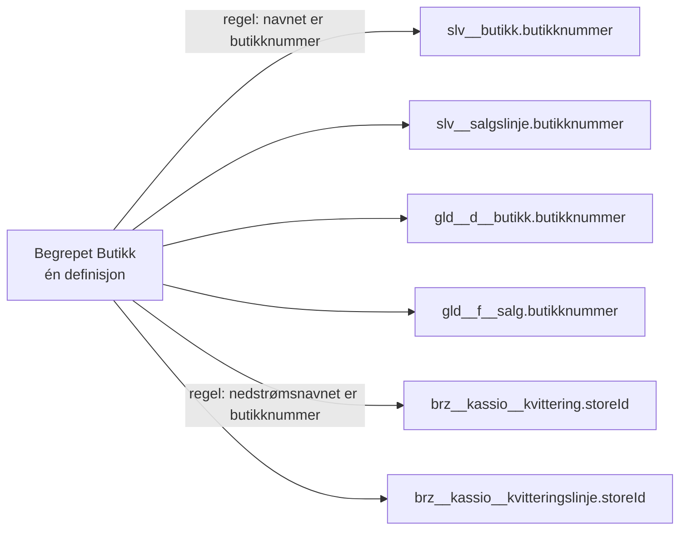

# Modul 9: Forretningsbegreper

**Du lærer**
- hva et forretningsbegrep er: ett ord, én definisjon, koblet til alle kolonnene som betyr det samme
- å koble kolonner til et begrep med **begrepsregler**, også kolonner som heter noe annet i kilden
- at kolonnene **arver** beskrivelsen, og når en kolonne skal beholde sin egen
- hvor begrepene står i Git (`specly/Concepts/<navn>.md`), og hva som endres i kontraktene

**Tid:** ca. 45 minutter. **For hvem:** forvalter.
**Start her:** fortsetter du fra modul 8, er du klar. Ellers: sett startpunktet `M9`
(`./kurs til M9`, eller `notebooks/kurs_til` med «Til» = `start/M9`). Stegene står i
[Slik setter du et startpunkt](start.md).

Tallene under gjelder en modell med nettbutikken (modul 6) og kundeklubben (modul 7): `start/M9`, eller din egen når
du har gjort modul 2–8. Kommer du rett fra modul 5, får Produkt 5 kolonner og Medlemsnivå 0.

Har du laget sølv- og bronzetabellene selv, mangler noen kolonner beskrivelse. Da spør Specly om færre kolonner i
steg 3 og 4, og kolonnene uten beskrivelse får begrepets tekst. Stegene sier fra der det skiller.

**Forutsetninger:**
- rundturen. Lært i [modul 2](M2.md).
- nedstrømsnavn: navnet en kolonne får i neste lag. Lært i [modul 3](M3.md).
- påkrevd beskrivelse på gull. Lært i [modul 8](M8.md) (ikke nødvendig, men du ser nytten bedre).

---

## Spørsmålet

Salgssjefen og kundeklubbansvarlig bruker de samme ordene, men mener de det samme? Dataeieren skriver:

> «Når vi sier *butikk*, *produkt* og *salgsbeløp*, skal det bety det samme i alle tabeller. Og nettbutikken er også en
> butikk. Det må stå ett sted.»

Se på tallene: nummeret på en butikk står i seks kolonner i tre lag (bronze, sølv og gull). I kassen heter det
`storeId`. Fra `start/M9` har hver kolonne sin egen beskrivelse: «Butikken.», «Butikkens nummer.», «Butikkens nummer
(101-107).». Har du laget tabellene selv, har noen av kolonnene ingen. Ingen av beskrivelsene sier at 107 er
nettbutikken.



Et **forretningsbegrep** er ett ord fra forretningen med én definisjon. Du kobler det til kolonnene. Kolonnene arver
beskrivelsen. Endrer du definisjonen, endres alle kolonnene.

---

## Steg 1: Finn kolonnene som betyr det samme

**Hva og hvorfor:** Før du lager begreper, ser du hva som finnes. Specly kan vise alle kolonnenavn i prosjektet,
gruppert på navn.

**Gjør:** Åpne «Forretningsordbok» i sidepanelet (bokikonet), og fanen «Kolonner» øverst i sidepanelet. Listen
(«Kolonnenavn på tvers av alle tabeller i prosjektet») står i hovedbildet, med søkefeltet «Søk kolonner…» over. Søk etter
`butikknummer`, `varenummer` og `belop`. Kolonnen «Tabeller» sier hvor mange tabeller navnet står i. Klikk på pilen
foran navnet for å se hvilke tabeller det er, med datatype og beskrivelse for hver.

Søket treffer deler av navnet: `belop` gir fire rader (`belop`, `enhetspris_belop`, `rabatt_belop` og `utpris_belop`).
Husk det til steg 3. Knappen «+ Nytt forretningsbegrep» på raden lar du være. Begrepet lager du i steg 2.

**Hva tror du?** I hvor mange tabeller står `butikknummer`? Og finnes det kolonner som er et butikknummer, men heter noe
annet?

<details><summary>Svar</summary>

`butikknummer` står i fire tabeller: `slv__butikk`, `slv__salgslinje`, `gld__d__butikk` og `gld__f__salg`. I bronze heter
det `storeId` (kassen), med nedstrømsnavnet `butikknummer`. Søker du etter `storeId`, står det også fire tabeller: to
i raw og to i bronze. `AKTNR` i varesystemet er også et butikknummer for noen rader,
men et leverandørnummer for andre. Den har nedstrømsnavnet `aktornummer`. Lært i [modul 4](M4.md).
</details>

**Riktig når:** du har funnet de fire tabellene med `butikknummer`, og ser at kassen kaller det `storeId`.

---

## Steg 2: Lag begrepet Butikk

**Hva og hvorfor:** Begrepet har fire felt, og under «Arves til kolonner» feltet Klassifisering (se «Les mer» i steg
6). Du fyller ut to av dem:

| Felt | Butikk | Hvorfor |
|---|---|---|
| Forretningsbeskrivelse | Et utsalgssted i Toppfart, identifisert med butikknummeret. Butikkene har numrene 101-106, og nettbutikken er butikk 107. Samme nummer i varesystemet (AKTNR) og i kassen (storeId). | Teksten kolonnene arver |
| Datatype | `int` | Typen kolonnene har i alle lag |
| Nedstrømsnavn | (tomt) | Se «Les mer» |
| Utviklernotat | (tomt) | |

**Gjør:**
1. I «Forretningsordbok», fanen «Forretningsbegrep»: «Nytt forretningsbegrep». Skriv `Butikk` i «Navn», og «Opprett».
2. Hvert felt på begrepet har «Rediger» til høyre. Skriv forretningsbeskrivelsen og «Lagre».
3. «Rediger» ved «Datatype»: velg `int` i listen, og trykk «Lagre». Datatypen er ikke lagret før du har trykket
   «Lagre», selv om du har valgt den i listen.

<details><summary>Les mer: hvorfor er nedstrømsnavnet tomt?</summary>

En kolonne som kobles til begrepet, arver også begrepets nedstrømsnavn. Nedstrømsnavnet er navnet kolonnen får i neste
lag (modul 3). Hadde Butikk hatt nedstrømsnavnet `butikk`, ville alle seks kolonnene fått det, og kolonnene i laget etter
ville blitt omdøpt til `butikk`. Det vil vi ikke. Et tomt felt på begrepet gir kolonnene ingenting, og de beholder sitt.

Det samme gjelder datatypen: hakeboksen «Sett datatype fra forretningsbegrepet» (i linjen «Regler (N)» på begrepet)
står av, så kolonnene beholder sin egen type. Begrepets datatype brukes bare på en kolonne som ikke har type.
</details>

**Riktig når:** begrepet Butikk finnes, med beskrivelse og datatype.

---

## Steg 3: Koble kolonnene med regler

**Hva og hvorfor:** Du kan koble kolonner én og én («Koble kolonne…»). Men nye tabeller kommer, og da må noen huske å
koble. En **begrepsregel** sier hvilke kolonner som hører til begrepet, etter navnet. Den kobler alle som treffer nå, og
de nye neste gang reglene kjøres.

Butikk trenger to regler:

| Regel | Match basert på | Mønster | Treffer |
|---|---|---|---|
| 1 | Kolonnenavn | `^butikknummer$` | de fire kolonnene i sølv og gull |
| 2 | Nedstrømsnavn | `^butikknummer$` | `storeId` i de to kassetabellene i bronze |

Regel 2 er poenget: den finner kolonnen på det den *skal hete*, ikke det kilden kaller den. Det er derfor nedstrømsnavnet
ble satt i modul 3.

**Hva tror du skjer?** Regelen kjøres når du lagrer den. Det står nederst i dialogen der du lager regelen. Flere av
kolonnene har allerede en egen beskrivelse. Hva skjer med den?

<details><summary>Svar</summary>

Specly spør før den skriver over en tekst. Idet du trykker «Lagre» på regelen, kommer dialogen «Bruk regler». Den
lister kolonnene som har en egen beskrivelse, og du velger om hver av dem skal beholde sin tekst eller få begrepets.
En kolonne uten beskrivelse står ikke i dialogen: den får begrepets tekst uten spørsmål. Det samme gjelder en kolonne
med samme tekst som begrepet.
</details>

**Gjør:**
1. På begrepet Butikk, under «Regler (0)»: «Legg til regel».
2. «Mønster» = `butikknummer`. «Match basert på» = Kolonnenavn (står fra før). Hak av «Match hele navnet» (mønsteret blir
   `^butikknummer$`). Under feltet står «4 kolonner matcher dette mønsteret» og de fire navnene. «Lagre».
3. Dialogen «Bruk regler» kommer. Under «Nye kolonner regelen kobler for første gang» står én linje per kolonne som
   har egen beskrivelse, med en hake foran. Til høyre står bryteren «Behold | Overskriv» for hele gruppen («Behold» er
   valgt). Dialogen viser ikke teksten på kolonnen, bare navnet og «Forretningsbeskrivelse».
   - En **hake** betyr «behold kolonnens egen tekst». Vil du ha begrepets tekst, tar du haken bort. Linjen blir da
     strøket over.
   - La haken stå på `gld__f__salg.butikknummer`. Ta den bort på alle de andre.
   - Hvor mange linjer du ser, kommer an på modellen din: fire fra `start/M9` (to i gull og to i sølv), og to hvis du
     har laget sølvtabellene selv uten beskrivelser (bare de to i gull).

   Trykk «Bruk regler». Under reglene står det nå «4 kolonner matchet, 4 koblet».
4. «Legg til regel» igjen. Samme mønster, «Match basert på» = Nedstrømsnavn, «Match hele navnet». Det skal stå «2
   kolonner matcher dette mønsteret» (`storeId` i de to kassetabellene). «Lagre».
5. Dialogen «Bruk regler» kommer igjen. `gld__f__salg.butikknummer` står under «Kolonner som allerede er unntak»: la
   «Behold» stå. Fra `start/M9` står også de to `storeId` under «Nye kolonner regelen kobler for første gang»: ta bort
   hakene. Har du laget bronzetabellene selv uten beskrivelser, står de ikke der. Trykk «Bruk regler». Det står «6
   kolonner matchet, 2 koblet», og nederst til høyre kommer meldingen «Regler brukt – 2 kolonner koblet, 0 koblinger
   fjernet».

Hvorfor beholde teksten i faktaen? Beskrivelsen av `gld__f__salg.butikknummer` sier noe begrepet ikke sier: at nummeret
er del av den naturlige nøkkelen. De andre tekstene («Butikken.», «Butikkens nummer.») sier mindre enn begrepet.

Kolonnen i faktaen er koblet til begrepet, men **overstyrt** for beskrivelsen: den beholder sin egen tekst, også når
begrepet endres. Specly sier «Overstyrt» på skjermen, og i filen heter det `exceptions` (unntak). Det er noe annet enn
«Legg til unntak» i modul 8, som unntar en tabell fra en regel.

<details><summary>Les mer: et mønster som treffer for mye</summary>

Mønsteret er et regulært uttrykk, og et uttrykk treffer *hvor som helst* i navnet, hvis du ikke haker av «Match hele
navnet» (som setter `^` foran og `$` bak). Søket i steg 1 virker på samme måte. Prøv mønsteret `belop` uten haken i
steg 4: det står «8 kolonner matcher dette mønsteret», også `rabatt_belop`, `enhetspris_belop` og `utpris_belop`. Med
haken treffer det to. Se alltid på tallet under mønsteret før du lagrer.
</details>

**Riktig når:** begrepet har «Regler (2)» og «Koblede kolonner (6)», og raden `gld__f__salg.butikknummer` har det
oransje ikonet «Overstyrt» i kolonnen «Beskrivelse».

Se i riktig kolonne: nesten alle radene har et oransje ikon et sted. Bronze har det under «Nedstrømsnavn», sølv under
«Utviklernotat» og gull under «Klassifisering» (fra modul 8). Forklaringen på ikonene står over listen: bok betyr at
verdien følger begrepet, og oransje at kolonnen beholder sin egen.

---

## Steg 4: Produkt, Salgsbeløp og Medlemsnivå

**Din tur.** Lag de tre andre begrepene på samme måte. Finn selv hvilke regler som trengs.

| Begrep | Datatype | Forretningsbeskrivelse |
|---|---|---|
| Produkt | `string` | En vare Toppfart selger, identifisert med varenummeret uten ledende nuller (4711). Samme nummer i varesystemet og i kassen. |
| Salgsbeløp | `decimal(10,2)` | Det kunden betalte for en salgslinje: antall ganger enhetspris, minus rabatt, med mva, i kroner. Negativt ved retur. |
| Medlemsnivå | `string` | Nivået et medlem har i kundeklubben: Bronse, Sølv eller Gull. Nivået gir rabatt, og kan endre seg over tid. |

I dialogen «Bruk regler» velger du «Overskriv» når begrepets tekst er minst like god, og «Behold» når kolonnen sier
noe mer. Dialogen viser ikke teksten på kolonnen, så se etter i tabellen først hvis du er i tvil (eller i steg 1:
pilen foran kolonnenavnet). Dialogen lister bare kolonnene som har egen beskrivelse, så du kan få færre linjer enn
svaret under har kolonner.

<details><summary>Svar: reglene</summary>

| Begrep | Regler | Kolonner | Behold eller overskriv |
|---|---|---|---|
| Produkt | Kolonnenavn `^varenummer$`, Nedstrømsnavn `^varenummer$` | 6: `varenummer` i `slv__produkt`, `slv__salgslinje` og `gld__d__produkt`, `VARENR` i `brz__varius__vare`, `sku` i `brz__kassio__kvitteringslinje` og `product_code` i `brz__nettora__ordrelinje` | «Overskriv». Kolonnene sier «Varenummeret uten ledende nuller.» Begrepet sier det samme og mer |
| Salgsbeløp | Kolonnenavn `^belop$` | 2: `belop` i `slv__salgslinje` og `gld__f__salg` | «Overskriv». Begrepet sier også hvordan beløpet er regnet ut |
| Medlemsnivå | Kolonnenavn `^medlemsniva$`, Nedstrømsnavn `^medlemsniva$` | 3: `medlemsniva` i `slv__kunde` og `gld__d__kunde`, `tier` i `brz__lojal__medlem` | «Behold». Kolonnene sier hvilke verdier som står i dataene: `BRONZE`, `SILVER` eller `GOLD`. Begrepet bruker forretningens ord: Bronse, Sølv eller Gull |

Det er ikke ett riktig svar for hver kolonne. Tabellen viser valgene i fasit.

Salgsbeløp trenger ingen regel på nedstrømsnavn: beløpet regnes ut i sølv (feltet Beregning, modul 4). Det finnes ingen
kildekolonne som *er* beløpet.

Kommer du rett fra modul 5, får Medlemsnivå ingen kolonner. Det er ikke feil: begrepet er definert før tabellene
finnes. Når kundeklubben kommer inn (modul 7), trykker du «Bruk alle regler» i listen over begrepene (eller «Tagg
kolonner med regler» på begrepet), og kolonnene kobles. Specly sier «tagge» der kurset sier «koble».
</details>

**Riktig når:** du har fire begreper, og Produkt har 6 koblede kolonner, Salgsbeløp 2 og Medlemsnivå 3.

---

## Steg 5: Se at kolonnene arver

**Hva og hvorfor:** Nå skal du se at én endring på begrepet når alle kolonnene.

**Gjør:**
1. Åpne `slv__salgslinje`. Ved `butikknummer` står et bokikon (begrepet) og merket «1 overstyrt»: kolonnen har sitt eget
   utviklernotat (fra modul 6), og beholder det. Beskrivelsen er begrepets tekst.
2. Gå tilbake til begrepet Butikk. «Rediger» ved beskrivelsen, og legg til en setning til slutt: «Butikk 107 har ingen
   fysisk adresse.» Markøren står først i teksten når feltet åpnes, så flytt den til slutten før du skriver. «Lagre».
3. Specly spør «Oppdatere 5 kolonner?» og viser hva som skjer: «5 kolonner får den nye verdien», «1 kolonne er overstyrt og
   beholder sin egen verdi». Trykk «Lagre og oppdater».
4. Åpne `gld__d__butikk`. Beskrivelsen av `butikknummer` har den nye setningen.

**Hva tror du?** Hvilken kolonne fikk ikke den nye setningen?

<details><summary>Svar</summary>

`gld__f__salg.butikknummer`, som er overstyrt for beskrivelsen (steg 3). Den beholder sin egen tekst, også når begrepet
endres. Vil du koble den til igjen, klikk på det oransje ikonet på raden i «Koblede kolonner» («Overstyrt på kolonnen –
klikk for å koble til igjen»).
</details>

**Riktig når:** fem kolonner har den nye setningen, og `gld__f__salg.butikknummer` har sin egen tekst.

---

## Steg 6: Rundturen, og begrepene i Git

**Hva og hvorfor:** Begrepene er en del av modellen, og havner i Git som alt annet. Det er nyttig å vite hvor, fordi du
kan lage og endre begreper der også.

**Gjør:**
1. Eksporter til Git (rundturen). Se i listen hva som skrives: under «BEGREPER» står de fire begrepene med «NY» (de
   blir fire filer under `specly/Concepts/`), og under «TABELLER» kontraktene der en beskrivelse er endret. Har du laget
   tabellene selv, er flere av endringene nye beskrivelser der det ikke sto noe før.
2. Åpne `specly/Concepts/Butikk.md` på GitHub eller lokalt. GitHub viser filen som «Preview», med feltene øverst
   tegnet som en tabell. Trykk «Code» over filen for å se teksten slik den står her.

<details><summary>Slik ser filen ut (forkortet)</summary>

```markdown
---
columns:
  - exceptions:
      - downstreamName
    link: linkedWithExceptions
    path: brz__kassio__kvittering.storeId
    source: ruleBased
  …
  - exceptions:
      - businessDescription
      - klassifisering
    link: linkedWithExceptions
    path: gld__f__salg.butikknummer
    source: ruleBased
  - exceptions:
      - developerNote
    link: linkedWithExceptions
    path: slv__butikk.butikknummer
    source: ruleBased
  …
dataType: int
name: Butikk
rules:
  - columnNamePattern: ^butikknummer$
    matchField: downstreamName
    isRegex: true
    tableNamePattern: null
    …
    isActive: true
    order: 1
  - columnNamePattern: ^butikknummer$
    matchField: columnName
    isRegex: true
    tableNamePattern: null
    …
    isActive: true
    order: 0
uuid: …
---
Et utsalgssted i Toppfart, identifisert med butikknummeret. Butikkene har numrene 101-106, og nettbutikken er butikk 107. Samme nummer i varesystemet (AKTNR) og i kassen (storeId). Butikk 107 har ingen fysisk adresse.
```

- Øverst (mellom `---`) står begrepets felt, i alfabetisk rekkefølge. Under står beskrivelsen.
- `rules` er reglene. Rekkefølgen på dem i filen kan være omvendt hos deg. `order` sier hvilken som er den første.
- `columns` har bare koblingene en regel ikke sier alt om: kolonnene som er overstyrt på minst ett felt
  (`exceptions`). Her er det alle seks: `storeId` har sitt eget nedstrømsnavn, sølv har eget utviklernotat, og gull
  har egen klassifisering (modul 8). Specly overstyrer av seg selv når kolonnen har en verdi begrepet ikke har.
- Filnavnet er navnet uten æ, ø og å: `Medlemsnivå` blir `Medlemsniva.md`, `Salgsbeløp` blir `Salgsbelop.md`. Navnet står
  riktig i `name`.
</details>

3. Åpne kontrakten `specly/Tables/solv/slv__salgslinje.odcs.yaml` og finn `butikknummer`.

**Hva tror du?** Står begrepet Butikk i kontrakten?

<details><summary>Svar</summary>

Nei. Kontrakten har bare den arvede teksten i `description`. Koblingen mellom kolonnen og begrepet står bare i
begrepsfilen. Kodegeneratoren trenger ikke vite om begrepet: den bruker beskrivelsen, som blir kommentaren på kolonnen (`COMMENT`) i
Databricks etter neste kjøring.
</details>

4. Generer og kjør. I Catalog Explorer: åpne `gld__d__butikk`, fanen «Overview». Kolonnen «Comment» ved
   `butikknummer` viser begrepets tekst, med setningen om butikk 107. Kolonnen er smal, så teksten går over mange
   linjer.

<details><summary>Les mer: lage et begrep i Git</summary>

Du kan skrive en ny fil `specly/Concepts/Kvittering.md` selv, med bare `name`, `dataType`, `rules` og beskrivelsen (ingen
`uuid` og ingen `columns`). Push, og «Hent inn til …» i Specly. Reglene kjører ikke av seg selv: Specly viser dialogen
«Regler for det som kom inn fra Git» ([Slik setter du et startpunkt](start.md#regeldialogen)) med raden
«Begrepsregler», for eksempel «2 kolonner kobles til forretningsbegreper». Ingen regel er valgt på forhånd: hak av
«Begrepsregler» og trykk «Kjør valgte». Da kommer dialogen «Bruk regler» fra steg 3, og kolonnene kobles. Neste eksport
skriver `uuid` inn i filen. Behold den, så blir et nytt navn senere en omdøping og ikke et nytt begrep.

<!-- OMVEI-KONFLIKTSIDE start: kan fjernes hvis siden ikke kommer lenger (docs/kursholder.md) -->
> **Kan komme:** Åpner «Hent inn til …» siden «Hent endringer fra Git» med konflikter, velger du side etter regelen i
> [Konfliktsiden ved «Hent inn»](start.md#konfliktsiden). Filen du skrev, kom fra Git: der tar du Git sin. Står det
> konflikter på `replacedText` eller `previousValues` under begrepene dine, med «—» på Git-siden, beholder du din.
<!-- OMVEI-KONFLIKTSIDE slutt -->

Alle detaljene står i `specly/AGENTS.md`, avsnittet «Business concepts». Det er på engelsk, og langt.
</details>

<details><summary>Les mer: begreper og styring (modul 8)</summary>

En kolonne som arver beskrivelsen fra et begrep, oppfyller kravet om beskrivelse i modul 8. Begreper er derfor den
raskeste måten å dokumentere mange kolonner på: én tekst, mange kolonner.

Feltet Klassifisering kan også arves («Kan arves fra forretningsbegrep» er på i prosjektoppsettet). Gir du Salgsbeløp
klassifiseringen `fortrolig`, får de koblede kolonnene den, så sant de ikke har en egen verdi.
</details>

**Riktig når:** fire filer i `specly/Concepts/`, og den nye beskrivelsen står under «Comment» i Catalog Explorer.

---

## Ferdig når

- [ ] Fire begreper: Butikk, Produkt, Salgsbeløp og Medlemsnivå, med beskrivelse og datatype, og uten nedstrømsnavn
- [ ] Butikk har 6 koblede kolonner, Produkt 6, Salgsbeløp 2, Medlemsnivå 3
- [ ] `gld__f__salg.butikknummer` beholder sin egen beskrivelse (overstyrt)
- [ ] Du har endret beskrivelsen av Butikk, og sett fem kolonner få den
- [ ] `specly/Concepts/Butikk.md` finnes i Git, og du vet at koblingen ikke står i kontrakten

Sammenlign med fasit: `./kurs sjekk M9` (eller `notebooks/kurs_sjekk` med «Modul» = `M9`). Du er i mål når den
skriver «Kontraktene stemmer med fasit.», «Begrepene stemmer med fasit (4 begreper, 17 koblede kolonner).»,
«Fasittest (modul 2-9): 106 riktige, 0 feil.» og «Taggene stemmer med fasit.»

Fra denne modulen ser sjekken også på begrepene, slik de står i `specly/Concepts/` i Git: at de fire begrepene
finnes, datatypen, at nedstrømsnavnet er tomt, at begrepet har regler, og at de samme kolonnene er koblet som i
fasit. Den sier hvilket begrep og hvilke kolonner det gjelder. Den ser ikke på teksten i beskrivelsene, eller på om
du valgte «Behold» eller «Overskriv». Sjekken leser Git, så eksporter fra Specly (og `git pull` eller «Pull») først.
I Specly skal «Forretningsordbok» vise «Forretningsbegrep: 4» og «Koblede kolonner: 17».

Nettlesersporet: etter «Pull» er feltet «Modul» borte. Første «Run all» lager feltet og stopper uten å sjekke noe
(«Velg modul»). Velg `M9` i
sidepanelet «Parameters» (rull ned i listen: `M9` til `M11` ligger under kanten) og trykk «Run all» igjen. Se [Notebookene etter «Pull»](start.md#notebookene-etter-pull).

## Rundturen som sjekkliste

1. Endre i Specly.
2. «Import og eksport» → «Eksporter til Git». Skriv en commit-melding (påkrevd), og «Commit og push N endringer til
   Git». La «Genererte filer» stå som Specly foreslår.
3. `git pull && ./generer` (nettlesersporet: «Pull» i Git-mappen).
4. `./kjor` (nettlesersporet: `notebooks/kurs_generer_kjor`).
5. Kontroller i Catalog Explorer, og til slutt `./kurs sjekk M9` (eller `notebooks/kurs_sjekk` med «Modul» = `M9`).

Løsning: [M9_losning.md](M9_losning.md). Neste: [Modul 10: Dataprodukt](M10.md).
